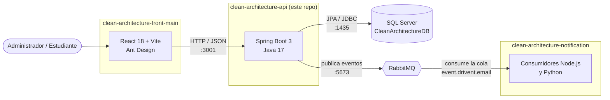
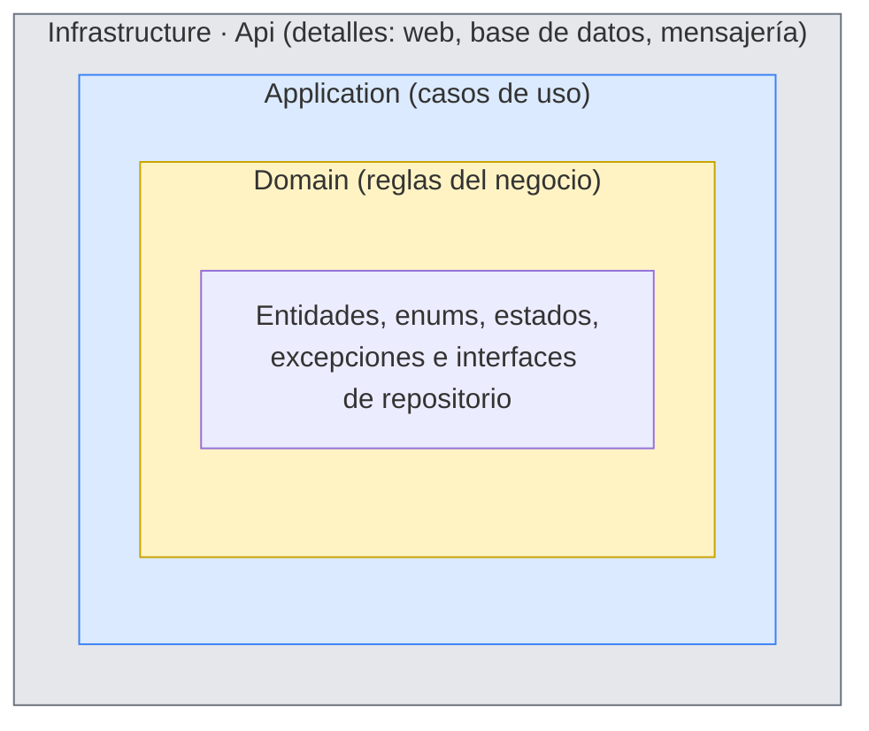
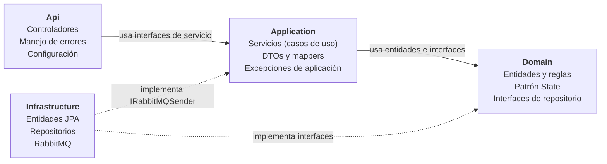

# clean-architecture-api

Backend del sistema de **convocatorias y solicitudes de la Universidad de Caldas**, desarrollado en el Semillero SOLID como ejemplo práctico de **Clean Architecture** con Spring Boot.

El sistema permite que un administrador publique convocatorias (monitorías, becas de investigación y residencias estudiantiles) con sus requisitos, y que los estudiantes se postulen a ellas. Además del producto, el proyecto está pensado para estudiar: cada decisión de diseño está explicada aquí y en la carpeta [`diagramas/`](diagramas/), y el código se puede leer capa por capa siguiendo los ejemplos de este documento.

## Contenido

1. [El sistema completo](#el-sistema-completo)
2. [Tecnologías](#tecnologías)
3. [Qué es Clean Architecture](#qué-es-clean-architecture)
4. [Las cuatro capas de este proyecto](#las-cuatro-capas-de-este-proyecto)
5. [Cómo se cumple la regla de dependencias](#cómo-se-cumple-la-regla-de-dependencias)
6. [Recorrido de una petición](#recorrido-de-una-petición)
7. [Patrones de diseño usados](#patrones-de-diseño-usados)
8. [Estructura de carpetas](#estructura-de-carpetas)
9. [Cómo agregar una funcionalidad nueva](#cómo-agregar-una-funcionalidad-nueva)
10. [Endpoints](#endpoints)
11. [Cómo ejecutarlo](#cómo-ejecutarlo)
12. [Pruebas](#pruebas)
13. [Diagramas](#diagramas)
14. [Estado del proyecto y lo que falta](#estado-del-proyecto-y-lo-que-falta)

## El sistema completo

El proyecto está repartido en tres repositorios de la organización [SemilleroSOLID](https://github.com/SemilleroSOLID). Este es el backend, donde viven las reglas del negocio.



| Repositorio | Qué hace |
|---|---|
| [clean-architecture-front-main](https://github.com/SemilleroSOLID/clean-architecture-front-main) | Interfaz web. Lista, crea, edita y cambia el estado de las convocatorias consumiendo esta API. |
| **clean-architecture-api** | API REST. Valida las reglas del negocio, guarda en SQL Server y publica eventos en RabbitMQ. |
| [clean-architecture-notification](https://github.com/SemilleroSOLID/clean-architecture-notification) | Microservicio que escucha RabbitMQ y envía las notificaciones (correo) sin que el backend tenga que esperar. |

## Tecnologías

| Tecnología | Versión | Para qué se usa |
|---|---|---|
| Java | 17 | Lenguaje del backend. |
| Spring Boot | 3.2.5 | Servidor web, inyección de dependencias y configuración. |
| Spring Web | — | Controladores REST. |
| Spring Data JPA + Hibernate | — | Acceso a la base de datos (solo en la capa Infrastructure). |
| Spring Validation (Jakarta Bean Validation) | — | Validar el formato de los datos que llegan (`@NotBlank`, `@NotNull`, `@Size`). |
| Spring AMQP | — | Publicar mensajes en RabbitMQ. |
| SQL Server | 2022 | Base de datos relacional. |
| RabbitMQ | 3.8 | Cola de mensajes para comunicarse con el servicio de notificaciones. |
| Gradle | wrapper incluido | Compilar, probar y empaquetar. |
| JUnit 5 | — | Pruebas unitarias del dominio. |
| Docker y Docker Compose | — | Levantar la base de datos y el backend sin instalar nada más. |

## Qué es Clean Architecture

Clean Architecture es una forma de organizar el código propuesta por Robert C. Martin (*Clean Architecture*, 2017). La idea central es separar **lo que hace el negocio** de **cómo se entrega y se guarda**. Las reglas de una convocatoria ("la fecha de fin debe ser al menos un día después de la de inicio", "una convocatoria cerrada no se edita") no deberían cambiar porque se cambie de SQL Server a PostgreSQL o de REST a GraphQL.

Para lograrlo, el código se divide en capas concéntricas y se respeta una sola regla:

> **Regla de dependencias:** el código de una capa solo puede depender de capas más internas. Lo de adentro no sabe que existe lo de afuera.



Lo que se gana con esto:

- **Se puede probar el negocio sin base de datos ni servidor.** Las 37 pruebas del dominio corren en milisegundos con JUnit, sin Spring.
- **Los cambios de tecnología quedan aislados.** Cambiar la base de datos implica reescribir la capa Infrastructure; el dominio y los casos de uso no se tocan.
- **Cada regla está en un solo lugar.** Si hay que cambiar cuándo se cierra una convocatoria, se abre `OpenState.java` y no hay que buscar condicionales repartidos por los servicios.

## Las cuatro capas de este proyecto

El código está en `src/main/java/com/example/demo/` y cada carpeta de primer nivel es una capa.



### Domain: el corazón

Es la capa más interna y **no depende de nada**: ni de Spring, ni de JPA, ni de Jackson. Solo usa Java.

| Contiene | Ejemplo |
|---|---|
| Entidades con reglas | `Convocation.validate(today, catalog)` revisa fechas y requisitos. `Request.validateAgainst(requirements)` revisa que la solicitud responda todos los requisitos. |
| Enums del negocio | `EnumConvocationState` (`OPEN`, `CLOSED`, `FINISHED`, `CANCELLED`), `EnumStateRequest`, `EnumConvocationType`. |
| Patrón State | `Domain/States/`: una clase por estado de la convocatoria. |
| Excepciones de negocio | `DomainValidationException` (con un mapa campo → mensaje) e `InvalidConvocationStateException`. |
| Interfaces de repositorio (puertos) | `IConvocationRepository`, `IRequestRepository`... Dicen **qué** se necesita guardar o consultar, no **cómo**. |

Un detalle que muestra la independencia: la fecha de "hoy" no se obtiene dentro del dominio con `LocalDate.now()`, se recibe como parámetro. Así las pruebas pueden fijar el día que quieran y el dominio no depende del reloj del servidor.

### Application: los casos de uso

Coordina el trabajo. Un servicio carga lo que necesita mediante las interfaces del dominio, le pide a las entidades que validen o cambien de estado, y guarda el resultado. **No contiene reglas del negocio**, las delega.

| Contiene | Ejemplo |
|---|---|
| Interfaces de servicio | `IConvocationService`, `IRequestService`, `IStudentService`. Los controladores dependen de estas, no de la implementación. |
| Servicios | `ConvocationService.closeConvocation(id)` carga la convocatoria, llama a `convocation.close()` y la guarda. |
| DTOs | `ConvocationDto`, `RequestDto`. Son el contrato con el front y llevan las anotaciones de Bean Validation. |
| Mappers DTO ↔ dominio | `ConvocationMapper`, `RequestMapper`, `StudentMapper`. |
| Excepciones de aplicación | `NotFoundException`, `ConflictException`. |
| Puertos hacia afuera | `IRabbitMQSender`: el servicio sabe que puede enviar un mensaje, pero no sabe que es RabbitMQ. |

### Infrastructure: los detalles técnicos

Aquí está todo lo que depende de una tecnología concreta.

| Contiene | Ejemplo |
|---|---|
| Entidades JPA | `ConvocationEntity` con `@Entity`, `@Table` y `@Column`. Representan las tablas, **no** el negocio. |
| CRUDs de Spring Data | `IConvocationCrudRepository extends CrudRepository<ConvocationEntity, Integer>`. |
| Repositorios (adaptadores) | `ConvocationRepository implements IConvocationRepository`: usa el CRUD y convierte entre entidad JPA y dominio. |
| Mappers de persistencia | `ConvocationPersistenceMapper`: `ConvocationEntity` ↔ `Convocation`. |
| Mensajería | `RabbitMQSender implements IRabbitMQSender` y la configuración de la cola en `RabbitMQService`. |

### Api: la puerta de entrada

Recibe las peticiones HTTP y devuelve respuestas. No decide nada del negocio.

| Contiene | Ejemplo |
|---|---|
| Controladores | `ConvocationController`, `RequestController`, `StudentController`, `RequirementsController`. |
| Respuesta común | `CustomResponse<T>` con `data`, `codeState` y `message`. |
| Manejo global de errores | `GlobalExceptionHandler` convierte las excepciones en códigos HTTP: dominio inválido → 400, no existe → 404, conflicto → 409. |
| Configuración | `ClockConfig` (zona horaria `America/Bogota`), `JacksonConfig`, `WebConfig` (CORS). |

## Cómo se cumple la regla de dependencias

Esto se puede comprobar en el código, no solo en los diagramas. Estas búsquedas no devuelven ningún resultado:

```bash
# El dominio no importa nada de otras capas ni de frameworks
grep -rn "^import" src/main/java/com/example/demo/Domain | grep -vE "com.example.demo.Domain|java\."

# Application no conoce Infrastructure ni Api
grep -rn "import com.example.demo.\(Infrastructure\|Api\)" src/main/java/com/example/demo/Application

# Los controladores no conocen Infrastructure (ni JPA ni repositorios)
grep -rn "import com.example.demo.Infrastructure" src/main/java/com/example/demo/Api
```

Las decisiones concretas que lo hacen posible:

| Principio | Cómo está aplicado |
|---|---|
| **Inversión de dependencias** | El dominio define `IConvocationRepository`. Infrastructure la implementa con JPA. Spring inyecta la implementación en el servicio, que solo conoce la interfaz. |
| **Entidades de negocio separadas de las tablas** | `Convocation` (dominio) y `ConvocationEntity` (JPA) son clases distintas. El dominio guarda el estado como enum; la tabla guarda `stateConvocationId` como número. El mapper traduce. |
| **DTOs separados del dominio** | El JSON que recibe el controlador es un `ConvocationDto`. Si el front pide un campo nuevo, cambia el DTO y el mapper, no la entidad. |
| **Reglas dentro de las entidades** | Los servicios no validan fechas ni preguntan por el estado. Llaman a `convocation.validate(...)`, `convocation.close()`, `request.validateAgainst(...)`. |
| **Errores sin HTTP en el dominio** | El dominio lanza `DomainValidationException` con un mapa `campo → mensaje`. Solo `GlobalExceptionHandler`, en la capa Api, sabe que eso se responde con 400. |
| **Controladores delgados** | Cada método del controlador tiene una línea: llama al servicio y envuelve el resultado en `CustomResponse`. |

### Una concesión consciente

La capa Application usa anotaciones de Spring (`@Service`, `@Autowired`, `@Transactional`). En una Clean Architecture estricta, esa capa tampoco dependería del framework y los servicios se registrarían desde una clase de configuración. Se decidió aceptarlo porque simplifica mucho el proyecto para el semillero y no afecta lo más importante: **el dominio sigue siendo Java puro** y se prueba sin Spring.

## Recorrido de una petición

Ejemplo: el administrador cierra una convocatoria con `PUT /convocation/closeConvocation/5`.

1. **Api.** `ConvocationController.closeConvocation(5)` recibe la petición y llama a `IConvocationService.closeConvocation(5)`.
2. **Application.** `ConvocationService` busca la convocatoria con `IConvocationRepository.findById(5)`.
3. **Infrastructure.** `ConvocationRepository` consulta SQL Server con `IConvocationCrudRepository`, recibe un `ConvocationEntity` y lo convierte en `Convocation` con `ConvocationPersistenceMapper`.
4. **Domain.** El servicio llama a `convocation.applyDateRules(hoy)` (si ya pasó la fecha de fin, la convocatoria pasa sola a `CLOSED`) y luego a `convocation.close()`. La convocatoria le pasa la orden a su estado actual: `OpenState` la cambia a `CLOSED`; cualquier otro estado lanza *"No se puede cerrar una convocatoria cerrada"*.
5. **Application → Infrastructure.** El servicio guarda con `IConvocationRepository.save(...)`, que convierte de vuelta a `ConvocationEntity`.
6. **Application → Api.** El servicio convierte el resultado a `ConvocationDto` y el controlador responde `200` con `CustomResponse`. Si hubo una excepción en cualquier paso, `GlobalExceptionHandler` responde 400, 404 o 409.

El recorrido completo, con los casos de error, está dibujado en [diagramas/diagrama-secuencia.md](diagramas/diagrama-secuencia.md).

## Patrones de diseño usados

| Patrón | Dónde | Para qué |
|---|---|---|
| **Repository** | `Domain/Interfaces` + `Infrastructure/Persistence/Repositories` | Esconder cómo se guardan los datos detrás de una interfaz del dominio. |
| **Adapter** | `ConvocationRepository`, `RabbitMQSender` | Adaptar una tecnología (Spring Data, RabbitMQ) a la interfaz que pide el núcleo. |
| **Data Transfer Object** | `Application/Dtos` | Separar el contrato JSON de las entidades del negocio. |
| **Mapper** | `Application/Mappers`, `Infrastructure/Mappers` | Convertir entre DTO, dominio y entidad JPA, cada uno en su capa. |
| **State** | `Domain/States` | Cada estado de la convocatoria decide qué acciones permite y a cuál pasa. Evita `if (estado == ...)` en los servicios. Ver [estados-convocatoria.md](diagramas/estados-convocatoria.md). |
| **Simple Factory** | `ConvocationStates.of(enum)` | Obtener el objeto de estado correspondiente al enum guardado en la base de datos. |
| **Dependency Injection** | Todo el proyecto | Spring entrega a cada clase las implementaciones de las interfaces que pide. |
| **Publish / Subscribe** | RabbitMQ | El backend publica eventos y el servicio de notificaciones los consume por su cuenta. |

## Estructura de carpetas

```text
clean-architecture-api/
├── src/main/java/com/example/demo/
│   ├── Api/                          ← capa de entrada
│   │   ├── Config/                   ← ClockConfig, JacksonConfig, WebConfig, GlobalExceptionHandler
│   │   ├── Controllers/              ← ConvocationController, RequestController, StudentController...
│   │   └── Dtos/                     ← CustomResponse
│   ├── Application/                  ← casos de uso
│   │   ├── I*Service.java            ← interfaces que usan los controladores
│   │   ├── IRabbitMQSender.java      ← puerto de mensajería
│   │   ├── Dtos/                     ← ConvocationDto, RequestDto, StudentDto...
│   │   ├── Exceptions/               ← NotFoundException, ConflictException
│   │   ├── Mappers/                  ← DTO ↔ dominio
│   │   └── Services/                 ← ConvocationService, RequestService...
│   ├── Domain/                       ← reglas del negocio (Java puro)
│   │   ├── Entities/                 ← Convocation, Request, Student, ConvocationRequirement...
│   │   ├── Enums/                    ← estados, tipos y condiciones
│   │   ├── Exceptions/               ← DomainValidationException, InvalidConvocationStateException
│   │   ├── Interfaces/               ← IConvocationRepository, IRequestRepository... (puertos)
│   │   └── States/                   ← patrón State: OpenState, ClosedState, FinishedState, CancelledState
│   └── Infrastructure/               ← detalles técnicos
│       ├── Implementations/Services/ ← RabbitMQSender, RabbitMQService
│       ├── Mappers/                  ← entidad JPA ↔ dominio
│       └── Persistence/
│           ├── Cruds/                ← interfaces de Spring Data
│           ├── Entities/             ← clases @Entity
│           └── Repositories/         ← implementaciones de los repositorios del dominio
├── src/test/java/.../Domain/         ← pruebas unitarias del dominio
├── diagramas/                        ← diagramas de estados, clases y secuencia (Mermaid)
├── create-database.sql               ← crea la base de datos y los datos de ejemplo
├── docker-compose.yml                ← SQL Server + backend
├── Dockerfile                        ← imagen del backend
└── sqlserver.Dockerfile              ← imagen de SQL Server con el script inicial
```

## Cómo agregar una funcionalidad nueva

Ejemplo: *"un estudiante puede retirar su solicitud"*. El orden recomendado va de adentro hacia afuera, para que el dominio se diseñe sin pensar en la base de datos:

1. **Domain.** Agregar el método `withdraw()` en `Request` con su regla (por ejemplo, solo si todavía no está decidida). Si necesita una consulta nueva, agregarla a `IRequestRepository`. Escribir la prueba en `src/test/.../Domain`.
2. **Application.** Agregar `withdrawRequest(id)` en `IRequestService` y en `RequestService`: cargar, llamar a `request.withdraw()`, guardar.
3. **Infrastructure.** Si se agregó un método a `IRequestRepository`, implementarlo en `RequestRepository` (y en el CRUD de Spring Data si hace falta).
4. **Api.** Agregar el endpoint en `RequestController`, que solo llama al servicio.

Antes de subir el cambio, correr las tres búsquedas de [la sección anterior](#cómo-se-cumple-la-regla-de-dependencias). Si alguna devuelve algo, hay una dependencia en la dirección equivocada.

## Endpoints

Todas las rutas empiezan con `http://localhost:3001/ms-logica-negocio/api`. Las respuestas tienen la forma `{ "data": ..., "codeState": ..., "message": "..." }`.

**Convocatorias**

| Método | Ruta | Qué hace |
|---|---|---|
| GET | `/convocation/getAllConvocations` | Lista todas las convocatorias con su estado actual. |
| GET | `/convocation/getConvocationById/{id}` | Detalle de una convocatoria con sus requisitos. |
| GET | `/convocation/getAllConvocationTypes` | Tipos de convocatoria. |
| POST | `/convocation/createConvocation` | Crea una convocatoria (queda `OPEN`). |
| PUT | `/convocation/updateConvocation/{id}` | Edita una convocatoria abierta. |
| DELETE | `/convocation/deleteConvocation/{id}` | Elimina una convocatoria abierta sin solicitudes. |
| PUT | `/convocation/closeConvocation/{id}` | Cierra una convocatoria abierta. |
| PUT | `/convocation/reopenConvocation/{id}` | Reabre una cerrada. Cuerpo: `{ "endDate": "AAAA-MM-DD" }`. |
| PUT | `/convocation/finishConvocation/{id}` | Finaliza una cerrada sin solicitudes pendientes. |
| PUT | `/convocation/cancelConvocation/{id}` | Cancela. Cuerpo: `{ "reason": "..." }`. |

**Requisitos, estudiantes y solicitudes**

| Método | Ruta | Qué hace |
|---|---|---|
| GET | `/requirements/getAllRequirements` | Catálogo de tipos de requisito. |
| GET | `/requirements/getAllConditionRequirements` | Condiciones posibles (igual, mayor o igual...). |
| GET | `/student/getAllStudents` | Lista de estudiantes. |
| GET | `/student/getStudentById/{id}` | Detalle de un estudiante. |
| POST | `/request/createRequest` | Crea la solicitud de un estudiante a una convocatoria. |
| GET | `/test/hello` | Comprobar que el servidor responde. |

**Códigos de error:** `400` datos inválidos o acción no permitida en el estado actual (el cuerpo trae un mapa `campo → mensaje`), `404` no existe, `409` conflicto (por ejemplo, una solicitud repetida).

## Cómo ejecutarlo

### Requisitos

- Docker y Docker Compose.
- Java 17, solo si se quiere compilar o correr las pruebas fuera de Docker.
- El repositorio `clean-architecture-notification` clonado al lado de este, para tener RabbitMQ.

### Pasos

1. Levantar RabbitMQ desde el repositorio de notificaciones:

   ```bash
   cd ../clean-architecture-notification/node
   docker compose up -d
   ```

2. Levantar SQL Server y el backend desde este repositorio:

   ```bash
   docker compose up -d --build
   ```

   El contenedor `sqlserver` ejecuta `create-database.sql` al iniciar: crea `CleanArchitectureDB` y carga el catálogo de requisitos, los tipos de convocatoria y cinco estudiantes de ejemplo. El `backend` espera a que la base de datos esté lista antes de arrancar.

3. Comprobar que responde: `GET http://localhost:3001/ms-logica-negocio/api/test/hello`.

4. (Opcional) Levantar el front desde `clean-architecture-front-main` con `npm install` y `npm run dev`, y abrir http://localhost:5173.

| Servicio | Dirección |
|---|---|
| Backend | http://localhost:3001/ms-logica-negocio/api |
| SQL Server | `localhost:1435` (usuario `sa`, contraseña en `sqlserver.Dockerfile`) |
| RabbitMQ | `localhost:5673` |

### Configuración

`src/main/resources/application-dev.properties` lee estas variables de entorno (entre paréntesis el valor por defecto):

| Variable | Valor por defecto |
|---|---|
| `DB_HOST` | `localhost` |
| `DB_PORT` | `1433` |
| `RABBITMQ_HOST` | `localhost` |
| `RABBITMQ_PORT` | `5673` |

Dentro de Docker Compose el backend usa `sqlserver:1433` y llega a RabbitMQ por `host.docker.internal:5673`. La fecha de "hoy" para las reglas del negocio se calcula en la zona horaria `America/Bogota` (propiedad `app.time-zone`), no en la del contenedor.

## Pruebas

```bash
./gradlew test
```

Son pruebas unitarias del dominio, sin Spring ni base de datos:

| Clase | Qué prueba |
|---|---|
| `ConvocationValidationTest` | Reglas de fechas y requisitos al crear y editar una convocatoria. |
| `ConvocationStateTest` | Cada transición válida e inválida de los cuatro estados, el cierre automático por fecha y la regla de no cambiar requisitos con solicitudes. |
| `RequestValidationTest` | Que una solicitud responda todos los requisitos de la convocatoria, sin repetidos ni ajenos. |

Que el dominio se pueda probar así, con objetos creados con `new` y sin levantar nada, es una de las pruebas más claras de que la arquitectura está bien separada.

## Diagramas

| Diagrama | Qué muestra |
|---|---|
| [Clases](diagramas/diagrama-clases.md) | Las clases de la convocatoria en las cuatro capas y el modelo de dominio completo. |
| [Secuencia](diagramas/diagrama-secuencia.md) | Crear una convocatoria, cambiar su estado, crear una solicitud y, planeado, aprobar una solicitud y notificar por RabbitMQ. |
| [Estados de la convocatoria](diagramas/estados-convocatoria.md) | Ciclo de vida (Abierta, Cerrada, Finalizada, Cancelada), acciones permitidas en cada estado e implementación con el patrón State. |

Los diagramas están escritos en [Mermaid](https://mermaid.js.org/), así que GitHub los dibuja directamente y se pueden editar como texto.

## Estado del proyecto y lo que falta

El trabajo se organiza en [issues](https://github.com/SemilleroSOLID/clean-architecture-api/issues) agrupados en cinco fases.

| Fase | Contenido | Estado |
|---|---|---|
| 1. Convocatorias (CU-001) | Crear, consultar, editar, eliminar y listar convocatorias; validaciones; refactor a Clean Architecture; diagrama de estados. | Terminada |
| 2. Solicitudes (CU-002) | Estudiantes y creación de solicitudes (terminado). Falta la verificación automática de requisitos (#14) y el formulario de postulación en el front (#15). | En curso |
| 3. Gestión de solicitudes y notificaciones | Ver solicitudes, aprobar o rechazar con justificación, historial y retiro del estudiante, eventos en RabbitMQ y envío real del correo. | Pendiente |
| 4. Autenticación y roles | JWT con roles Administrador y Estudiante, login y rutas protegidas en el front. | Pendiente |
| 5. Calidad y despliegue | Patrón State (terminado). Faltan pruebas de servicios con Mockito, pruebas de integración, GitHub Actions, un Docker Compose único y los diagramas de despliegue y entidad-relación. | En curso |

Cuando se termine el backlog, la estructura de capas será la misma; lo que crece es el contenido de cada una:

- **Domain** tendrá la verificación de requisitos de una solicitud y los estados de la solicitud (pendiente, activa, aprobada, rechazada, retirada), probablemente con el mismo patrón State.
- **Application** tendrá los casos de uso de aprobar, rechazar y retirar, y un puerto para publicar eventos de notificación.
- **Infrastructure** implementará ese puerto con RabbitMQ y tendrá la parte técnica de la seguridad (JWT).
- **Api** tendrá los nuevos endpoints protegidos por rol. El dominio no sabrá quién está autenticado: el servicio recibe el id del usuario como un dato más.
