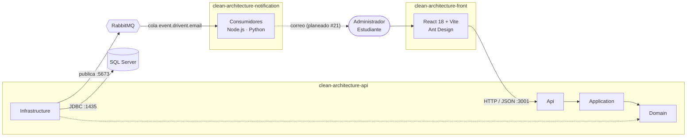
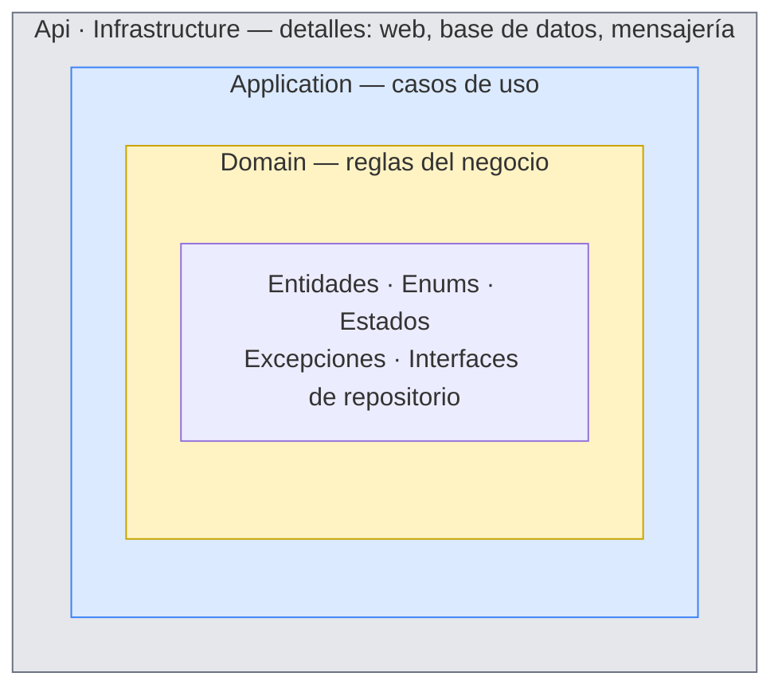
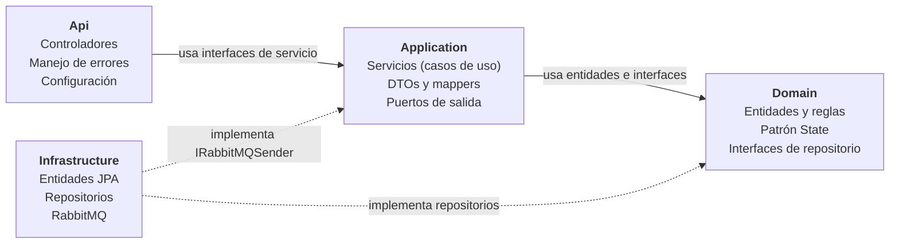
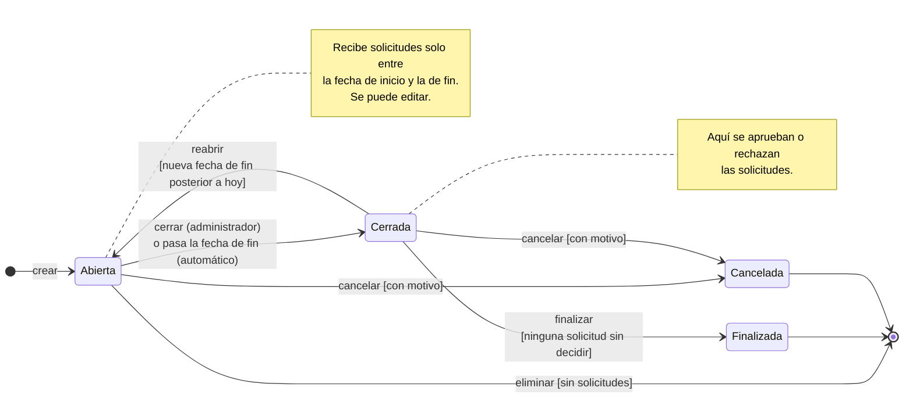
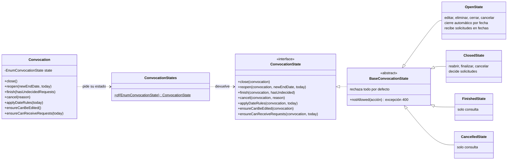
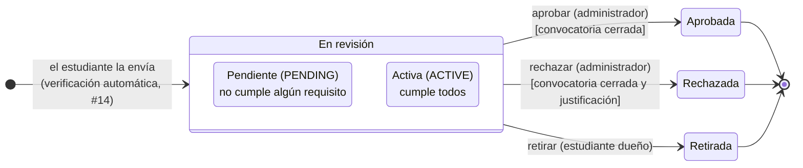

<h1 align="center">Sistema de Convocatorias · Clean Architecture</h1>

<p align="center">
  Plataforma de convocatorias y solicitudes de la <b>Universidad de Caldas</b>, construida en el <b>Semillero SOLID</b><br/>
  como ejemplo práctico de Clean Architecture, patrones de diseño y arquitectura orientada a eventos.
</p>

<p align="center">
  
</p>

<p align="center">
  
  
  
  
  
  
  
  
</p>

<p align="center">
  <a href="#visión-general">Visión general</a> ·
  <a href="#clean-architecture-en-este-proyecto">Clean Architecture</a> ·
  <a href="#ciclo-de-vida-de-una-convocatoria">Estados</a> ·
  <a href="#endpoints">Endpoints</a> ·
  <a href="#cómo-ejecutar-todo-el-sistema">Ejecutar</a> ·
  <a href="#diagramas">Diagramas</a>
</p>

---

Este repositorio es el **backend** y también la **documentación principal** del sistema completo. Los otros dos repositorios tienen su propio README con el detalle interno de cada uno:

| Repositorio | Rol | Documentación |
|---|---|---|
| **clean-architecture-api** (este) | API REST con las reglas del negocio | Este documento |
| [clean-architecture-front](https://github.com/SemilleroSOLID/clean-architecture-front) | Aplicación web para administradores y estudiantes | [README del front](https://github.com/SemilleroSOLID/clean-architecture-front#readme) |
| [clean-architecture-notification](https://github.com/SemilleroSOLID/clean-architecture-notification) | Microservicio de notificaciones por eventos | [README de notificaciones](https://github.com/SemilleroSOLID/clean-architecture-notification#readme) |

## Contenido

1. [Visión general](#visión-general)
2. [Tecnologías](#tecnologías)
3. [Clean Architecture en este proyecto](#clean-architecture-en-este-proyecto)
4. [Las cuatro capas](#las-cuatro-capas)
5. [Cómo se cumple la regla de dependencias](#cómo-se-cumple-la-regla-de-dependencias)
6. [Ciclo de vida de una convocatoria](#ciclo-de-vida-de-una-convocatoria)
7. [Recorrido de una petición](#recorrido-de-una-petición)
8. [Eventos de notificación](#eventos-de-notificación)
9. [Patrones de diseño](#patrones-de-diseño)
10. [Estructura de carpetas](#estructura-de-carpetas)
11. [Cómo agregar una funcionalidad](#cómo-agregar-una-funcionalidad)
12. [Endpoints](#endpoints)
13. [Cómo ejecutar todo el sistema](#cómo-ejecutar-todo-el-sistema)
14. [Pruebas](#pruebas)
15. [Diagramas](#diagramas)
16. [Estado del proyecto](#estado-del-proyecto)

## Visión general

El sistema resuelve dos casos de uso de la universidad:

- **CU-001 · Gestionar convocatorias.** El administrador publica convocatorias de monitoría, beca de investigación o residencia estudiantil, cada una con fechas y requisitos (por ejemplo, *promedio mayor o igual a 4.0*). Después las edita, las cierra, las reabre, las finaliza o las cancela.
- **CU-002 · Postularse.** El estudiante envía una solicitud a una convocatoria abierta, entregando un valor para cada requisito. El administrador las revisa y decide.

Está dividido en tres aplicaciones independientes que se comunican por HTTP y por mensajes:



| Comunicación | Tipo | Por qué |
|---|---|---|
| Front → API | **Síncrona** (HTTP/REST) | El usuario necesita la respuesta en el momento: si la convocatoria se guardó o qué campo tiene error. |
| API → Notificaciones | **Asíncrona** (RabbitMQ) | Enviar un correo puede tardar o fallar. El backend publica el evento y responde de inmediato; si el consumidor está caído, el mensaje espera en la cola. |

## Tecnologías

| Repositorio | Tecnologías |
|---|---|
| **API** |        |
| **Front** |       |
| **Notificaciones** |      |
| **Infraestructura** |    |

Dentro del backend, cada tecnología tiene un lugar fijo, y eso es parte de la arquitectura:

| Tecnología | Para qué | Capa donde se usa |
|---|---|---|
| Spring Web | Controladores REST | Api |
| Jakarta Bean Validation | Validar formato del JSON (`@NotBlank`, `@NotNull`, `@Size`) | Application (DTOs) |
| Spring Data JPA / Hibernate | Leer y escribir en SQL Server | Solo Infrastructure |
| Spring AMQP | Publicar mensajes en RabbitMQ | Solo Infrastructure |
| JUnit 5 | Pruebas unitarias | Domain (sin Spring) |
| Java puro (`java.time`, colecciones) | Reglas del negocio | Domain |

## Clean Architecture en este proyecto

Clean Architecture (Robert C. Martin, *Clean Architecture*, 2017) separa **lo que hace el negocio** de **cómo se entrega y se guarda**. Las reglas de una convocatoria ("la fecha de fin debe ser al menos un día después de la de inicio", "una convocatoria cerrada no se edita") no deberían cambiar porque se cambie SQL Server por PostgreSQL o REST por GraphQL.

El código se divide en capas concéntricas con una sola regla:

> **Regla de dependencias:** el código solo puede depender de capas más internas. Lo de adentro no sabe que existe lo de afuera.



Lo que se gana:

- **El negocio se prueba sin base de datos ni servidor.** Las 48 pruebas del dominio corren en milisegundos con JUnit, sin levantar Spring.
- **Los cambios de tecnología quedan aislados.** Cambiar la base de datos implica reescribir Infrastructure; el dominio y los casos de uso no se tocan.
- **Cada regla vive en un solo lugar.** Para cambiar cuándo se cierra una convocatoria se abre `OpenState.java`, no hay condicionales repartidos por los servicios.

## Las cuatro capas

El código está en `src/main/java/com/example/demo/` y cada carpeta de primer nivel es una capa.



### Domain · el núcleo

No depende de nada: ni Spring, ni JPA, ni Jackson. Solo Java.

| Contiene | Ejemplo |
|---|---|
| Entidades con reglas | `Convocation.validate(today, catalog)` revisa fechas y requisitos. `Request.validateAgainst(requirements)` revisa que la solicitud responda todos los requisitos y `Request.verifyRequirements(requirements)` la deja `ACTIVE` o `PENDING` según los cumpla. |
| Enums del negocio | `EnumConvocationState`, `EnumStateRequest`, `EnumConvocationType`, `EnumConditionRequirement`. |
| Patrón State | `Domain/States/`, una clase por estado de la convocatoria. |
| Excepciones de negocio | `DomainValidationException` (mapa campo → mensaje) e `InvalidConvocationStateException`. |
| Puertos de persistencia | `IConvocationRepository`, `IRequestRepository`... Dicen **qué** se necesita guardar o consultar, no **cómo**. |

La fecha de "hoy" no se obtiene dentro del dominio con `LocalDate.now()`: se recibe como parámetro. Así las pruebas fijan el día que necesitan y el dominio no depende del reloj del servidor.

### Application · los casos de uso

Coordina. Un servicio carga lo que necesita mediante las interfaces del dominio, le pide a las entidades que validen o cambien de estado y guarda el resultado. **No contiene reglas del negocio.**

| Contiene | Ejemplo |
|---|---|
| Interfaces de servicio | `IConvocationService`, `IRequestService`, `IStudentService`. Los controladores dependen de estas. |
| Servicios | `ConvocationService.closeConvocation(id)`: carga, llama a `convocation.close()`, guarda. |
| DTOs | `ConvocationDto`, `RequestDto`. Contrato con el front, con las anotaciones de Bean Validation. |
| Mappers DTO ↔ dominio | `ConvocationMapper`, `RequestMapper`, `StudentMapper`. |
| Excepciones de aplicación | `NotFoundException`, `ConflictException`, `ForbiddenException`. |
| Eventos | `RequestStatusChangedEvent`: el mensaje que se publica en cada cambio de estado de una solicitud. |
| Puertos de salida | `IRabbitMQSender`: el servicio sabe que puede publicar un evento, no que es RabbitMQ. |

### Infrastructure · los detalles técnicos

| Contiene | Ejemplo |
|---|---|
| Entidades JPA | `ConvocationEntity` con `@Entity` y `@Column`. Representan tablas, **no** el negocio. |
| CRUDs de Spring Data | `IConvocationCrudRepository extends CrudRepository<ConvocationEntity, Integer>`. |
| Adaptadores de repositorio | `ConvocationRepository implements IConvocationRepository`. |
| Mappers de persistencia | `ConvocationPersistenceMapper`: `ConvocationEntity` ↔ `Convocation`. |
| Mensajería | `RabbitMQSender implements IRabbitMQSender` y la topología en `RabbitMQService`. |

### Api · la puerta de entrada

| Contiene | Ejemplo |
|---|---|
| Controladores | `ConvocationController`, `RequestController`, `StudentController`, `RequirementsController`. Un método = una línea que llama al servicio. |
| Respuesta común | `CustomResponse<T>` con `data`, `codeState` y `message`. |
| Errores | `GlobalExceptionHandler`: dominio inválido → 400, no existe → 404, conflicto → 409. |
| Configuración | `ClockConfig` (zona `America/Bogota`), `JacksonConfig`, `WebConfig` (CORS). |

## Cómo se cumple la regla de dependencias

Se puede comprobar en el código. Estas tres búsquedas **no devuelven ningún resultado**:

```bash
# Domain no importa nada de otras capas ni de frameworks
grep -rn "^import" src/main/java/com/example/demo/Domain | grep -vE "com.example.demo.Domain|java\."

# Application no conoce Infrastructure ni Api
grep -rn "import com.example.demo.\(Infrastructure\|Api\)" src/main/java/com/example/demo/Application

# Api no conoce Infrastructure
grep -rn "import com.example.demo.Infrastructure" src/main/java/com/example/demo/Api
```

| Principio | Cómo está aplicado |
|---|---|
| **Inversión de dependencias** | El dominio define `IConvocationRepository`; Infrastructure la implementa con JPA; Spring inyecta la implementación en el servicio, que solo conoce la interfaz. |
| **Negocio separado de las tablas** | `Convocation` (dominio) y `ConvocationEntity` (JPA) son clases distintas. El dominio usa el enum `OPEN`; la tabla guarda `stateConvocationId = 1`. El mapper traduce. |
| **Negocio separado del JSON** | El controlador recibe un `ConvocationDto`. Si el front pide un campo nuevo, cambian el DTO y el mapper, no la entidad. |
| **Reglas dentro de las entidades** | Los servicios no validan fechas ni preguntan por el estado: llaman a `convocation.validate(...)`, `convocation.close()`, `request.validateAgainst(...)`. |
| **Errores sin HTTP en el dominio** | El dominio lanza `DomainValidationException`; solo `GlobalExceptionHandler` sabe que eso es un 400. |

> **Concesión consciente.** Application usa anotaciones de Spring (`@Service`, `@Autowired`, `@Transactional`). En una versión estricta esa capa tampoco dependería del framework. Se acepta porque simplifica el proyecto y no afecta lo esencial: **el dominio es Java puro** y se prueba sin Spring.

## Ciclo de vida de una convocatoria

Es la parte central de lo implementado. Una convocatoria pasa por cuatro estados y cada uno permite acciones distintas. Las reglas se definieron en [#30](https://github.com/SemilleroSOLID/clean-architecture-api/issues/30) y se implementaron con el **patrón State** en [#31](https://github.com/SemilleroSOLID/clean-architecture-api/issues/31).



### Qué significa cada estado

| Estado | Enum | Qué pasa en él | Color en el front |
|---|---|---|---|
| **Abierta** | `OPEN` | Estado inicial al crearla. Recibe solicitudes mientras hoy esté entre la fecha de inicio y la de fin. Se puede editar, cerrar, cancelar y eliminar (si no tiene solicitudes). | 🟢 verde |
| **Cerrada** | `CLOSED` | Ya no recibe solicitudes. El administrador decide las que llegaron. Se puede reabrir con una nueva fecha de fin, finalizar o cancelar. | 🟠 naranja |
| **Finalizada** | `FINISHED` | Todas las solicitudes fueron decididas. Solo consulta. | 🔵 azul |
| **Cancelada** | `CANCELLED` | Se suspendió con un motivo obligatorio. Reemplaza la eliminación cuando ya hay solicitudes. Solo consulta. | 🔴 rojo |

### Acciones permitidas

| Acción | Endpoint | Abierta | Cerrada | Finalizada | Cancelada |
|---|---|:-:|:-:|:-:|:-:|
| Editar | `PUT /updateConvocation/{id}` | ✅ | ❌ | ❌ | ❌ |
| Eliminar | `DELETE /deleteConvocation/{id}` | ✅ sin solicitudes | ❌ | ❌ | ❌ |
| Cerrar | `PUT /closeConvocation/{id}` | ✅ | ❌ | ❌ | ❌ |
| Reabrir | `PUT /reopenConvocation/{id}` | ❌ | ✅ | ❌ | ❌ |
| Finalizar | `PUT /finishConvocation/{id}` | ❌ | ✅ si todo está decidido | ❌ | ❌ |
| Cancelar | `PUT /cancelConvocation/{id}` | ✅ | ✅ | ❌ | ❌ |
| Recibir solicitudes | `POST /request/createRequest` | ✅ dentro de las fechas | ❌ | ❌ | ❌ |
| Aprobar o rechazar solicitudes | `PUT /request/approveRequest/{id}` · `rejectRequest/{id}` | ❌ | ✅ | ❌ | ❌ |

Si se intenta una acción no permitida, la API responde **400** con un mensaje claro, por ejemplo `{ "state": "No se puede editar una convocatoria cerrada" }`. El front muestra solo los botones permitidos en cada estado, pero la regla real está en el backend.

### Cierre automático

No hay una tarea programada que cierre convocatorias. Cada vez que se consulta o se usa una convocatoria, el servicio llama a `convocation.applyDateRules(hoy)`: si está **Abierta** y la fecha de fin ya pasó, el propio estado la pasa a **Cerrada**. Así la regla está en el dominio y no depende de que un proceso externo se ejecute a tiempo. "Hoy" se calcula en la zona horaria de Colombia, no en la del contenedor (UTC).

### Cómo está implementado: patrón State

Sin el patrón, cada servicio tendría condicionales como `if (state == OPEN) ... else if (state == CLOSED) ...` repetidos en cada acción. Con el patrón, **cada estado es una clase** que sabe qué permite y a qué estado pasa.



Cómo funciona, paso a paso:

1. En la base de datos solo se guarda el número del estado (`stateConvocationId`). El mapper lo convierte en el enum `EnumConvocationState`.
2. Cuando se llama, por ejemplo, `convocation.close()`, la entidad le pide a `ConvocationStates.of(state)` el objeto de su estado actual y le delega la acción.
3. `BaseConvocationState` **rechaza todo por defecto**. Cada estado concreto sobrescribe solo lo que permite. Por eso `FinishedState` y `CancelledState` casi no tienen código: heredan el rechazo.
4. Si la acción es válida, el estado cambia el enum de la convocatoria (por ejemplo a `CLOSED`) y el servicio la guarda.

```java
// ConvocationService: no hay ningún if sobre el estado
public ConvocationDto closeConvocation(int convocationId) {
    return this.changeState(convocationId, Convocation::close);
}

// OpenState: solo una convocatoria abierta se puede cerrar
@Override
public void close(Convocation convocation) {
    convocation.setState(EnumConvocationState.CLOSED);
}
```

Agregar un estado nuevo (por ejemplo *Suspendida*) es crear su clase y registrarla en `ConvocationStates`, sin tocar los servicios. Es el principio abierto/cerrado de SOLID. Todas las transiciones válidas e inválidas están cubiertas por `ConvocationStateTest` (21 pruebas).

El detalle completo, con las decisiones del equipo y el anexo de estados de la solicitud, está en [diagramas/estados-convocatoria.md](diagramas/estados-convocatoria.md).

### Estados de una solicitud

Las solicitudes siguen el mismo patrón desde [#19](https://github.com/SemilleroSOLID/clean-architecture-api/issues/19): `ReviewRequestState` (que comparten `PENDING` y `ACTIVE`) permite aprobar, rechazar y retirar; `AcceptedRequestState`, `RejectedRequestState` y `CancelledRequestState` son finales.



Una solicitud retirada no se borra: queda `CANCELLED` en el historial del estudiante y ya no cuenta para la selección ni para finalizar la convocatoria. Detalle y diagrama de clases en el [anexo de estados](diagramas/estados-convocatoria.md#anexo-estados-de-una-solicitud).

## Recorrido de una petición

Ejemplo: el administrador cierra la convocatoria 5 con `PUT /convocation/closeConvocation/5`.

1. **Api.** `ConvocationController.closeConvocation(5)` llama a `IConvocationService.closeConvocation(5)`.
2. **Application.** `ConvocationService` busca la convocatoria con `IConvocationRepository.findById(5)`.
3. **Infrastructure.** `ConvocationRepository` consulta SQL Server, recibe un `ConvocationEntity` y lo convierte en `Convocation`.
4. **Domain.** `applyDateRules(hoy)` aplica el cierre automático y luego `close()` delega en el estado actual. `OpenState` la pasa a `CLOSED`; cualquier otro estado lanza *"No se puede cerrar una convocatoria cerrada"*.
5. **Infrastructure.** El servicio guarda con `IConvocationRepository.save(...)`.
6. **Api.** El controlador responde `200` con un `CustomResponse`. Si hubo una excepción, `GlobalExceptionHandler` responde 400, 404 o 409.

Los recorridos completos, con los casos de error, están en [diagramas/diagrama-secuencia.md](diagramas/diagrama-secuencia.md).

## Eventos de notificación

Desde [#20](https://github.com/SemilleroSOLID/clean-architecture-api/issues/20), cada vez que una solicitud se crea o cambia de estado el backend publica un evento en RabbitMQ para que el microservicio de notificaciones le avise al estudiante. El backend no envía correos: publica y responde.

| Acción | Endpoint | `previousState` → `newState` |
|---|---|---|
| El estudiante se postula | `POST /request/createRequest` | `null` → `ACTIVE` o `PENDING` |
| El administrador aprueba | `PUT /request/approveRequest/{id}` | `ACTIVE` o `PENDING` → `ACCEPT` |
| El administrador rechaza | `PUT /request/rejectRequest/{id}` | `ACTIVE` o `PENDING` → `REJECT` (con `comment`) |
| El estudiante la retira | `PUT /request/cancelRequest/{id}` | `ACTIVE` o `PENDING` → `CANCELLED` |

El mensaje sale al exchange `event.drivent.exchange` con la routing key `email` y llega a la cola `event.drivent.email`. Es JSON (`content_type: application/json`) y es el contrato con el consumidor: se pueden agregar campos, no renombrarlos.

```json
{
  "event": "REQUEST_STATUS_CHANGED",
  "requestId": 9,
  "studentId": 4,
  "studentName": "Santiago Ramírez López",
  "studentEmail": "santiago.ramirez@ucaldas.test",
  "convocationId": 3,
  "convocationTitle": "Residencia Estudiantil 2027",
  "previousState": "PENDING",
  "newState": "REJECT",
  "comment": "El promedio mínimo para la residencia es 3.5",
  "date": "2026-10-19T23:00:06-05:00"
}
```

Cómo está repartido entre las capas:

| Capa | Pieza | Qué hace |
|---|---|---|
| Application | `RequestStatusChangedEvent` | El mensaje. `RequestMapper.toStatusChangedEvent(...)` lo arma con la solicitud, el estudiante y la convocatoria. |
| Application | `IRabbitMQSender.publishRequestStatusChanged(event)` | El puerto. `RequestService` lo llama después de cada cambio, sin saber que existe RabbitMQ. |
| Infrastructure | `RabbitMQSender` | Lo publica con `RabbitTemplate` y `Jackson2JsonMessageConverter` (configurado en `RabbitMQService`). |

Dos reglas del publicador:

- **Solo después del commit.** Dentro de una transacción, el evento se registra para `afterCommit`: si guardar falla, el estudiante nunca recibe un aviso de algo que no pasó. Una operación rechazada (400, 403, 404) no publica nada.
- **RabbitMQ caído no rompe el negocio.** El cambio ya está guardado; si no se puede publicar, se registra el error en el log (`No se pudo publicar en RabbitMQ el evento ...`) y la petición responde 200. `spring.rabbitmq.connection-timeout=2s` evita que la respuesta se quede esperando. Cuando RabbitMQ vuelve, el backend se reconecta solo.

El consumidor de Node envía el correo al estudiante con una plantilla por estado ([#21](https://github.com/SemilleroSOLID/clean-architecture-api/issues/21)); en desarrollo los correos llegan a Mailpit (http://localhost:8025). Detalle en el [README de notificaciones](https://github.com/SemilleroSOLID/clean-architecture-notification#el-correo-al-estudiante). El endpoint de prueba `POST /convocation/sendNotification`, que publicaba texto libre, se eliminó.

## Patrones de diseño

| Patrón | Dónde | Para qué |
|---|---|---|
| **Repository** | `Domain/Interfaces` + `Infrastructure/Persistence/Repositories` | Esconder cómo se guardan los datos detrás de una interfaz del dominio. |
| **Adapter** | `ConvocationRepository`, `RabbitMQSender` | Adaptar una tecnología a la interfaz que pide el núcleo. |
| **DTO** | `Application/Dtos` | Separar el contrato JSON de las entidades. |
| **Mapper** | `Application/Mappers`, `Infrastructure/Mappers` | Convertir entre DTO, dominio y entidad JPA, cada uno en su capa. |
| **State** | `Domain/States` | Reglas de cada estado de la convocatoria en su propia clase. |
| **Simple Factory** | `ConvocationStates.of(enum)` | Obtener el objeto de estado a partir del enum guardado. |
| **Dependency Injection** | Todo el backend | Spring entrega las implementaciones de las interfaces. |
| **Publish / Subscribe** | RabbitMQ + notificaciones | Desacoplar el envío de notificaciones del backend. |

## Estructura de carpetas

```text
clean-architecture-api/
├── src/main/java/com/example/demo/
│   ├── Api/                          ← entrada HTTP
│   │   ├── Config/                   ← ClockConfig, JacksonConfig, WebConfig, GlobalExceptionHandler
│   │   ├── Controllers/              ← Convocation, Request, Student, Requirements, Test
│   │   └── Dtos/                     ← CustomResponse
│   ├── Application/                  ← casos de uso
│   │   ├── I*Service.java            ← interfaces que usan los controladores
│   │   ├── IRabbitMQSender.java      ← puerto de mensajería
│   │   ├── Dtos/                     ← ConvocationDto, RequestDto, StudentDto...
│   │   ├── Exceptions/               ← NotFoundException, ConflictException
│   │   ├── Mappers/                  ← DTO ↔ dominio
│   │   └── Services/                 ← ConvocationService, RequestService...
│   ├── Domain/                       ← reglas del negocio (Java puro)
│   │   ├── Entities/                 ← Convocation, Request, Student, ConvocationRequirement...
│   │   ├── Enums/                    ← estados, tipos y condiciones
│   │   ├── Exceptions/               ← DomainValidationException, InvalidConvocationStateException
│   │   ├── Interfaces/               ← puertos de persistencia
│   │   └── States/                   ← OpenState, ClosedState, FinishedState, CancelledState
│   └── Infrastructure/               ← detalles técnicos
│       ├── Implementations/Services/ ← RabbitMQSender, RabbitMQService
│       ├── Mappers/                  ← entidad JPA ↔ dominio
│       └── Persistence/
│           ├── Cruds/                ← interfaces de Spring Data
│           ├── Entities/             ← clases @Entity
│           └── Repositories/         ← implementaciones de los puertos
├── src/test/java/.../Domain/         ← pruebas unitarias del dominio
├── diagramas/                        ← diagramas Mermaid (estados, clases, secuencia)
├── create-database.sql               ← base de datos y datos de ejemplo
├── docker-compose.yml                ← SQL Server + backend
├── Dockerfile                        ← imagen del backend
└── sqlserver.Dockerfile              ← SQL Server con el script inicial
```

## Cómo agregar una funcionalidad

Ejemplo: *"un estudiante puede retirar su solicitud"*. Se trabaja de adentro hacia afuera, para diseñar el dominio sin pensar en la base de datos:

1. **Domain.** Método `withdraw()` en `Request` con su regla (solo si no está decidida). Si hace falta una consulta nueva, se agrega a `IRequestRepository`. Prueba unitaria en `src/test/.../Domain`.
2. **Application.** `withdrawRequest(id)` en `IRequestService` y `RequestService`: cargar, llamar a `request.withdraw()`, guardar.
3. **Infrastructure.** Implementar el método nuevo del repositorio, si lo hubo.
4. **Api.** Endpoint en `RequestController` que solo llama al servicio.

Antes de subir el cambio se corren las tres búsquedas de [la regla de dependencias](#cómo-se-cumple-la-regla-de-dependencias). Si alguna devuelve algo, hay una dependencia en la dirección equivocada.

## Endpoints

Base: `http://localhost:3001/ms-logica-negocio/api`. Todas las respuestas tienen la forma `{ "data": ..., "codeState": ..., "message": "..." }`.

<details open>
<summary><b>Convocatorias</b></summary>

| Método | Ruta | Qué hace |
|---|---|---|
| GET | `/convocation/getAllConvocations` | Lista todas con su estado actual. |
| GET | `/convocation/getConvocationById/{id}` | Detalle con requisitos. |
| GET | `/convocation/getAllConvocationTypes` | Tipos de convocatoria. |
| POST | `/convocation/createConvocation` | Crea una convocatoria (queda `OPEN`). |
| PUT | `/convocation/updateConvocation/{id}` | Edita una abierta. |
| DELETE | `/convocation/deleteConvocation/{id}` | Elimina una abierta sin solicitudes. |
| PUT | `/convocation/closeConvocation/{id}` | Cierra. |
| PUT | `/convocation/reopenConvocation/{id}` | Reabre. Cuerpo: `{ "endDate": "AAAA-MM-DD" }`. |
| PUT | `/convocation/finishConvocation/{id}` | Finaliza. |
| PUT | `/convocation/cancelConvocation/{id}` | Cancela. Cuerpo: `{ "reason": "..." }`. |

</details>

<details open>
<summary><b>Requisitos, estudiantes y solicitudes</b></summary>

| Método | Ruta | Qué hace |
|---|---|---|
| GET | `/requirements/getAllRequirements` | Catálogo de tipos de requisito. |
| GET | `/requirements/getAllConditionRequirements` | Condiciones (igual, mayor o igual...). |
| GET | `/student/getAllStudents` | Lista de estudiantes. |
| GET | `/student/getStudentById/{id}` | Detalle de un estudiante. |
| POST | `/request/createRequest` | Crea la solicitud de un estudiante y verifica sus requisitos: queda `ACTIVE` si los cumple todos o `PENDING` si no, con la lista de los que no cumple. |
| GET | `/request/getAllRequests?convocationId=&state=` | Lista las solicitudes, de la más reciente a la más antigua. Los dos filtros son opcionales. |
| GET | `/request/getRequestById/{id}` | Detalle con el estudiante, la convocatoria y, por cada requisito, el valor exigido, el valor del estudiante y si lo cumple. |
| GET | `/request/getRequestsByStudent/{studentId}` | Historial de un estudiante: sus solicitudes con título, tipo, fechas y estado de la convocatoria, el estado de la solicitud y la justificación si fue rechazada. |
| PUT | `/request/cancelRequest/{id}` | El estudiante retira su solicitud en revisión. Cuerpo: `{ "studentId": ... }`. Queda `CANCELLED`; 403 si no es el dueño. |
| PUT | `/request/approveRequest/{id}` | Aprueba una solicitud sin decidir (`PENDING` o `ACTIVE`) de una convocatoria cerrada: queda `ACCEPT`. |
| PUT | `/request/rejectRequest/{id}` | La rechaza con justificación obligatoria. Cuerpo: `{ "comment": "..." }`. Queda `REJECT` y la justificación se guarda para el estudiante. |
| GET | `/test/hello` | Comprueba que el servidor responde. |

</details>

| Código | Cuándo |
|---|---|
| `400` | Datos inválidos o acción no permitida en el estado actual. El cuerpo trae un mapa `campo → mensaje`. |
| `404` | La convocatoria, la solicitud, el estudiante o el recurso no existe. |
| `409` | Conflicto, por ejemplo una solicitud repetida o eliminar una convocatoria con solicitudes. |

## Cómo ejecutar todo el sistema

### Requisitos

- Docker y Docker Compose.
- Node.js 22 para el front y Node.js 20 para el consumidor de notificaciones.
- Java 17 solo si se quiere compilar o correr las pruebas fuera de Docker.
- Los tres repositorios clonados en la misma carpeta.

### Pasos

```bash
# 1. RabbitMQ y Mailpit (repositorio de notificaciones)
cd clean-architecture-notification/node
docker compose up -d

# 2. SQL Server + backend (este repositorio)
cd ../../clean-architecture-api
docker compose up -d --build

# 3. Front
cd ../clean-architecture-front
npm install
cp .env.example .env
npm run dev

# 4. Consumidor de notificaciones (envía los correos a Mailpit)
cd ../clean-architecture-notification/node
npm install
cp .env.example .env
npm run start:consumer -- email
```

El contenedor `sqlserver` ejecuta `create-database.sql` al iniciar: crea `CleanArchitectureDB` y carga los requisitos, los tipos de convocatoria y cinco estudiantes de ejemplo. El backend espera a que la base de datos esté lista.

| Servicio | Dirección |
|---|---|
| Front | http://localhost:5173 |
| Backend | http://localhost:3001/ms-logica-negocio/api |
| SQL Server | `localhost:1435` (usuario `sa`, contraseña en `sqlserver.Dockerfile`) |
| RabbitMQ | `localhost:5673` · panel en http://localhost:15673 (`admin` / `admin`) |
| Mailpit (correos de desarrollo) | http://localhost:8025 |

### Configuración del backend

`src/main/resources/application-dev.properties` lee estas variables:

| Variable | Valor por defecto |
|---|---|
| `DB_HOST` | `localhost` |
| `DB_PORT` | `1433` |
| `RABBITMQ_HOST` | `localhost` |
| `RABBITMQ_PORT` | `5673` |

Dentro de Docker Compose el backend usa `sqlserver:1433` y llega a RabbitMQ por `host.docker.internal:5673`. La zona horaria de las reglas es `America/Bogota` (propiedad `app.time-zone`).

## Pruebas

```bash
./gradlew test
```

| Clase | Pruebas | Qué cubre |
|---|:-:|---|
| `ConvocationValidationTest` | 10 | Reglas de fechas y requisitos al crear y editar. |
| `ConvocationStateTest` | 21 | Cada transición válida e inválida de los cuatro estados, el cierre automático y la regla de no cambiar requisitos con solicitudes. |
| `RequestValidationTest` | 6 | Que una solicitud responda todos los requisitos, sin repetidos ni ajenos. |
| `RequirementVerificationTest` | 12 | Las 5 condiciones (cada una con un caso que cumple y otro que no), la comparación de números y de texto, y que la solicitud quede `ACTIVE` o `PENDING`, nunca `REJECT`. |
| `RequestDecisionTest` | 6 | Aprobar y rechazar: justificación obligatoria, no decidir dos veces y solo con la convocatoria cerrada. |
| `RequestStateTest` | 6 | El patrón State de la solicitud: qué permite cada estado y el retiro por el estudiante. |
| `RabbitMQSenderTest` | 3 | Que el evento se publique en el exchange, que espere al commit y que con RabbitMQ caído la operación no falle. |

Las pruebas del dominio crean los objetos con `new`, sin Spring ni base de datos; la del publicador usa un `RabbitTemplate` simulado con Mockito. Que se pueda probar así es una de las señales más claras de que el dominio está bien aislado.

## Diagramas

| Diagrama | Qué muestra |
|---|---|
| [Estados de la convocatoria](diagramas/estados-convocatoria.md) | Ciclo de vida, acciones por estado, decisiones del equipo y el patrón State. |
| [Clases](diagramas/diagrama-clases.md) | Las clases de la convocatoria en las cuatro capas y el modelo de dominio. |
| [Secuencia](diagramas/diagrama-secuencia.md) | Crear convocatoria, cambiar estado, crear solicitud y aprobar o rechazar con la notificación por RabbitMQ. |

Están escritos en [Mermaid](https://mermaid.js.org/): GitHub los dibuja directamente y se editan como texto.

## Estado del proyecto

El trabajo se organiza en [issues](https://github.com/SemilleroSOLID/clean-architecture-api/issues) por fases.

| Fase | Contenido | Estado |
|---|---|---|
| 1 · Convocatorias (CU-001) | Crear, consultar, editar, eliminar y listar; validaciones; refactor a Clean Architecture; diagrama de estados. | ✅ Terminada |
| 2 · Solicitudes (CU-002) | Estudiantes, creación de solicitudes, verificación automática de requisitos y formulario de postulación en el front. | ✅ Terminada |
| 3 · Gestión y notificaciones | Ver, aprobar y rechazar solicitudes, historial y retiro del estudiante, eventos en RabbitMQ y correo real al estudiante. | ✅ Terminada |
| 4 · Autenticación y roles | JWT con roles Administrador y Estudiante, login y rutas protegidas. | ⏳ Pendiente |
| 5 · Calidad y despliegue | Patrón State listo. Faltan pruebas con Mockito, pruebas de integración, GitHub Actions, Docker Compose único y diagramas de despliegue y entidad-relación. | 🔄 En curso |

Al terminar el backlog la estructura de capas será la misma; crece el contenido de cada una:

- **Domain:** ya tiene la verificación de requisitos y los estados de la solicitud con el patrón State.
- **Application:** ya publica un evento en cada cambio de estado de una solicitud; faltan los casos de uso de autenticación.
- **Infrastructure:** la parte técnica del JWT.
- **Api:** endpoints nuevos protegidos por rol. El dominio no sabrá quién está autenticado: recibe el id del usuario como un dato más.

---

<p align="center">Semillero SOLID · Universidad de Caldas</p>
