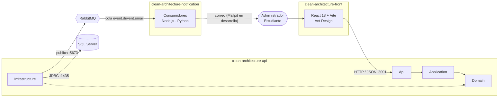
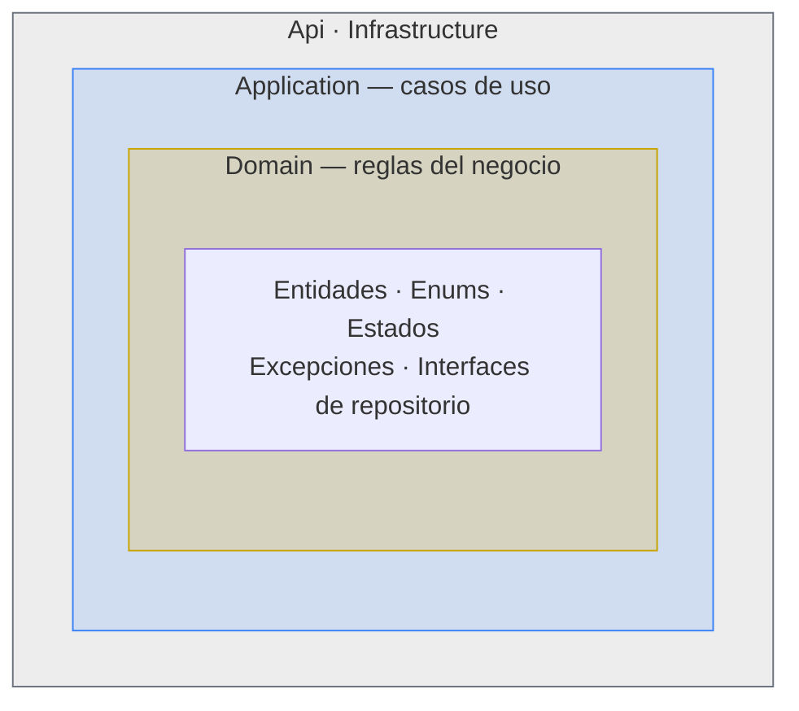
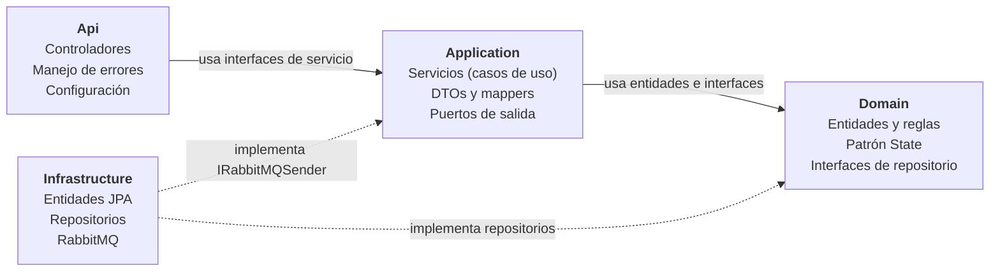
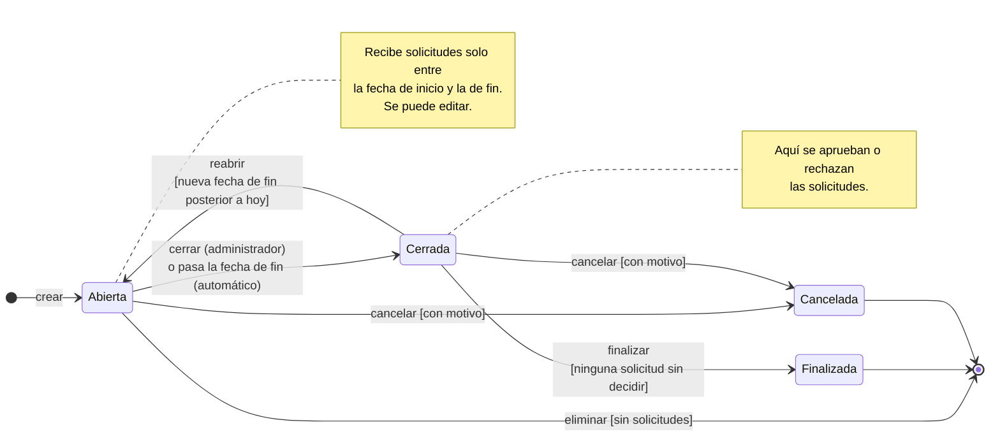
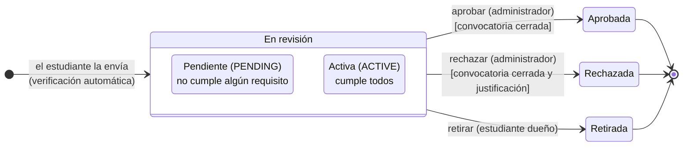
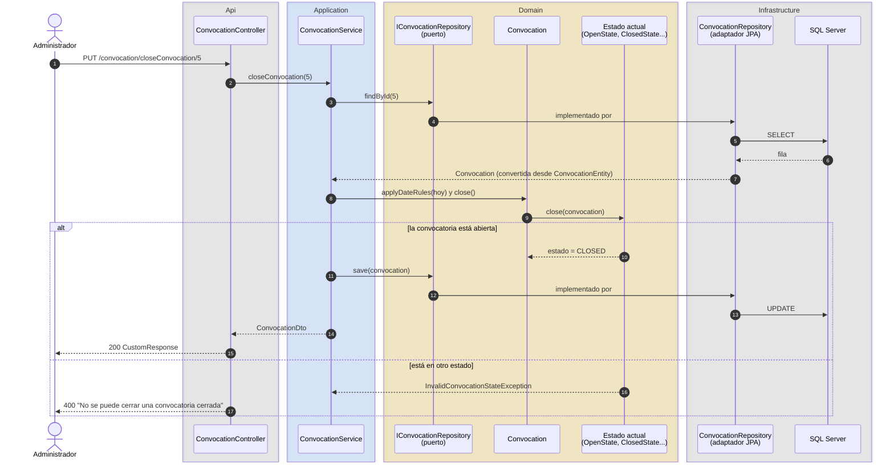
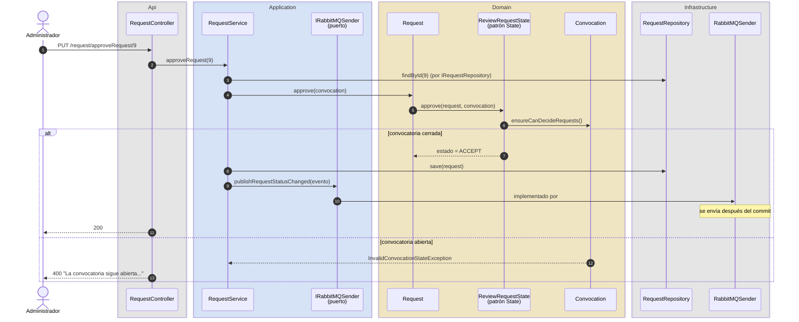
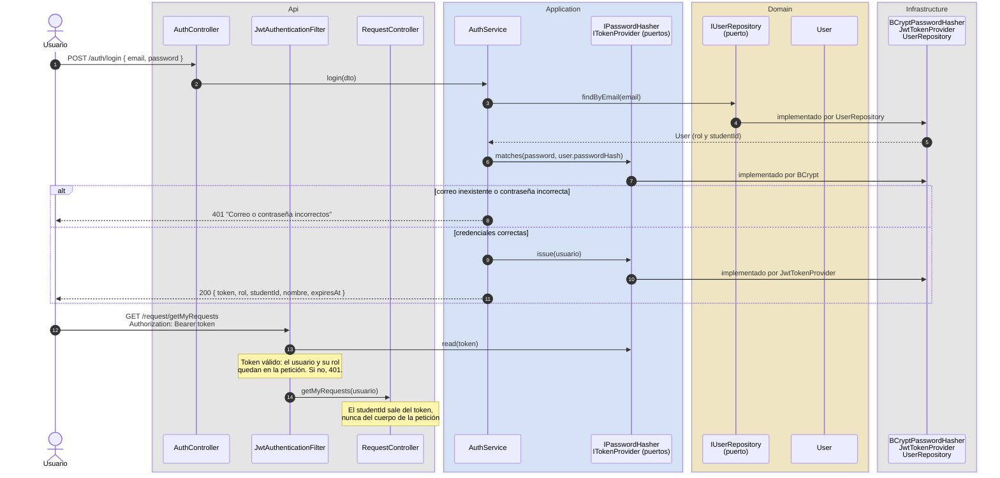
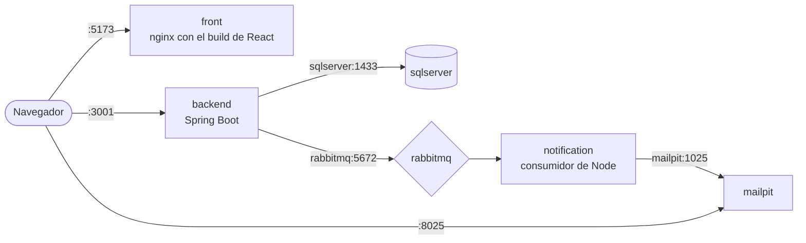

<h1 align="center">Sistema de Convocatorias · Clean Architecture</h1>

<p align="center">
  Plataforma de convocatorias y solicitudes de la <b>Universidad de Caldas</b>, construida en el <b>Semillero SOLID</b><br/>
  como ejemplo práctico de Clean Architecture, patrones de diseño y arquitectura orientada a eventos.
</p>

<p align="center">
  
</p>

<p align="center">
  <a href="https://github.com/SemilleroSOLID/clean-architecture-api/actions/workflows/ci.yml"></a>
  
  
  
  
  
  
  
  
</p>

<p align="center">
  <a href="#empezar-rápido">Empezar rápido</a> ·
  <a href="#clean-architecture-en-este-proyecto">Clean Architecture</a> ·
  <a href="#ciclo-de-vida-de-una-convocatoria">Estados</a> ·
  <a href="#patrones-de-diseño-implementados">Patrones de diseño</a> ·
  <a href="#pruebas">Pruebas</a> ·
  <a href="#cómo-contribuir">Contribuir</a>
</p>

---

Este repositorio es el **backend** y también la **documentación principal** del sistema completo. Los otros dos repositorios tienen su propio README con el detalle interno de cada uno:

| Repositorio | Rol | Documentación |
|---|---|---|
| **clean-architecture-api** (este) | API REST con las reglas del negocio | Este documento |
| [clean-architecture-front](https://github.com/SemilleroSOLID/clean-architecture-front) | Aplicación web para administradores y estudiantes | [README del front](https://github.com/SemilleroSOLID/clean-architecture-front#readme) |
| [clean-architecture-notification](https://github.com/SemilleroSOLID/clean-architecture-notification) | Microservicio de notificaciones por eventos | [README de notificaciones](https://github.com/SemilleroSOLID/clean-architecture-notification#readme) |

## Contenido

1. [Empezar rápido](#empezar-rápido)
2. [Visión general](#visión-general)
3. [Tecnologías](#tecnologías)
4. [Clean Architecture en este proyecto](#clean-architecture-en-este-proyecto)
5. [Las cuatro capas](#las-cuatro-capas)
6. [Cómo se cumple la regla de dependencias](#cómo-se-cumple-la-regla-de-dependencias)
7. [Ciclo de vida de una convocatoria](#ciclo-de-vida-de-una-convocatoria)
8. [Recorrido de una petición](#recorrido-de-una-petición)
9. [Eventos de notificación](#eventos-de-notificación)
10. [Seguridad: login con JWT y roles](#seguridad-login-con-jwt-y-roles)
11. [Patrones de diseño implementados](#patrones-de-diseño-implementados)
12. [Estructura de carpetas](#estructura-de-carpetas)
13. [Cómo agregar una funcionalidad](#cómo-agregar-una-funcionalidad)
14. [Endpoints](#endpoints)
15. [Cómo ejecutar todo el sistema](#cómo-ejecutar-todo-el-sistema)
16. [Pruebas](#pruebas)
17. [Cómo contribuir](#cómo-contribuir)
18. [Diagramas](#diagramas)
19. [Qué falta](#qué-falta)

## Empezar rápido

Para ver el sistema funcionando en tu máquina solo necesitas **Git** y **Docker Desktop**.

```bash
mkdir "Clean Architecture" && cd "Clean Architecture"
git clone https://github.com/SemilleroSOLID/clean-architecture-api.git      # o tu fork, ver "Cómo contribuir"
git clone https://github.com/SemilleroSOLID/clean-architecture-front.git
git clone https://github.com/SemilleroSOLID/clean-architecture-notification.git

cd clean-architecture-api
docker compose up -d --build
```

La primera vez tarda unos minutos. Cuando `docker compose ps` muestre el backend `healthy`:

| Qué | Dónde | Usuario |
|---|---|---|
| Aplicación web | http://localhost:5173 | Administrador `admin@ucaldas.test` / `Admin2026*` · Estudiante `laura.gomez@ucaldas.test` / `Estudiante2026*` |
| API | http://localhost:3001/ms-logica-negocio/api | Token de `POST /auth/login` |
| Correos que reciben los estudiantes (Mailpit) | http://localhost:8025 | |
| Panel de RabbitMQ | http://localhost:15673 | `admin` / `admin` |

Las pruebas no necesitan el sistema arriba:

```bash
./gradlew test       # con Java 17
docker run --rm -v "$(pwd)":/app -v gradle-cache:/root/.gradle -w /app eclipse-temurin:17-jdk-jammy bash ./gradlew test   # sin Java
```

En PowerShell, cambia `$(pwd)` por `${PWD}`.

**Si es tu primera vez con el proyecto**, este orden ayuda a entenderlo:

1. [Clean Architecture en este proyecto](#clean-architecture-en-este-proyecto) y [Las cuatro capas](#las-cuatro-capas): dónde va cada cosa y por qué.
2. [Ciclo de vida de una convocatoria](#ciclo-de-vida-de-una-convocatoria): el patrón State, que es el corazón del dominio.
3. [Recorrido de una petición](#recorrido-de-una-petición) y los [diagramas de secuencia](diagramas/diagrama-secuencia.md): cómo viaja una petición por las capas.
4. [Patrones de diseño implementados](#patrones-de-diseño-implementados): qué patrón resuelve cada problema y dónde verlo en el código.
5. [Pruebas](#pruebas) y [Cómo contribuir](#cómo-contribuir): para tomar una de las [pruebas pendientes](#qué-falta).

## Visión general

El sistema resuelve dos casos de uso de la universidad:

- **CU-001 · Gestionar convocatorias.** El administrador publica convocatorias de monitoría, beca de investigación o residencia estudiantil, cada una con fechas y requisitos (por ejemplo, *promedio mayor o igual a 4.0*). Después las edita, las cierra, las reabre, las finaliza o las cancela.
- **CU-002 · Postularse.** El estudiante envía una solicitud a una convocatoria abierta, entregando un valor para cada requisito. El administrador las revisa y decide.

Está dividido en tres aplicaciones independientes que se comunican por HTTP y por mensajes:



| Comunicación | Tipo | Por qué |
|---|---|---|
| Front → API | **Síncrona** (HTTP/REST) | El usuario necesita la respuesta en el momento: si la convocatoria se guardó o qué campo tiene error. |
| API → Notificaciones | **Asíncrona** (RabbitMQ) | Enviar un correo puede tardar o fallar. El backend publica el evento y responde de inmediato; si el consumidor está caído, el mensaje espera en la cola. |

## Tecnologías

| Repositorio | Tecnologías |
|---|---|
| **API** |        |
| **Front** |       |
| **Notificaciones** |      |
| **Infraestructura** |    |

Dentro del backend, cada tecnología tiene un lugar fijo, y eso es parte de la arquitectura:

| Tecnología | Para qué | Capa donde se usa |
|---|---|---|
| Spring Web | Controladores REST | Api |
| Jakarta Bean Validation | Validar formato del JSON (`@NotBlank`, `@NotNull`, `@Size`) | Application (DTOs) |
| Spring Data JPA / Hibernate | Leer y escribir en SQL Server | Solo Infrastructure |
| Spring AMQP | Publicar mensajes en RabbitMQ | Solo Infrastructure |
| Spring Security + jjwt + BCrypt | Login, roles y contraseñas | Api (reglas de acceso) e Infrastructure (JWT y BCrypt) |
| JUnit 5 + Mockito + JaCoCo | Pruebas y cobertura | `src/test` (el dominio se prueba sin Spring) |
| Java puro (`java.time`, colecciones) | Reglas del negocio | Domain |

## Clean Architecture en este proyecto

Clean Architecture (Robert C. Martin, *Clean Architecture*, 2017) separa **lo que hace el negocio** de **cómo se entrega y se guarda**. Las reglas de una convocatoria ("la fecha de fin debe ser al menos un día después de la de inicio", "una convocatoria cerrada no se edita") no deberían cambiar porque se cambie SQL Server por PostgreSQL o REST por GraphQL.

El código se divide en capas concéntricas con una sola regla:

> **Regla de dependencias:** el código solo puede depender de capas más internas. Lo de adentro no sabe que existe lo de afuera.



Lo que se gana:

- **El negocio se prueba sin base de datos ni servidor.** Las 61 pruebas del dominio corren en milisegundos con JUnit, sin levantar Spring.
- **Los cambios de tecnología quedan aislados.** Cambiar la base de datos implica reescribir Infrastructure; el dominio y los casos de uso no se tocan.
- **Cada regla vive en un solo lugar.** Para cambiar cuándo se cierra una convocatoria se abre `OpenState.java`, no hay condicionales repartidos por los servicios.

## Las cuatro capas

El código está en `src/main/java/com/example/demo/` y cada carpeta de primer nivel es una capa.



### Domain · el núcleo

No depende de nada: ni Spring, ni JPA, ni Jackson. Solo Java.

| Contiene | Ejemplo |
|---|---|
| Entidades con reglas | `Convocation.validate(today, catalog)` revisa fechas y requisitos. `Request.validateAgainst(requirements)` revisa que la solicitud responda todos los requisitos y `Request.verifyRequirements(requirements)` la deja `ACTIVE` o `PENDING` según los cumpla. |
| Enums del negocio | `EnumConvocationState`, `EnumStateRequest`, `EnumConvocationType`, `EnumConditionRequirement`, `EnumRole`. |
| Patrón State | `Domain/States/`, una clase por estado de la convocatoria y de la solicitud. |
| Excepciones de negocio | `DomainValidationException` (mapa campo → mensaje), `InvalidConvocationStateException` e `InvalidRequestStateException`. |
| Puertos de persistencia | `IConvocationRepository`, `IRequestRepository`, `IUserRepository`... Dicen **qué** se necesita guardar o consultar, no **cómo**. |

La fecha de "hoy" no se obtiene dentro del dominio con `LocalDate.now()`: se recibe como parámetro. Así las pruebas fijan el día que necesitan y el dominio no depende del reloj del servidor.

### Application · los casos de uso

Coordina. Un servicio carga lo que necesita mediante las interfaces del dominio, le pide a las entidades que validen o cambien de estado y guarda el resultado. **No contiene reglas del negocio.**

| Contiene | Ejemplo |
|---|---|
| Interfaces de servicio | `IConvocationService`, `IRequestService`, `IStudentService`. Los controladores dependen de estas. |
| Servicios | `ConvocationService.closeConvocation(id)`: carga, llama a `convocation.close()`, guarda. |
| DTOs | `ConvocationDto`, `RequestDto`. Contrato con el front, con las anotaciones de Bean Validation. |
| Mappers DTO ↔ dominio | `ConvocationMapper`, `RequestMapper`, `StudentMapper`. |
| Excepciones de aplicación | `NotFoundException`, `ConflictException`, `ForbiddenException`, `UnauthorizedException`. |
| Eventos | `RequestStatusChangedEvent`: el mensaje que se publica en cada cambio de estado de una solicitud. |
| Puertos de salida | `IRabbitMQSender`: el servicio sabe que puede publicar un evento, no que es RabbitMQ. `IPasswordHasher` e `ITokenProvider`: sabe verificar una contraseña y emitir un token, no que son BCrypt y JWT. |
| Usuario autenticado | `AuthenticatedUserDto`: el Api se lo pasa a los servicios como un dato más; ni Application ni Domain saben cómo se autenticó. |

### Infrastructure · los detalles técnicos

| Contiene | Ejemplo |
|---|---|
| Entidades JPA | `ConvocationEntity` con `@Entity` y `@Column`. Representan tablas, **no** el negocio. |
| CRUDs de Spring Data | `IConvocationCrudRepository extends CrudRepository<ConvocationEntity, Integer>`. |
| Adaptadores de repositorio | `ConvocationRepository implements IConvocationRepository`. |
| Mappers de persistencia | `ConvocationPersistenceMapper`: `ConvocationEntity` ↔ `Convocation`. |
| Mensajería | `RabbitMQSender implements IRabbitMQSender` y la topología en `RabbitMQService`. |
| Seguridad | `BCryptPasswordHasher implements IPasswordHasher`, `JwtTokenProvider implements ITokenProvider`. |

### Api · la puerta de entrada

| Contiene | Ejemplo |
|---|---|
| Controladores | `ConvocationController`, `RequestController`, `StudentController`, `RequirementsController`, `AuthController`. Un método = una línea que llama al servicio. |
| Respuesta común | `CustomResponse<T>` con `data`, `codeState` y `message`. |
| Errores | `GlobalExceptionHandler`: dominio inválido → 400, credenciales incorrectas → 401, solicitud ajena → 403, no existe → 404, conflicto → 409. |
| Seguridad | `Config/Security/SecurityConfig` (reglas por rol), `JwtAuthenticationFilter` (lee el token con `ITokenProvider`). |
| Configuración | `ClockConfig` (zona `America/Bogota`), `JacksonConfig`, `WebConfig` (CORS). |

## Cómo se cumple la regla de dependencias

Se puede comprobar en el código. Estas tres búsquedas **no devuelven ningún resultado**:

```bash
# Domain no importa nada de otras capas ni de frameworks
grep -rn "^import" src/main/java/com/example/demo/Domain | grep -vE "com.example.demo.Domain|java\."

# Application no conoce Infrastructure ni Api
grep -rn "import com.example.demo.\(Infrastructure\|Api\)" src/main/java/com/example/demo/Application

# Api no conoce Infrastructure
grep -rn "import com.example.demo.Infrastructure" src/main/java/com/example/demo/Api
```

| Principio | Cómo está aplicado |
|---|---|
| **Inversión de dependencias** | El dominio define `IConvocationRepository`; Infrastructure la implementa con JPA; Spring inyecta la implementación en el servicio, que solo conoce la interfaz. |
| **Negocio separado de las tablas** | `Convocation` (dominio) y `ConvocationEntity` (JPA) son clases distintas. El dominio usa el enum `OPEN`; la tabla guarda `stateConvocationId = 1`. El mapper traduce. |
| **Negocio separado del JSON** | El controlador recibe un `ConvocationDto`. Si el front pide un campo nuevo, cambian el DTO y el mapper, no la entidad. |
| **Reglas dentro de las entidades** | Los servicios no validan fechas ni preguntan por el estado: llaman a `convocation.validate(...)`, `convocation.close()`, `request.validateAgainst(...)`. |
| **Errores sin HTTP en el dominio** | El dominio lanza `DomainValidationException`; solo `GlobalExceptionHandler` sabe que eso es un 400. |

> **Concesión consciente.** Application usa anotaciones de Spring (`@Service`, `@Autowired`, `@Transactional`). En una versión estricta esa capa tampoco dependería del framework. Se acepta porque simplifica el proyecto y no afecta lo esencial: **el dominio es Java puro** y se prueba sin Spring.

## Ciclo de vida de una convocatoria

Es la parte central de lo implementado. Una convocatoria pasa por cuatro estados y cada uno permite acciones distintas. Las reglas se definieron en [#30](https://github.com/SemilleroSOLID/clean-architecture-api/issues/30) y se implementaron con el **patrón State** en [#31](https://github.com/SemilleroSOLID/clean-architecture-api/issues/31).



### Qué significa cada estado

| Estado | Enum | Qué pasa en él | Color en el front |
|---|---|---|---|
| **Abierta** | `OPEN` | Estado inicial al crearla. Recibe solicitudes mientras hoy esté entre la fecha de inicio y la de fin. Se puede editar, cerrar, cancelar y eliminar (si no tiene solicitudes). | 🟢 verde |
| **Cerrada** | `CLOSED` | Ya no recibe solicitudes. El administrador decide las que llegaron. Se puede reabrir con una nueva fecha de fin, finalizar o cancelar. | 🟠 naranja |
| **Finalizada** | `FINISHED` | Todas las solicitudes fueron decididas. Solo consulta. | 🔵 azul |
| **Cancelada** | `CANCELLED` | Se suspendió con un motivo obligatorio. Reemplaza la eliminación cuando ya hay solicitudes. Solo consulta. | 🔴 rojo |

### Acciones permitidas

| Acción | Endpoint | Abierta | Cerrada | Finalizada | Cancelada |
|---|---|:-:|:-:|:-:|:-:|
| Editar | `PUT /updateConvocation/{id}` | ✅ | ❌ | ❌ | ❌ |
| Eliminar | `DELETE /deleteConvocation/{id}` | ✅ sin solicitudes | ❌ | ❌ | ❌ |
| Cerrar | `PUT /closeConvocation/{id}` | ✅ | ❌ | ❌ | ❌ |
| Reabrir | `PUT /reopenConvocation/{id}` | ❌ | ✅ | ❌ | ❌ |
| Finalizar | `PUT /finishConvocation/{id}` | ❌ | ✅ si todo está decidido | ❌ | ❌ |
| Cancelar | `PUT /cancelConvocation/{id}` | ✅ | ✅ | ❌ | ❌ |
| Recibir solicitudes | `POST /request/createRequest` | ✅ dentro de las fechas | ❌ | ❌ | ❌ |
| Aprobar o rechazar solicitudes | `PUT /request/approveRequest/{id}` · `rejectRequest/{id}` | ❌ | ✅ | ❌ | ❌ |

Si se intenta una acción no permitida, la API responde **400** con un mensaje claro, por ejemplo `{ "state": "No se puede editar una convocatoria cerrada" }`. El front muestra solo los botones permitidos en cada estado, pero la regla real está en el backend.

### Cierre automático

No hay una tarea programada que cierre convocatorias. Cada vez que se consulta o se usa una convocatoria, el servicio llama a `convocation.applyDateRules(hoy)`: si está **Abierta** y la fecha de fin ya pasó, el propio estado la pasa a **Cerrada**. Así la regla está en el dominio y no depende de que un proceso externo se ejecute a tiempo. "Hoy" se calcula en la zona horaria de Colombia, no en la del contenedor (UTC).

### Cómo está implementado: patrón State

Sin el patrón, cada servicio tendría condicionales como `if (state == OPEN) ... else if (state == CLOSED) ...` repetidos en cada acción. Con el patrón, **cada estado es una clase** que sabe qué permite y a qué estado pasa.


Cómo funciona, paso a paso:

1. En la base de datos solo se guarda el número del estado (`stateConvocationId`). El mapper lo convierte en el enum `EnumConvocationState`.
2. Cuando se llama, por ejemplo, `convocation.close()`, la entidad le pide a `ConvocationStates.of(state)` el objeto de su estado actual y le delega la acción.
3. `BaseConvocationState` **rechaza todo por defecto**. Cada estado concreto sobrescribe solo lo que permite. Por eso `FinishedState` y `CancelledState` casi no tienen código: heredan el rechazo.
4. Si la acción es válida, el estado cambia el enum de la convocatoria (por ejemplo a `CLOSED`) y el servicio la guarda.

```java
// ConvocationService: no hay ningún if sobre el estado
public ConvocationDto closeConvocation(int convocationId) {
    return this.changeState(convocationId, Convocation::close);
}

// OpenState: solo una convocatoria abierta se puede cerrar
@Override
public void close(Convocation convocation) {
    convocation.setState(EnumConvocationState.CLOSED);
}
```

Agregar un estado nuevo (por ejemplo *Suspendida*) es crear su clase y registrarla en `ConvocationStates`, sin tocar los servicios. Es el principio abierto/cerrado de SOLID. Todas las transiciones válidas e inválidas están cubiertas por `ConvocationStateTest` (21 pruebas).

El detalle completo, con las decisiones del equipo y el anexo de estados de la solicitud, está en [diagramas/estados-convocatoria.md](diagramas/estados-convocatoria.md).

### Estados de una solicitud

Las solicitudes siguen el mismo patrón: `ReviewRequestState` (que comparten `PENDING` y `ACTIVE`) permite aprobar, rechazar y retirar; `AcceptedRequestState`, `RejectedRequestState` y `CancelledRequestState` son finales.



Una solicitud retirada no se borra: queda `CANCELLED` en el historial del estudiante y ya no cuenta para la selección ni para finalizar la convocatoria. Detalle y diagrama de clases en el [anexo de estados](diagramas/estados-convocatoria.md#anexo-estados-de-una-solicitud).

## Recorrido de una petición

Ejemplo: el administrador cierra la convocatoria 5 con `PUT /convocation/closeConvocation/5`. Cada caja es una capa; fíjate en que **la caja Domain no llama a nadie hacia afuera**: el servicio usa la interfaz `IConvocationRepository`, que es del dominio, y la implementación de Infrastructure se conecta por inyección de dependencias.



Paso a paso:

1. **Api.** `ConvocationController.closeConvocation(5)` llama a `IConvocationService.closeConvocation(5)`.
2. **Application.** `ConvocationService` busca la convocatoria con `IConvocationRepository.findById(5)`.
3. **Infrastructure.** `ConvocationRepository` consulta SQL Server, recibe un `ConvocationEntity` y lo convierte en `Convocation`.
4. **Domain.** `applyDateRules(hoy)` aplica el cierre automático y luego `close()` delega en el estado actual. `OpenState` la pasa a `CLOSED`; cualquier otro estado lanza *"No se puede cerrar una convocatoria cerrada"*.
5. **Infrastructure.** El servicio guarda con `IConvocationRepository.save(...)`.
6. **Api.** El controlador responde `200` con un `CustomResponse`. Si hubo una excepción, `GlobalExceptionHandler` responde 400, 404 o 409.

Los recorridos de los seis casos de uso (crear convocatoria, cambiar su estado, crear, decidir y retirar una solicitud, e iniciar sesión), con las mismas cajas por capa y sus errores, están en [diagramas/diagrama-secuencia.md](diagramas/diagrama-secuencia.md).

## Eventos de notificación

Cada vez que una solicitud se crea o cambia de estado el backend publica un evento en RabbitMQ para que el microservicio de notificaciones le avise al estudiante. El backend no envía correos: publica y responde.

| Acción | Endpoint | `previousState` → `newState` |
|---|---|---|
| El estudiante se postula | `POST /request/createRequest` | `null` → `ACTIVE` o `PENDING` |
| El administrador aprueba | `PUT /request/approveRequest/{id}` | `ACTIVE` o `PENDING` → `ACCEPT` |
| El administrador rechaza | `PUT /request/rejectRequest/{id}` | `ACTIVE` o `PENDING` → `REJECT` (con `comment`) |
| El estudiante la retira | `PUT /request/cancelRequest/{id}` | `ACTIVE` o `PENDING` → `CANCELLED` |

El mensaje sale al exchange `event.drivent.exchange` con la routing key `email` y llega a la cola `event.drivent.email`. Es JSON (`content_type: application/json`) y es el contrato con el consumidor: se pueden agregar campos, no renombrarlos.

```json
{
  "event": "REQUEST_STATUS_CHANGED",
  "requestId": 9,
  "studentId": 4,
  "studentName": "Santiago Ramírez López",
  "studentEmail": "santiago.ramirez@ucaldas.test",
  "convocationId": 3,
  "convocationTitle": "Residencia Estudiantil 2027",
  "previousState": "PENDING",
  "newState": "REJECT",
  "comment": "El promedio mínimo para la residencia es 3.5",
  "date": "2026-10-19T23:00:06-05:00"
}
```

Así se ve al aprobar una solicitud. Las reglas (que la solicitud esté en revisión y la convocatoria cerrada) las decide el dominio; RabbitMQ es un detalle de Infrastructure que el servicio solo conoce por su interfaz:



Cómo está repartido entre las capas:

| Capa | Pieza | Qué hace |
|---|---|---|
| Application | `RequestStatusChangedEvent` | El mensaje. `RequestMapper.toStatusChangedEvent(...)` lo arma con la solicitud, el estudiante y la convocatoria. |
| Application | `IRabbitMQSender.publishRequestStatusChanged(event)` | El puerto. `RequestService` lo llama después de cada cambio, sin saber que existe RabbitMQ. |
| Infrastructure | `RabbitMQSender` | Lo publica con `RabbitTemplate` y `Jackson2JsonMessageConverter` (configurado en `RabbitMQService`). |

Dos reglas del publicador:

- **Solo después del commit.** Dentro de una transacción, el evento se registra para `afterCommit`: si guardar falla, el estudiante nunca recibe un aviso de algo que no pasó. Una operación rechazada (400, 403, 404) no publica nada.
- **RabbitMQ caído no rompe el negocio.** El cambio ya está guardado; si no se puede publicar, se registra el error en el log (`No se pudo publicar en RabbitMQ el evento ...`) y la petición responde 200. `spring.rabbitmq.connection-timeout=2s` evita que la respuesta se quede esperando. Cuando RabbitMQ vuelve, el backend se reconecta solo.

El consumidor de Node envía el correo al estudiante con una plantilla por estado; en desarrollo los correos llegan a Mailpit (http://localhost:8025). Detalle en el [README de notificaciones](https://github.com/SemilleroSOLID/clean-architecture-notification#el-correo-al-estudiante).

## Seguridad: login con JWT y roles

Todos los endpoints, salvo el login y `/test/hello`, piden un token. Hay dos roles: **ADMIN** gestiona convocatorias, estudiantes y todas las solicitudes; **STUDENT** ve las convocatorias y crea, ve y retira **solo sus** solicitudes.



| Pieza | Capa | Qué hace |
|---|---|---|
| `User`, `EnumRole`, `IUserRepository` | Domain | El usuario con su rol y, si es estudiante, el `Student` al que corresponde. |
| `AuthService`, `IPasswordHasher`, `ITokenProvider`, `AuthenticatedUserDto` | Application | El login y los puertos para cifrar contraseñas y emitir tokens, sin saber que son BCrypt y JWT. |
| `BCryptPasswordHasher`, `JwtTokenProvider`, `UserRepository` | Infrastructure | BCrypt, JWT firmado con HS256 (librería jjwt) y la tabla `Users`. |
| `SecurityConfig`, `JwtAuthenticationFilter`, `AuthController` | Api | Quién puede llamar cada endpoint, leer el token de cada petición y el login. |

Decisiones:

- **Contraseñas con BCrypt**, con sal propia por usuario; en la tabla `Users` solo está el hash.
- **El login no revela si un correo existe:** el mismo 401 y el mismo mensaje para un correo inexistente y para una contraseña incorrecta. Con un correo inexistente también se verifica un hash, para que la respuesta tarde lo mismo.
- **El estudiante sale del token.** `createRequest` y `cancelRequest` ya no reciben `studentId`: si alguien lo manda en el cuerpo, se ignora.
- **Un estudiante no ve solicitudes de otro:** el detalle y el historial ajenos responden 403 (lo revisa `RequestService`, porque depende del dueño de cada solicitud).
- **Sin sesión en el servidor:** cada petición trae su token; por eso no hay cookie ni protección CSRF. El token dura 8 horas (`JWT_EXPIRATION_MINUTES`).
- **401 y 403 con el mismo formato** `CustomResponse` que el resto de errores. Un token vencido o alterado responde *"La sesión no es válida o venció"*; el front borra la sesión y vuelve al login con ese aviso.

Usuarios de desarrollo (los crea `create-database.sql`):

| Correo | Contraseña | Rol |
|---|---|---|
| `admin@ucaldas.test` | `Admin2026*` | ADMIN |
| `laura.gomez@ucaldas.test`, `andres.torres@ucaldas.test`, `valentina.herrera@ucaldas.test`, `santiago.ramirez@ucaldas.test`, `camila.ospina@ucaldas.test` | `Estudiante2026*` | STUDENT |

## Patrones de diseño implementados

Un **patrón de diseño** es una solución conocida a un problema que se repite. Esta tabla resume los que están en el código; debajo se explica cada uno con dónde verlo.

| Patrón | Tipo | Dónde | Problema que resuelve |
|---|---|---|---|
| [State](#state) | Comportamiento | `Domain/States` | Que cada estado de la convocatoria y de la solicitud decida qué acciones permite. |
| [Simple Factory](#simple-factory) | Creacional | `ConvocationStates.of`, `RequestStates.of`, `ConsumerFactory` (notificaciones) | Obtener el objeto correcto sin `if` ni `switch`. |
| [Template Method](#template-method) | Comportamiento | `BaseConvocationState`, `BaseRequestState`, `Consumer` (notificaciones) | Escribir una sola vez lo común y dejar a cada subclase solo lo que cambia. |
| [Repository](#repository-y-adapter-puertos-y-adaptadores) | Estructural | `Domain/Interfaces` + `Infrastructure/Persistence/Repositories` | Que el dominio guarde y consulte sin saber que existe SQL Server. |
| [Adapter](#repository-y-adapter-puertos-y-adaptadores) | Estructural | `ConvocationRepository`, `RabbitMQSender`, `BCryptPasswordHasher`, `JwtTokenProvider` | Conectar una tecnología a la interfaz que pide el núcleo. |
| [DTO y Mapper](#dto-y-mapper) | Estructural | `Application/Dtos`, `Application/Mappers`, `Infrastructure/Mappers` | Separar el JSON y las tablas del modelo de negocio. |
| [Inyección de dependencias](#inyección-de-dependencias) | Creacional | Todo el backend (Spring) | Que cada clase reciba lo que necesita en lugar de crearlo. |
| [Publish / Subscribe](#publish--subscribe) | Comportamiento (arquitectura) | `RabbitMQSender` → RabbitMQ → consumidor de notificaciones | Avisar al estudiante sin que el backend espere al correo. |
| [Chain of Responsibility](#chain-of-responsibility) | Comportamiento | Filtros de Spring Security + `JwtAuthenticationFilter` | Revisar cada petición en pasos encadenados antes de llegar al controlador. |
| [Retry y cola de fallidos](#retry-y-cola-de-fallidos) | Resiliencia | Consumidor de notificaciones | Que un fallo pasajero del correo no pierda la notificación. |

En el front se usan además **Provider** (`AuthProvider` comparte la sesión con React Context), un **guardia de rutas** (`ProtectedRoute`) e **Interceptor** (Axios agrega el token a cada petición); están en el [README del front](https://github.com/SemilleroSOLID/clean-architecture-front#sesión-y-rutas-por-rol).

### State

- **Problema:** una convocatoria abierta se puede editar y una cerrada no; una solicitud en revisión se puede aprobar y una aprobada no. Sin el patrón, cada servicio tendría `if (state == OPEN) ... else if ...` repetidos.
- **Cómo está:** cada estado es una clase (`OpenState`, `ClosedState`, `ReviewRequestState`, `AcceptedRequestState`...). La entidad no decide: le delega a su estado actual.
- **Dónde verlo:** [Ciclo de vida de una convocatoria](#cómo-está-implementado-patrón-state) lo explica con su diagrama de clases, y `ConvocationStateTest` y `RequestStateTest` prueban cada transición.

```java
// Request: no hay ningún if sobre el estado
public void approve(Convocation convocation) {
    currentState().approve(this, convocation);
}
```

### Simple Factory

- **Problema:** en la base de datos se guarda el estado como un número; hay que obtener el objeto de estado que corresponde.
- **Cómo está:** `RequestStates.of(estado)` devuelve el objeto de un mapa. Como los estados no guardan datos, hay **una sola instancia de cada uno**, compartida por todas las solicitudes.
- **Dónde verlo:** `Domain/States/ConvocationStates.java` y `RequestStates.java`. En el repositorio de notificaciones, `ConsumerFactory` devuelve el consumidor según el canal (`email`, `sms`, `whatsapp`), y el consumidor de Python hace lo mismo con `NewConsumer`.

```java
public final class RequestStates {
    private static final Map<EnumStateRequest, RequestState> STATES = Map.of(
            EnumStateRequest.PENDING, new ReviewRequestState(EnumStateRequest.PENDING),
            EnumStateRequest.ACTIVE, new ReviewRequestState(EnumStateRequest.ACTIVE),
            EnumStateRequest.ACCEPT, new AcceptedRequestState(),
            EnumStateRequest.REJECT, new RejectedRequestState(),
            EnumStateRequest.CANCELLED, new CancelledRequestState());

    public static RequestState of(EnumStateRequest state) {
        return STATES.get(state);
    }
}
```

Agregar un estado es crear su clase y registrarla aquí; quien usa la fábrica no cambia (principio abierto/cerrado).

### Template Method

- **Problema:** todos los estados rechazan las acciones que no permiten con el mismo tipo de mensaje; solo cambia el nombre del estado.
- **Cómo está:** la clase base tiene el comportamiento común (rechazar todo con *"No se puede {acción} una convocatoria {estado}"*) y deja un método abstracto, `label()`, que cada subclase completa. Cada estado sobrescribe solo las acciones que sí permite.
- **Dónde verlo:** `BaseConvocationState` y `BaseRequestState`. En notificaciones, `Consumer` tiene el procesamiento común de cada mensaje (confirmarlo aunque falle) y deja `consumeMessage` a cada canal.

```java
abstract class BaseRequestState implements RequestState {
    protected abstract String label();                  // lo que cambia: "aprobada", "rechazada"...

    public void approve(Request request, Convocation convocation) {
        throw notAllowed("aprobar");                    // lo común: rechazar por defecto
    }
}
```

### Repository y Adapter (puertos y adaptadores)

- **Problema:** el dominio necesita guardar y consultar, pero no debe depender de JPA ni de SQL Server.
- **Cómo está:** el dominio define la interfaz (**puerto**), por ejemplo `IConvocationRepository`, y dice *qué* necesita. Infrastructure la implementa (**adaptador**) con Spring Data JPA y convierte `ConvocationEntity` ↔ `Convocation`. Lo mismo pasa con los puertos de Application: `IRabbitMQSender` (implementado con RabbitMQ), `IPasswordHasher` (con BCrypt) e `ITokenProvider` (con JWT).
- **Dónde verlo:** en los diagramas de secuencia de este README, la llamada al puerto (caja Domain o Application) aparece seguida de *"implementado por"* el adaptador (caja Infrastructure).
- **Por qué:** es la [regla de dependencias](#cómo-se-cumple-la-regla-de-dependencias) en la práctica, y permite probar los servicios simulando los puertos con Mockito.

### DTO y Mapper

- **Problema:** el JSON que pide el front, las tablas de la base y el modelo del negocio cambian por razones distintas.
- **Cómo está:** tres modelos separados (`ConvocationDto`, `Convocation`, `ConvocationEntity`) y un mapper en cada frontera: `ConvocationMapper` (DTO ↔ dominio, en Application) y `ConvocationPersistenceMapper` (dominio ↔ entidad JPA, en Infrastructure).
- **Por qué:** si el front pide un campo nuevo cambian el DTO y su mapper, no la entidad del negocio.

### Inyección de dependencias

- **Problema:** si `RequestService` creara su propio repositorio con `new`, quedaría atado a SQL Server y no se podría probar con un repositorio simulado.
- **Cómo está:** Spring crea los objetos y entrega a cada clase las implementaciones de las interfaces que pide. En las pruebas, Mockito hace ese trabajo con `@InjectMocks`.

### Publish / Subscribe

- **Problema:** enviar un correo puede tardar o fallar, y eso no debe demorar ni romper la aprobación de una solicitud.
- **Cómo está:** el backend **publica** el evento `REQUEST_STATUS_CHANGED` en RabbitMQ y responde de inmediato; el servicio de notificaciones está **suscrito** a la cola y envía el correo cuando puede. Ninguno conoce al otro: solo comparten el formato del mensaje.
- **Dónde verlo:** [Eventos de notificación](#eventos-de-notificación). Agregar otro canal (SMS) es agregar otro suscriptor, sin tocar el backend.

### Chain of Responsibility

- **Problema:** cada petición debe pasar por varios controles (CORS, leer el token, revisar el rol) antes de llegar al controlador.
- **Cómo está:** Spring Security encadena filtros; cada uno hace su parte y pasa la petición al siguiente. `JwtAuthenticationFilter` se agrega a la cadena: si el token es válido deja el usuario en la petición; si no, la cadena termina en 401 o 403.
- **Dónde verlo:** `Api/Config/Security/SecurityConfig.java`.

### Retry y cola de fallidos

- **Problema:** si el servidor de correo falla un momento, el mensaje no debería perderse; y un mensaje mal formado no debería detener el consumidor.
- **Cómo está:** el consumidor reintenta el envío hasta 3 veces, esperando un poco más cada vez; si no lo logra, o si el mensaje no es un evento válido, lo aparta en la cola `event.drivent.email.failed` con el motivo, y sigue con el siguiente.
- **Dónde verlo:** el [README de notificaciones](https://github.com/SemilleroSOLID/clean-architecture-notification#qué-pasa-cuando-algo-falla).

## Estructura de carpetas

```text
clean-architecture-api/
├── src/main/java/com/example/demo/
│   ├── Api/                          ← entrada HTTP
│   │   ├── Config/                   ← GlobalExceptionHandler, ClockConfig, JacksonConfig, WebConfig (CORS)
│   │   │   └── Security/             ← SecurityConfig (reglas por rol), JwtAuthenticationFilter
│   │   ├── Controllers/              ← Auth, Convocation, Request, Student, Requirements, Test
│   │   └── Dtos/                     ← CustomResponse
│   ├── Application/                  ← casos de uso
│   │   ├── I*Service.java            ← interfaces que usan los controladores
│   │   ├── IRabbitMQSender.java, IPasswordHasher.java, ITokenProvider.java  ← puertos de salida
│   │   ├── Dtos/                     ← ConvocationDto, RequestDto, SessionDto, AuthenticatedUserDto...
│   │   ├── Events/                   ← RequestStatusChangedEvent
│   │   ├── Exceptions/               ← NotFound, Conflict, Forbidden, Unauthorized
│   │   ├── Mappers/                  ← DTO ↔ dominio
│   │   └── Services/                 ← ConvocationService, RequestService, AuthService...
│   ├── Domain/                       ← reglas del negocio (Java puro)
│   │   ├── Entities/                 ← Convocation, Request, Student, User...
│   │   ├── Enums/                    ← estados, tipos, condiciones y roles
│   │   ├── Exceptions/               ← DomainValidationException y las de estado
│   │   ├── Interfaces/               ← puertos de persistencia
│   │   └── States/                   ← patrón State de la convocatoria y de la solicitud
│   └── Infrastructure/               ← detalles técnicos
│       ├── Implementations/Services/ ← RabbitMQSender, RabbitMQService
│       ├── Security/                 ← JwtTokenProvider, BCryptPasswordHasher
│       ├── Mappers/                  ← entidad JPA ↔ dominio
│       └── Persistence/
│           ├── Cruds/                ← interfaces de Spring Data
│           ├── Entities/             ← clases @Entity
│           └── Repositories/         ← implementaciones de los puertos
├── src/test/java/com/example/demo/   ← pruebas, en las mismas carpetas que el código que prueban
├── src/test/resources/               ← perfil "test" (H2 en memoria para contextLoads)
├── diagramas/                        ← diagramas Mermaid (secuencia, clases, estados, entidad-relación, despliegue)
├── docker/                           ← script de arranque de SQL Server
├── create-database.sql               ← base de datos, usuarios y datos de ejemplo
├── docker-compose.yml                ← todo el sistema: base, RabbitMQ, Mailpit, backend, consumidor y front
├── Dockerfile                        ← imagen del backend
└── sqlserver.Dockerfile              ← SQL Server con el script inicial
```

## Cómo agregar una funcionalidad

Ejemplo: *"el estudiante puede corregir los valores de su solicitud mientras está en revisión"*. Se trabaja **de adentro hacia afuera**, para diseñar la regla sin pensar todavía en la base de datos ni en HTTP:

1. **Domain.** `Request.edit(values, requirements)` delega en su estado: `ReviewRequestState` lo permite (vuelve a validar y a verificar los requisitos) y `BaseRequestState` lo rechaza, así una solicitud aprobada o retirada no se puede editar. Prueba en `src/test/.../Domain`, con `new` y sin Spring.
2. **Application.** `editRequest(id, dto, studentId)` en `IRequestService` y `RequestService`: cargar, comprobar que es del estudiante, llamar a `request.edit(...)`, guardar y publicar el evento si cambió de `PENDING` a `ACTIVE`. Prueba con Mockito siguiendo `StudentServiceTest`.
3. **Infrastructure.** Solo si hace falta una consulta nueva en algún repositorio.
4. **Api.** `PUT /request/editRequest/{id}` en `RequestController`, que solo llama al servicio, y la regla de acceso `STUDENT` en `SecurityConfig`.
5. **Front.** El endpoint en `config/`, la función en `services/` y la pantalla (ver el [README del front](https://github.com/SemilleroSOLID/clean-architecture-front#cómo-agregar-una-pantalla)).

Antes de subir el cambio se corren las tres búsquedas de [la regla de dependencias](#cómo-se-cumple-la-regla-de-dependencias) y `./gradlew test`. Si una búsqueda devuelve algo, hay una dependencia en la dirección equivocada.

## Endpoints

Base: `http://localhost:3001/ms-logica-negocio/api`. Todas las respuestas tienen la forma `{ "data": ..., "codeState": ..., "message": "..." }`.

Salvo `/auth/login` y `/test/hello`, todos piden `Authorization: Bearer <token>`. La columna **Rol** dice quién puede llamarlo: *Ambos* significa cualquier usuario con sesión.

<details open>
<summary><b>Convocatorias</b></summary>

| Método | Ruta | Rol | Qué hace |
|---|---|---|---|
| GET | `/convocation/getAllConvocations` | Ambos | Lista todas con su estado actual. |
| GET | `/convocation/getConvocationById/{id}` | Ambos | Detalle con requisitos. |
| GET | `/convocation/getAllConvocationTypes` | Ambos | Tipos de convocatoria. |
| POST | `/convocation/createConvocation` | ADMIN | Crea una convocatoria (queda `OPEN`). |
| PUT | `/convocation/updateConvocation/{id}` | ADMIN | Edita una abierta. |
| DELETE | `/convocation/deleteConvocation/{id}` | ADMIN | Elimina una abierta sin solicitudes. |
| PUT | `/convocation/closeConvocation/{id}` | ADMIN | Cierra. |
| PUT | `/convocation/reopenConvocation/{id}` | ADMIN | Reabre. Cuerpo: `{ "endDate": "AAAA-MM-DD" }`. |
| PUT | `/convocation/finishConvocation/{id}` | ADMIN | Finaliza. |
| PUT | `/convocation/cancelConvocation/{id}` | ADMIN | Cancela. Cuerpo: `{ "reason": "..." }`. |

</details>

<details open>
<summary><b>Sesión, requisitos, estudiantes y solicitudes</b></summary>

| Método | Ruta | Rol | Qué hace |
|---|---|---|---|
| POST | `/auth/login` | Público | Cuerpo: `{ "email": "...", "password": "..." }`. Devuelve el token, su vencimiento, el rol, el nombre y el `studentId`. 401 si las credenciales no son válidas. |
| GET | `/auth/me` | Ambos | El usuario del token (sin el token). |
| GET | `/requirements/getAllRequirements` | Ambos | Catálogo de tipos de requisito. |
| GET | `/requirements/getAllConditionRequirements` | Ambos | Condiciones (igual, mayor o igual...). |
| GET | `/student/getAllStudents` | ADMIN | Lista de estudiantes. |
| GET | `/student/getStudentById/{id}` | ADMIN | Detalle de un estudiante. |
| POST | `/request/createRequest` | STUDENT | Crea la solicitud del estudiante del token y verifica sus requisitos: queda `ACTIVE` si los cumple todos o `PENDING` si no, con la lista de los que no cumple. |
| GET | `/request/getMyRequests` | STUDENT | Historial del estudiante del token. |
| GET | `/request/getAllRequests?convocationId=&state=` | ADMIN | Lista las solicitudes, de la más reciente a la más antigua. Los dos filtros son opcionales. |
| GET | `/request/getRequestById/{id}` | Ambos | Detalle con el estudiante, la convocatoria y, por cada requisito, el valor exigido, el valor del estudiante y si lo cumple. Un estudiante solo ve las suyas (403). |
| GET | `/request/getRequestsByStudent/{studentId}` | Ambos | Historial de un estudiante: sus solicitudes con título, tipo, fechas y estado de la convocatoria, el estado de la solicitud y la justificación si fue rechazada. Un estudiante solo el suyo (403). |
| PUT | `/request/cancelRequest/{id}` | STUDENT | El estudiante del token retira su solicitud en revisión. Queda `CANCELLED`; 403 si no es el dueño. |
| PUT | `/request/approveRequest/{id}` | ADMIN | Aprueba una solicitud sin decidir (`PENDING` o `ACTIVE`) de una convocatoria cerrada: queda `ACCEPT`. |
| PUT | `/request/rejectRequest/{id}` | ADMIN | La rechaza con justificación obligatoria. Cuerpo: `{ "comment": "..." }`. Queda `REJECT` y la justificación se guarda para el estudiante. |
| GET | `/test/hello` | Público | Comprueba que el servidor responde. |

</details>

| Código | Cuándo |
|---|---|
| `400` | Datos inválidos o acción no permitida en el estado actual. El cuerpo trae un mapa `campo → mensaje`. |
| `401` | Sin token, token vencido o alterado, o login con credenciales incorrectas. |
| `403` | El rol no puede usar ese endpoint, o la solicitud es de otro estudiante. |
| `404` | La convocatoria, la solicitud, el estudiante o el recurso no existe. |
| `409` | Conflicto, por ejemplo una solicitud repetida o eliminar una convocatoria con solicitudes. |

## Cómo ejecutar todo el sistema

Todo el sistema se levanta con **un solo comando**, con el `docker-compose.yml` de este repositorio.

### Requisitos

- Docker y Docker Compose.
- Los tres repositorios clonados en la misma carpeta:

```text
carpeta/
├── clean-architecture-api            ← este repositorio (aquí está el docker-compose.yml)
├── clean-architecture-front
└── clean-architecture-notification
```

Si las carpetas tienen otro nombre, copia `.env.example` a `.env` y ajusta `FRONT_DIR` y `NOTIFICATION_DIR`.

### Levantar todo

```bash
cd clean-architecture-api
docker compose up -d --build
```

La primera vez tarda unos minutos en construir las imágenes; después arranca en menos de un minuto. `docker compose ps` muestra el estado: cuando el backend dice `healthy`, todo está listo.



| Servicio | Dirección | Notas |
|---|---|---|
| Front | http://localhost:5173 | Build de producción servido por nginx. Usuarios en [Seguridad](#seguridad-login-con-jwt-y-roles). |
| Backend | http://localhost:3001/ms-logica-negocio/api | |
| Mailpit | http://localhost:8025 | Buzón con los correos que reciben los estudiantes. |
| RabbitMQ | `localhost:5673` · panel en http://localhost:15673 (`admin` / `admin`) | |
| SQL Server | `localhost:1435` (usuario `sa`, contraseña en `sqlserver.Dockerfile`) | |

Cómo está armado:

- **Red interna:** cada servicio llama a los otros por su nombre (`sqlserver`, `rabbitmq`, `mailpit`). El navegador sí llama al backend por `localhost:3001`, por eso el front se construye con esa dirección.
- **Orden de arranque con healthchecks:** el backend espera a que SQL Server tenga la base creada y a que RabbitMQ acepte conexiones; el front espera al backend. El consumidor además reintenta la conexión cada segundo y se reinicia solo si la pierde.
- **Datos persistentes:** SQL Server, RabbitMQ y Mailpit guardan sus datos en volúmenes. `create-database.sql` solo se ejecuta cuando la base no existe, así que reiniciar o recrear un contenedor no borra ni duplica nada. Para empezar de cero: `docker compose down -v`.

| Comando | Para qué |
|---|---|
| `docker compose up -d --build` | Levantar todo (y reconstruir lo que cambió). |
| `docker compose ps` | Ver el estado de cada servicio. |
| `docker compose logs -f notification` | Ver los eventos que procesa el consumidor. |
| `docker compose up -d --build --no-deps backend` | Reconstruir solo el backend después de cambiar su código. |
| `docker compose down` | Apagar todo conservando los datos. |
| `docker compose down -v` | Apagar todo y borrar los datos. |

### Trabajar en una sola pieza

Para desarrollar el front o el consumidor con recarga automática, se apaga su contenedor y se corre localmente; el resto sigue en Docker:

```bash
docker compose stop front          # y en clean-architecture-front: npm install && npm run dev
docker compose stop notification   # y en clean-architecture-notification/node: npm install && npm run start:consumer -- email
```

Los dos usan por defecto `localhost:3001`, `localhost:5673` y `localhost:1025`, que el compose publica. El `docker-compose.yml` del repositorio de notificaciones (solo RabbitMQ y Mailpit) sirve para trabajar en ese servicio sin el resto; no se debe levantar junto con este, porque usan los mismos puertos.

### Configuración del backend

`src/main/resources/application-dev.properties` lee estas variables:

| Variable | Valor por defecto |
|---|---|
| `DB_HOST` | `localhost` |
| `DB_PORT` | `1433` |
| `RABBITMQ_HOST` | `localhost` |
| `RABBITMQ_PORT` | `5673` |
| `JWT_SECRET` | Una clave de desarrollo. **En cualquier otro entorno se debe definir** (Base64, mínimo 32 bytes): con ella se firman los tokens. |
| `JWT_EXPIRATION_MINUTES` | `480` (8 horas) |

Dentro de Docker Compose el backend usa `sqlserver:1433` y `rabbitmq:5672`. La zona horaria de las reglas es `America/Bogota` (propiedad `app.time-zone`).

## Pruebas

```bash
./gradlew test                     # pruebas unitarias, sin Docker
./gradlew test jacocoTestReport    # y el reporte de cobertura en build/reports/jacoco/test/html/index.html
./gradlew integrationTest          # pruebas de integración, con Docker encendido (ver abajo)
```

No necesitan SQL Server ni RabbitMQ: las pruebas unitarias simulan lo que el código usa de afuera, y `contextLoads` arranca Spring con el perfil `test` (`src/test/resources/application-test.properties`), que usa una base H2 en memoria solo para comprobar que la aplicación se puede armar. Las pruebas contra un SQL Server real son las [de integración](#pruebas-de-integración).

| Clase | Capa | Pruebas | Qué cubre |
|---|---|:-:|---|
| `ConvocationValidationTest` | Domain | 10 | Reglas de fechas y requisitos al crear y editar. |
| `ConvocationStateTest` | Domain | 21 | Cada transición válida e inválida de los cuatro estados, el cierre automático y la regla de no cambiar requisitos con solicitudes. |
| `RequestValidationTest` | Domain | 6 | Que una solicitud responda todos los requisitos, sin repetidos ni ajenos. |
| `RequirementVerificationTest` | Domain | 12 | Las 5 condiciones (cada una con un caso que cumple y otro que no), la comparación de números y de texto, y que la solicitud quede `ACTIVE` o `PENDING`, nunca `REJECT`. |
| `RequestDecisionTest` | Domain | 6 | Aprobar y rechazar: justificación obligatoria, no decidir dos veces y solo con la convocatoria cerrada. |
| `RequestStateTest` | Domain | 6 | El patrón State de la solicitud: qué permite cada estado y el retiro por el estudiante. |
| **`StudentServiceTest`** | Application | 3 | **Prueba modelo de un servicio**: consultar un estudiante, uno que no existe y la lista. |
| `AuthServiceTest` | Application | 3 | Login correcto, el mismo mensaje para contraseña incorrecta y correo inexistente (y que ambos verifiquen un hash), y el administrador sin estudiante. |
| `RequestAccessTest` | Application | 2 | Que un estudiante no vea el historial ni el detalle de solicitudes de otro. |
| `RabbitMQSenderTest` | Infrastructure | 3 | Que el evento se publique en el exchange, que espere al commit y que con RabbitMQ caído la operación no falle. |
| `JwtTokenProviderTest` | Infrastructure | 4 | Que el token lleve el usuario y venza a las 8 horas, y que se rechace uno vencido, alterado o firmado con otra clave. |
| `ServiciosUcaldasLogicaNegocioApplicationTests` | Todas | 1 | `contextLoads`: que Spring pueda crear todos los componentes. |
| **`ConvocationIntegrationTest`** | Integración | 3 | **Ejemplo:** el administrador crea una convocatoria y queda guardada (200); un estudiante recibe 403 y sin token, 401. |
| **`RequestIntegrationTest`** | Integración | 1 | **Ejemplo:** un estudiante se postula; la solicitud queda a su nombre aunque el cuerpo diga otro `studentId`, y se publica el evento. |

Las pruebas del dominio crean los objetos con `new`, sin Spring ni base de datos; las de los servicios y el publicador usan repositorios y un `RabbitTemplate` simulados con Mockito. Que se pueda probar así es una de las señales más claras de que el dominio está bien aislado.

### Cómo escribir una prueba de servicio

Las pruebas de los servicios se escriben **una clase por servicio**. Como ejemplo está hecha la de `StudentService`. Las de los demás servicios están pendientes en issues abiertas y sin asignar. Varias personas pueden trabajarlas a la vez, cada una en su propio fork (incluso las cuatro en el mismo fork): se levanta el sistema con Docker y se escriben las pruebas siguiendo ese modelo. Cada issue explica los pasos:

| Issue | Servicio | Cobertura hoy |
|---|---|:-:|
| [#32](https://github.com/SemilleroSOLID/clean-architecture-api/issues/32) | `ConvocationService` | 1 % |
| [#33](https://github.com/SemilleroSOLID/clean-architecture-api/issues/33) | `RequestService` | 8 % |
| [#34](https://github.com/SemilleroSOLID/clean-architecture-api/issues/34) | `RequirementService`, `AuthService` y los mappers | 11 % / 100 % |

**1. Crear la clase** en `src/test/java/com/example/demo/Application/Services/`, con el nombre del servicio terminado en `Test`:

```java
@ExtendWith(MockitoExtension.class)
class ConvocationServiceTest {

    @Mock                                   // lo que el servicio usa de afuera: se simula
    private IConvocationRepository convocationRepository;

    @Spy                                    // clases simples sin dependencias: se usa la real
    private ConvocationMapper convocationMapper = new ConvocationMapper();

    @InjectMocks                            // la clase que se prueba, con los simulados adentro
    private ConvocationService convocationService;
}
```

**2. Cada prueba tiene tres partes**, separadas con un comentario:

```java
@Test
void aStudentThatDoesNotExistIsANotFoundError() {
    // Arrange (preparar): qué responden los simulados en este caso
    when(studentRepository.findById(99)).thenReturn(Optional.empty());

    // Act (ejecutar) y Assert (verificar)
    NotFoundException error = assertThrows(NotFoundException.class, () -> studentService.getStudentById(99));
    assertEquals("No existe un estudiante con id 99", error.getMessage());
}
```

**3. El nombre dice qué se comprueba:** *situación + resultado esperado*, por ejemplo `aClosedConvocationCannotBeEdited`. Una prueba revisa un solo comportamiento.

**4. Técnicas que se necesitan y dónde verlas** en las pruebas que ya existen:

| Necesito... | Cómo | Ejemplo |
|---|---|---|
| Que un repositorio devuelva algo | `when(repo.findById(1)).thenReturn(Optional.of(...))` | `StudentServiceTest` |
| Comprobar que se lanza una excepción | `assertThrows(NotFoundException.class, () -> ...)` | `StudentServiceTest` |
| Comprobar que se llamó a un método | `verify(repo).findAll()` | `StudentServiceTest` |
| Comprobar que **no** se guardó o publicó nada | `verify(repo, never()).save(any())` | `RabbitMQSenderTest`, `AuthServiceTest` |
| Fijar la fecha de "hoy" | `Clock.fixed(Instant.parse("2026-10-20T05:00:00Z"), ZoneOffset.UTC)` | `JwtTokenProviderTest` |
| Revisar el objeto que se envió (por ejemplo, el evento) | `ArgumentCaptor<RequestStatusChangedEvent>` + `verify(sender).publishRequestStatusChanged(captor.capture())` | Mockito: `ArgumentCaptor` |
| Probar un servicio con varias dependencias | `@Mock` de cada repositorio + `@InjectMocks` | `RequestAccessTest` |

`ConvocationService` y `RequestService` saben la fecha de hoy por un `Clock`. En la prueba se declara `@Spy private Clock clock = Clock.fixed(Instant.parse("2026-10-20T12:00:00Z"), ZoneOffset.UTC);` y `@InjectMocks` se lo entrega al servicio, igual que los repositorios simulados: así la prueba da el mismo resultado cualquier día.

**5. Correr solo esa clase** mientras se escribe, y al final todas:

```bash
./gradlew test --tests "*ConvocationServiceTest"
./gradlew test jacocoTestReport
```

El reporte de cobertura muestra en verde las líneas que alguna prueba ejecutó y en rojo las que no: sirve para encontrar qué caso falta.

### Pruebas de integración

Prueban el sistema de punta a punta: la petición HTTP con su token, la seguridad, el controlador, el servicio, el dominio y **un SQL Server real**. Están en `src/test/java/com/example/demo/Integration/` y se corren aparte, porque necesitan Docker:

```bash
# Con Java 17 y Docker Desktop encendido
./gradlew integrationTest

# Sin Java: Gradle dentro de un contenedor que puede usar el Docker de tu máquina
docker run --rm -e TESTCONTAINERS_HOST_OVERRIDE=host.docker.internal -v "$(pwd)":/app -v gradle-cache:/root/.gradle -v /var/run/docker.sock:/var/run/docker.sock -w /app eclipse-temurin:17-jdk-jammy bash ./gradlew integrationTest
```

En PowerShell, cambia `$(pwd)` por `${PWD}`. `TESTCONTAINERS_HOST_OVERRIDE` solo hace falta en esta segunda forma: le dice a Testcontainers cómo llegar, desde adentro del contenedor, a la base que levanta.

**Cómo funcionan** (todo está en la clase base `IntegrationTest`):

- **La base de datos** la levanta [Testcontainers](https://testcontainers.com/) con la **misma imagen del compose** (`clean-architecture-api-sqlserver`): mismo SQL Server, mismo `create-database.sql` y los mismos usuarios de prueba. Usa un contenedor propio que se borra al terminar, así que **no toca los datos de tu compose** y no hace falta tenerlo encendido. Si la imagen no existe todavía, se construye una vez desde `sqlserver.Dockerfile`.
- **RabbitMQ se simula:** `IRabbitMQSender` es un `@MockBean`, así que no hace falta RabbitMQ y la prueba puede revisar qué evento se publicó.
- **El token se obtiene como en el front:** `tokenOf(ADMIN, ADMIN_PASSWORD)` hace `POST /auth/login` con los usuarios semilla y devuelve el JWT.
- **La primera vez tarda más** (arranca SQL Server, unos 30 segundos); el contenedor se comparte entre todas las clases de prueba.

**Cómo agregar un flujo** (los pendientes están en [#35](https://github.com/SemilleroSOLID/clean-architecture-api/issues/35)):

```java
class ConvocationStatesIntegrationTest extends IntegrationTest {      // 1. heredar de IntegrationTest

    @Test
    void anAdministratorClosesAnOpenConvocation() throws Exception {
        String admin = tokenOf(ADMIN, ADMIN_PASSWORD);              // 2. el token del rol que llama
        // 3. preparar los datos con el api (o con jdbcTemplate si el api no permite crearlos así)
        int id = /* crear una convocatoria, como en ConvocationIntegrationTest */ 0;

        mockMvc.perform(as(admin, put("/convocation/closeConvocation/" + id)))   // 4. la petición
                .andExpect(status().isOk())                                    // 5. el código HTTP...
                .andExpect(jsonPath("$.data.state").value("CLOSED"));          //    ...y el CustomResponse
    }
}
```

| Necesito... | Cómo | Ejemplo |
|---|---|---|
| Llamar como administrador o estudiante | `as(tokenOf(LAURA, STUDENT_PASSWORD), get(...))` | `ConvocationIntegrationTest` |
| Revisar el cuerpo `CustomResponse` | `jsonPath("$.codeState")`, `jsonPath("$.message")`, `jsonPath("$.data...")` | `ConvocationIntegrationTest` |
| Datos que el api no deja crear directamente | `jdbcTemplate.update("UPDATE Convocation SET startDate = ? ...")` | `RequestIntegrationTest` |
| Comprobar el evento publicado | `ArgumentCaptor` + `verify(eventSender).publishRequestStatusChanged(...)` | `RequestIntegrationTest` |

Cada prueba crea sus propios datos (por ejemplo, su propia convocatoria), porque la base se comparte entre pruebas: así no dependen del orden en que corren.

## Cómo contribuir

Se trabaja con **fork**, así varias personas pueden hacer cambios a la vez sin pisarse:

1. **Fork** de este repositorio en GitHub (botón *Fork*): la copia queda en tu cuenta personal.
2. **Clonar tu fork** y, al lado, el front y las notificaciones (el compose los necesita), como en [Empezar rápido](#empezar-rápido) pero con `https://github.com/<tu-usuario-de-GitHub>/clean-architecture-api.git`.
3. Agregar el repositorio original para traer sus cambios:

   ```bash
   git remote add upstream https://github.com/SemilleroSOLID/clean-architecture-api.git
   git fetch upstream && git rebase upstream/main
   ```

4. **Una rama por tema** (`git checkout -b pruebas/convocation-service`), levantar el sistema con `docker compose up -d --build` y hacer los cambios.
5. Antes de subir: `./gradlew test` y las búsquedas de [la regla de dependencias](#cómo-se-cumple-la-regla-de-dependencias).
6. `git push origin <rama>` y, si quieres que el cambio llegue al repositorio principal, un **Pull Request** hacia `main` que mencione la issue (por ejemplo `#32`).

**Integración continua.** Cada push a `main` y cada Pull Request corren [GitHub Actions](.github/workflows/ci.yml): compila, corre las pruebas unitarias y las de integración y construye las imágenes Docker. Si algo se rompe, el commit o el PR queda con una ✗ roja y el badge del inicio pasa a *failing*; en la pestaña **Actions** se ve qué paso falló y se pueden descargar los reportes de las pruebas. En un fork, GitHub deja los workflows apagados: actívalos una vez en la pestaña **Actions** de tu fork y correrán también en tus ramas cuando abras el PR. El front y las notificaciones tienen su propio workflow.

Los mensajes de commit siguen el estilo del historial: en inglés y con un prefijo que dice qué tipo de cambio es (`feat:`, `fix:`, `test:`, `docs:`).

## Diagramas

| Diagrama | Qué muestra |
|---|---|
| [Secuencia por capas](diagramas/diagrama-secuencia.md) | Los seis casos de uso (crear convocatoria, cambiar su estado, crear, aprobar o rechazar y retirar una solicitud, iniciar sesión) con cajas Api, Application, **Domain** e Infrastructure, el camino feliz y los errores del dominio. |
| [Clases](diagramas/diagrama-clases.md) | La convocatoria en las cuatro capas, el modelo de dominio con los usuarios, los estados y eventos de la solicitud y la seguridad con puertos y adaptadores. |
| [Estados de la convocatoria](diagramas/estados-convocatoria.md) | Ciclo de vida, acciones por estado, decisiones del equipo y el patrón State. |
| [Entidad-relación](diagramas/diagrama-entidad-relacion.md) | Las tablas de SQL Server, sus llaves y qué relaciones son llaves foráneas reales y cuáles mantiene la aplicación. |
| [Despliegue](diagramas/diagrama-despliegue.md) | Los seis contenedores del Docker Compose, sus puertos, volúmenes y conexiones. |

Están escritos en [Mermaid](https://mermaid.js.org/): GitHub los dibuja directamente y se editan como texto. También están publicados en la [Wiki](https://github.com/SemilleroSOLID/clean-architecture-api/wiki), una página por diagrama.

## Qué falta

Las cuatro fases del backlog (convocatorias, solicitudes, gestión y notificaciones, autenticación) y la fase de calidad (pruebas de ejemplo, integración continua, diagramas y despliegue) están terminadas. Quedan las pruebas que cualquiera puede tomar desde su fork:

| Issue | Qué falta | Quién |
|---|---|---|
| [#32](https://github.com/SemilleroSOLID/clean-architecture-api/issues/32) | Pruebas de `ConvocationService`. | Abierta: cualquiera, en su fork |
| [#33](https://github.com/SemilleroSOLID/clean-architecture-api/issues/33) | Pruebas de `RequestService`. | Abierta: cualquiera, en su fork |
| [#34](https://github.com/SemilleroSOLID/clean-architecture-api/issues/34) | Pruebas de `RequirementService`, `AuthService` y los mappers. | Abierta: cualquiera, en su fork |
| [#35](https://github.com/SemilleroSOLID/clean-architecture-api/issues/35) | Pruebas de integración de los demás flujos (ver la guía en [Pruebas de integración](#pruebas-de-integración)). | Abierta: cualquiera, en su fork |

Todas las issues están en el [tablero del proyecto](https://github.com/orgs/SemilleroSOLID/projects/12) y en [GitHub](https://github.com/SemilleroSOLID/clean-architecture-api/issues).

---

<p align="center">Semillero SOLID · Universidad de Caldas</p>
