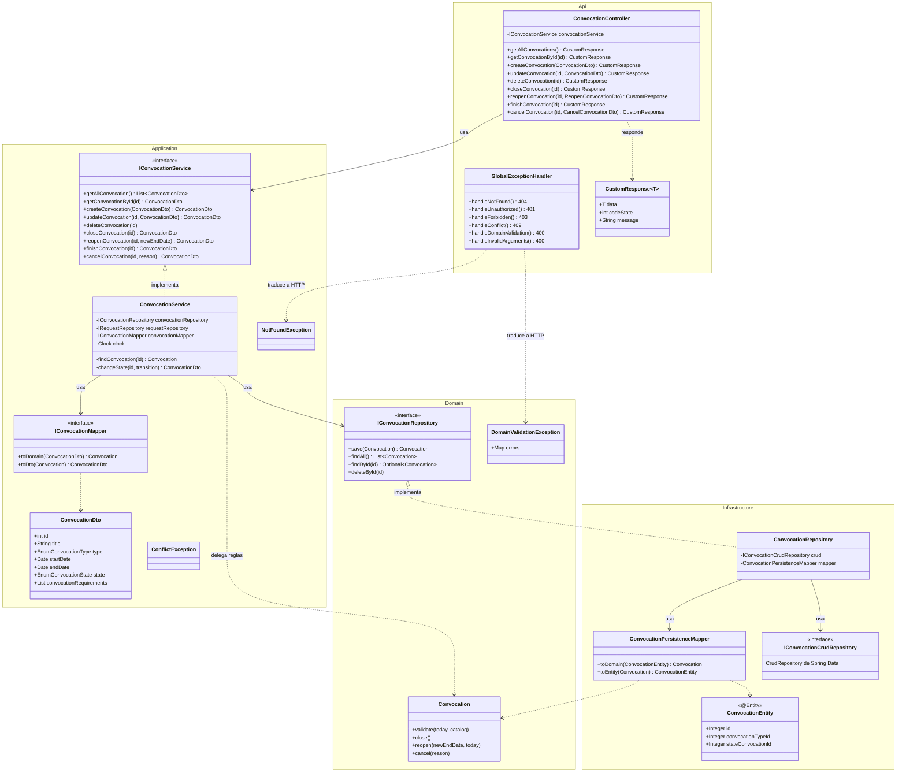
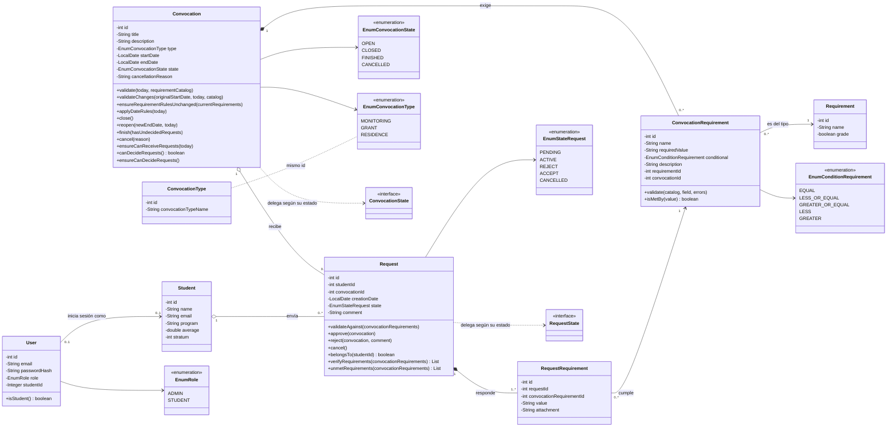
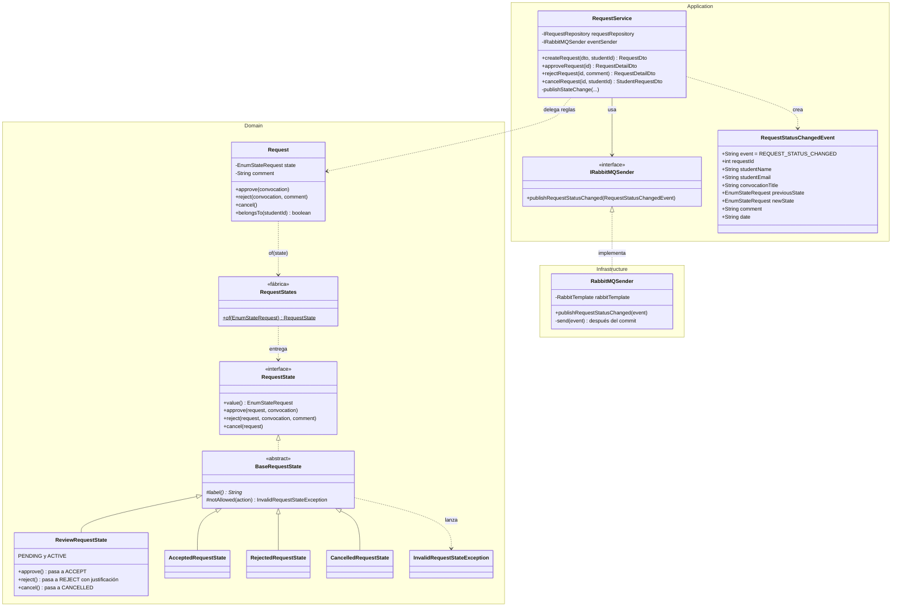
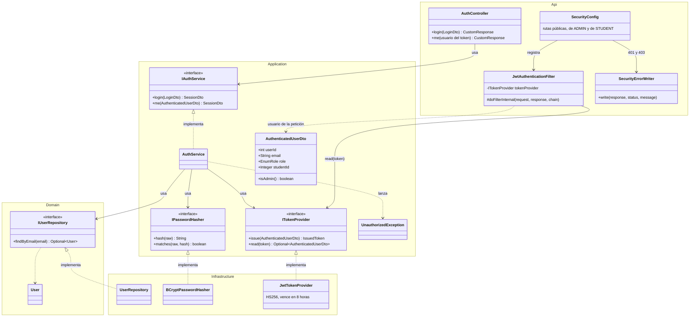

# Diagrama de clases

Este documento muestra cómo están organizadas las clases del backend. Está partido en varios diagramas, porque uno solo con las más de 130 clases no se podría leer:

1. **[Por capas](#1-clases-por-capas-convocatoria):** el recorrido de la convocatoria por las cuatro capas, para ver hacia dónde apuntan las dependencias.
2. **[Modelo de dominio](#2-modelo-de-dominio):** las entidades del negocio, los usuarios y cómo se relacionan.
3. **[Solicitudes: estados y eventos](#3-solicitudes-estados-y-eventos):** el patrón State de la solicitud y el evento que se publica en RabbitMQ.
4. **[Seguridad](#4-seguridad-login-y-jwt):** el login y el token JWT con puertos y adaptadores.
5. **[Patrón State de la convocatoria](#5-patrón-state-de-la-convocatoria):** está en [estados-convocatoria.md](estados-convocatoria.md#implementación-patrón-state), aquí solo se resume.

Las clases de solicitudes (`Request`) y estudiantes (`Student`) siguen exactamente la misma estructura que las de convocatoria: controlador, interfaz de servicio, servicio, mapper de DTO, interfaz de repositorio, repositorio, mapper de persistencia, CRUD de Spring Data y entidad JPA.

## 1. Clases por capas (convocatoria)

### Cómo leerlo

- Las flechas de **uso** (`-->`) siempre bajan hacia el dominio: el controlador usa la interfaz del servicio, el servicio usa la interfaz del repositorio. Ninguna clase del dominio usa algo de las otras capas.
- La única flecha que "sube" es la de **implementación** (`<|..`): `ConvocationRepository`, que está en Infrastructure, implementa `IConvocationRepository`, que está en Domain. Esa es la inversión de dependencias: el dominio define qué necesita y la infraestructura se adapta.
- Hay **tres representaciones** de una convocatoria y cada una vive en su capa: `ConvocationDto` (lo que viaja por HTTP), `Convocation` (las reglas del negocio) y `ConvocationEntity` (la tabla de SQL Server). Los mappers convierten entre ellas, así que un cambio en la tabla no toca el dominio ni el JSON.
- Las excepciones también están separadas: el dominio lanza `DomainValidationException` sin saber nada de HTTP, y `GlobalExceptionHandler`, en la capa Api, decide que eso es un 400.

## 2. Modelo de dominio

### Qué representa cada clase

| Clase | Qué es | Reglas que tiene |
|---|---|---|
| `Convocation` | Una convocatoria publicada por el administrador (monitoría, beca o residencia). | Fechas válidas, requisitos válidos, no cambiar las reglas si ya hay solicitudes, y todo lo que depende del estado (lo resuelve el patrón State). |
| `ConvocationRequirement` | Un requisito concreto de una convocatoria, por ejemplo "Promedio mayor o igual a 4.0". | El tipo de requisito debe existir, el valor debe ser mayor a 0 y, si es una nota, numérico y no mayor a 5.0. `isMetBy` compara el valor del estudiante con la condición: como número si los dos son números y, si no, solo `EQUAL` como texto sin mayúsculas. |
| `Requirement` | El catálogo de tipos de requisito (Promedio, Estrato, Semestres...). | `grade` indica si el valor es una nota de 0 a 5. |
| `ConvocationType` | El catálogo de tipos de convocatoria que viene de la base de datos. | Su id coincide con `EnumConvocationType`. |
| `Student` | El estudiante que se postula. | Por ahora solo datos. |
| `User` | Alguien que puede iniciar sesión: el administrador o un estudiante. | La contraseña solo se guarda como hash. Un `STUDENT` está ligado a su `Student`; el `ADMIN` no. |
| `Request` | La solicitud de un estudiante a una convocatoria. | Debe responder todos los requisitos de la convocatoria, sin repetir ni agregar requisitos ajenos. Al crearla queda `ACTIVE` si cumple todos o `PENDING` si no; nunca se rechaza automáticamente. |
| `RequestRequirement` | El valor que el estudiante entrega para un requisito, con su adjunto opcional. | — |

Las relaciones entre entidades se guardan por id (`convocationId`, `studentId`) y no como objetos anidados de JPA. Así el dominio no depende de cómo se cargan los datos, y cada servicio decide qué necesita consultar. Cómo queda eso en las tablas está en el [diagrama entidad-relación](diagrama-entidad-relacion.md).

## 3. Solicitudes: estados y eventos

La solicitud usa el mismo patrón State que la convocatoria, más simple: `PENDING` y `ACTIVE` se comportan igual (las dos esperan la decisión del administrador), así que comparten una sola clase, `ReviewRequestState`. Cada cambio de estado publica un evento a través de un puerto de Application, y RabbitMQ queda en Infrastructure.

- **Template Method:** `BaseRequestState` responde *"No se puede aprobar una solicitud aprobada"* para cualquier acción que el estado no permite; cada estado solo dice su nombre con `label()`. Los estados finales (`Accepted`, `Rejected`, `Cancelled`) no sobrescriben ninguna acción.
- **Adaptador:** `RequestService` solo conoce `IRabbitMQSender`. `RabbitMQSender` registra el envío para después del commit, así el estudiante nunca recibe un correo de un cambio que se deshizo.

## 4. Seguridad: login y JWT

`AuthService` no sabe de BCrypt, de JWT ni de Spring Security: usa tres puertos y la infraestructura los implementa. El filtro y la configuración de Spring Security están en la capa Api, porque son la puerta de entrada HTTP.

`IUserRepository` está en Domain porque `User` es una entidad del negocio. `IPasswordHasher` e `ITokenProvider` están en Application porque no son reglas del negocio sino herramientas que el caso de uso necesita. Las dos son la misma idea: la capa de adentro define la interfaz y Infrastructure la implementa.

## 5. Patrón State de la convocatoria

Las reglas que cambian según el estado de la convocatoria (qué se puede editar, cuándo se cierra, cuándo recibe solicitudes) no están en `if` dentro de los servicios. Cada estado es una clase (`OpenState`, `ClosedState`, `FinishedState`, `CancelledState`) que hereda de `BaseConvocationState` e implementa `ConvocationState`. `Convocation` le pregunta a su estado actual qué hacer. El diagrama completo y la explicación están en [estados-convocatoria.md](estados-convocatoria.md#implementación-patrón-state).

## Otros diagramas

- [Secuencia por capas](diagrama-secuencia.md): los seis casos de uso, con la capa Domain separada.
- [Estados de la convocatoria](estados-convocatoria.md): ciclo de vida y el patrón State completo.
- [Entidad-relación](diagrama-entidad-relacion.md): las tablas de SQL Server.
- [Despliegue](diagrama-despliegue.md): los contenedores del Docker Compose.
