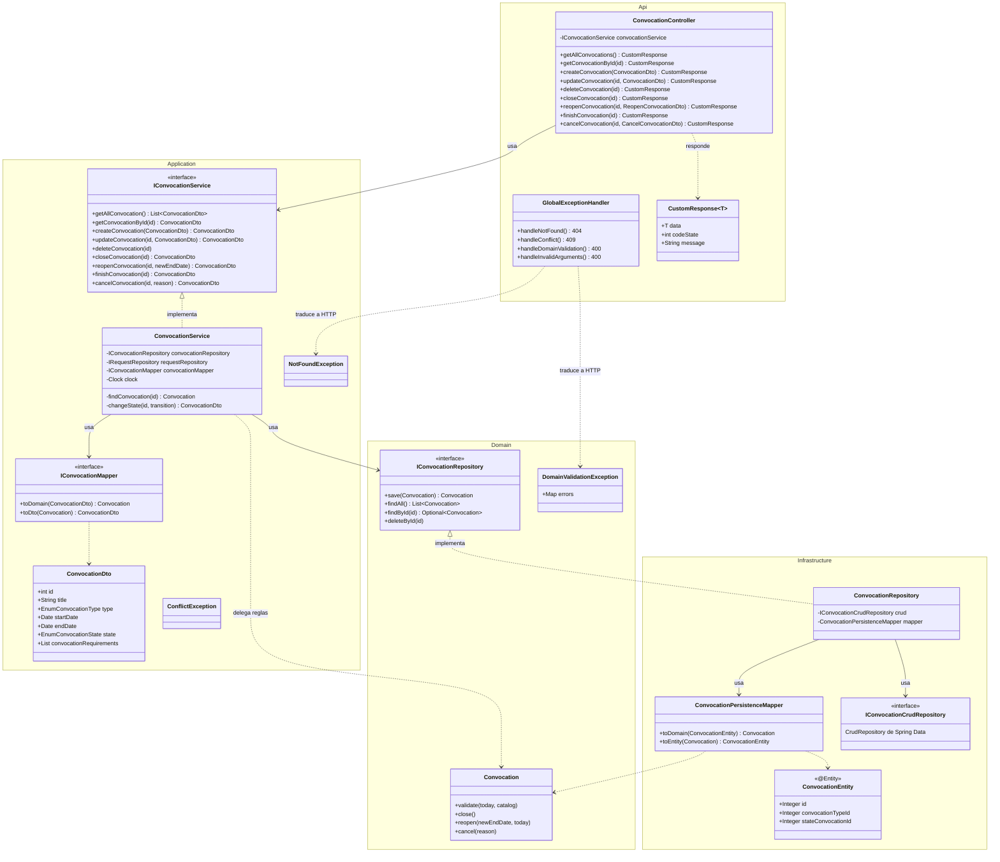
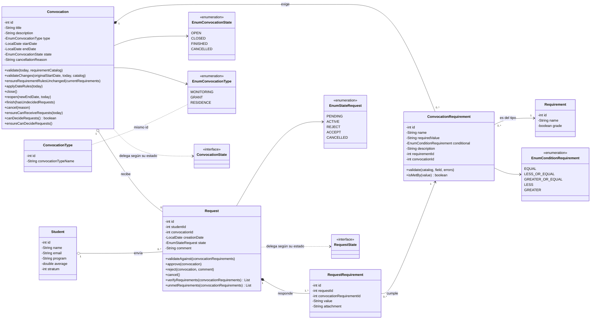

# Diagrama de clases

Este documento muestra cómo están organizadas las clases del backend. Tiene tres diagramas, porque uno solo con las 80 clases no se podría leer:

1. **Por capas:** el recorrido de la convocatoria por las cuatro capas, para ver hacia dónde apuntan las dependencias.
2. **Modelo de dominio:** las entidades del negocio y cómo se relacionan.
3. **Patrón State:** está en [estados-convocatoria.md](estados-convocatoria.md#implementación-patrón-state), aquí solo se resume.

Las clases de solicitudes (`Request`) y estudiantes (`Student`) siguen exactamente la misma estructura que las de convocatoria: controlador, interfaz de servicio, servicio, mapper de DTO, interfaz de repositorio, repositorio, mapper de persistencia, CRUD de Spring Data y entidad JPA.

## 1. Clases por capas (convocatoria)

### Cómo leerlo

- Las flechas de **uso** (`-->`) siempre bajan hacia el dominio: el controlador usa la interfaz del servicio, el servicio usa la interfaz del repositorio. Ninguna clase del dominio usa algo de las otras capas.
- La única flecha que "sube" es la de **implementación** (`<|..`): `ConvocationRepository`, que está en Infrastructure, implementa `IConvocationRepository`, que está en Domain. Esa es la inversión de dependencias: el dominio define qué necesita y la infraestructura se adapta.
- Hay **tres representaciones** de una convocatoria y cada una vive en su capa: `ConvocationDto` (lo que viaja por HTTP), `Convocation` (las reglas del negocio) y `ConvocationEntity` (la tabla de SQL Server). Los mappers convierten entre ellas, así que un cambio en la tabla no toca el dominio ni el JSON.
- Las excepciones también están separadas: el dominio lanza `DomainValidationException` sin saber nada de HTTP, y `GlobalExceptionHandler`, en la capa Api, decide que eso es un 400.

## 2. Modelo de dominio

### Qué representa cada clase

| Clase | Qué es | Reglas que tiene |
|---|---|---|
| `Convocation` | Una convocatoria publicada por el administrador (monitoría, beca o residencia). | Fechas válidas, requisitos válidos, no cambiar las reglas si ya hay solicitudes, y todo lo que depende del estado (lo resuelve el patrón State). |
| `ConvocationRequirement` | Un requisito concreto de una convocatoria, por ejemplo "Promedio mayor o igual a 4.0". | El tipo de requisito debe existir, el valor debe ser mayor a 0 y, si es una nota, numérico y no mayor a 5.0. `isMetBy` compara el valor del estudiante con la condición: como número si los dos son números y, si no, solo `EQUAL` como texto sin mayúsculas. |
| `Requirement` | El catálogo de tipos de requisito (Promedio, Estrato, Semestres...). | `grade` indica si el valor es una nota de 0 a 5. |
| `ConvocationType` | El catálogo de tipos de convocatoria que viene de la base de datos. | Su id coincide con `EnumConvocationType`. |
| `Student` | El estudiante que se postula. | Por ahora solo datos. |
| `Request` | La solicitud de un estudiante a una convocatoria. | Debe responder todos los requisitos de la convocatoria, sin repetir ni agregar requisitos ajenos. Al crearla queda `ACTIVE` si cumple todos o `PENDING` si no; nunca se rechaza automáticamente. |
| `RequestRequirement` | El valor que el estudiante entrega para un requisito, con su adjunto opcional. | — |

Las relaciones entre entidades se guardan por id (`convocationId`, `studentId`) y no como objetos anidados de JPA. Así el dominio no depende de cómo se cargan los datos, y cada servicio decide qué necesita consultar.

## 3. Patrón State

Las reglas que cambian según el estado de la convocatoria (qué se puede editar, cuándo se cierra, cuándo recibe solicitudes) no están en `if` dentro de los servicios. Cada estado es una clase (`OpenState`, `ClosedState`, `FinishedState`, `CancelledState`) que hereda de `BaseConvocationState` e implementa `ConvocationState`. `Convocation` le pregunta a su estado actual qué hacer. El diagrama completo y la explicación están en [estados-convocatoria.md](estados-convocatoria.md#implementación-patrón-state).

## Cómo quedará al terminar el backlog

Las clases nuevas siguen el mismo molde, así que el diagrama por capas no cambia de forma, solo crece:

| Issue | Qué agrega | Capa |
|---|---|---|
| [#16](https://github.com/SemilleroSOLID/clean-architecture-api/issues/16), [#18](https://github.com/SemilleroSOLID/clean-architecture-api/issues/18) | Consultas de solicitudes para el administrador y el historial del estudiante. | Application, Infrastructure |
| [#17](https://github.com/SemilleroSOLID/clean-architecture-api/issues/17), [#19](https://github.com/SemilleroSOLID/clean-architecture-api/issues/19) | Aprobar, rechazar y retirar solicitudes; los estados de la solicitud pueden usar el mismo patrón State. | Domain, Application |
| [#20](https://github.com/SemilleroSOLID/clean-architecture-api/issues/20) | Un puerto `INotificationPublisher` en Application implementado con RabbitMQ en Infrastructure, igual que hoy `IRabbitMQSender`. | Application, Infrastructure |
| [#22](https://github.com/SemilleroSOLID/clean-architecture-api/issues/22) | Seguridad con JWT y roles. Spring Security queda en Api e Infrastructure; el dominio no se entera de quién está autenticado. | Api, Infrastructure |
