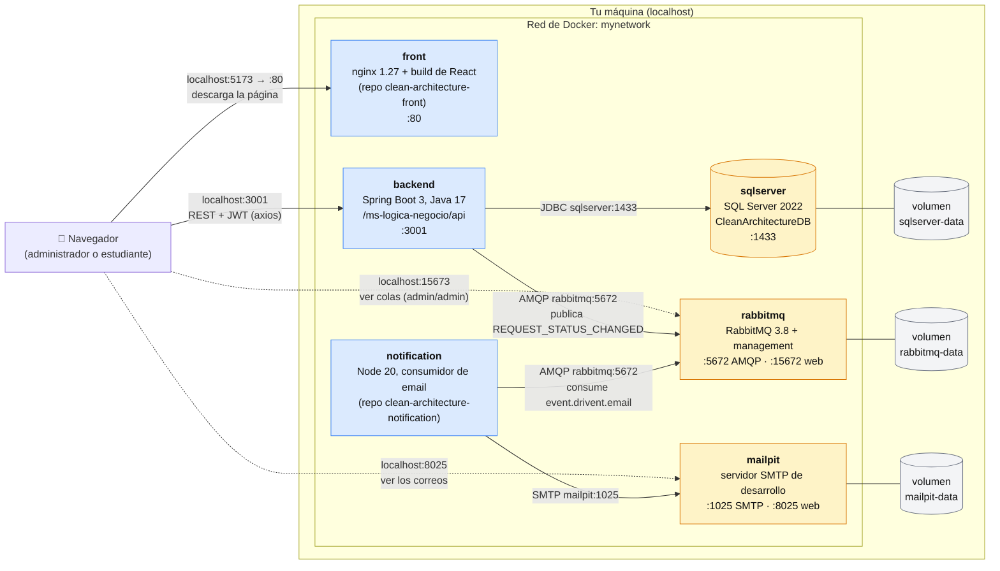

# Diagrama de despliegue

Cómo corre el sistema completo con el [`docker-compose.yml`](../docker-compose.yml) de este repositorio (`docker compose up -d --build`): seis contenedores en una misma red de Docker, tres volúmenes para que los datos sobrevivan y los puertos que quedan abiertos en tu máquina.

## Contenedores

| Servicio | Imagen | Puerto en tu máquina → contenedor | Espera a | Para qué |
|---|---|---|---|---|
| `sqlserver` | `sqlserver.Dockerfile` (SQL Server 2022 + `create-database.sql`) | `1435 → 1433` | — | La base `CleanArchitectureDB`. El script crea las tablas de catálogo y los usuarios de prueba solo cuando el volumen está vacío. |
| `rabbitmq` | `rabbitmq:3.8-management-alpine` | `5673 → 5672`, `15673 → 15672` | — | El broker de eventos. Usuario `admin` / `admin`. |
| `mailpit` | `axllent/mailpit:v1.21.8` | `1025 → 1025`, `8025 → 8025` | — | Atrapa los correos a los estudiantes y los muestra en la web; no envía nada a internet. |
| `backend` | `Dockerfile` de este repositorio | `3001 → 3001` | `sqlserver` y `rabbitmq` sanos | El api. Se conecta a los otros por nombre (`DB_HOST=sqlserver`, `RABBITMQ_HOST=rabbitmq`). |
| `notification` | `node/Dockerfile` del repo de notificaciones | — (no recibe conexiones) | `rabbitmq` sano | El consumidor de la cola `event.drivent.email`; reintenta cada correo y, si falla, lo deja en `event.drivent.email.failed`. Se reinicia solo si pierde RabbitMQ. |
| `front` | `Dockerfile` del repo del front (build de Vite servido por nginx) | `5173 → 80` | `backend` sano | La interfaz. |

## Cómo leerlo

- **Adentro de la red los contenedores se llaman por su nombre** (`sqlserver:1433`, `rabbitmq:5672`, `mailpit:1025`) y usan el puerto interno. Los puertos de la izquierda en la tabla (`1435`, `5673`...) son solo para entrar desde tu máquina, por ejemplo con un cliente de SQL. Son distintos de los estándar para no chocar con un SQL Server o un RabbitMQ que ya tengas instalado.
- **El navegador habla directo con el backend**, no a través de nginx: el front es una página estática y las peticiones de axios salen del navegador hacia `http://localhost:3001`. Por eso la dirección del api se fija al construir la imagen del front (`VITE_API_HOST`).
- **El backend y el consumidor nunca se hablan.** Solo comparten RabbitMQ: si `notification` está apagado, el backend sigue funcionando y los mensajes esperan en la cola.
- **Los volúmenes guardan los datos.** `docker compose down` borra los contenedores pero no los volúmenes; `docker compose down -v` sí los borra y la próxima vez la base arranca desde `create-database.sql`.
- **El orden de arranque lo dan los healthchecks**: el backend no arranca hasta que SQL Server responde y RabbitMQ acepta conexiones, y el front espera al backend.

Las pruebas de integración ([#25](https://github.com/SemilleroSOLID/clean-architecture-api/issues/25)) no usan este despliegue: levantan su propio SQL Server con la misma imagen y lo borran al terminar.
