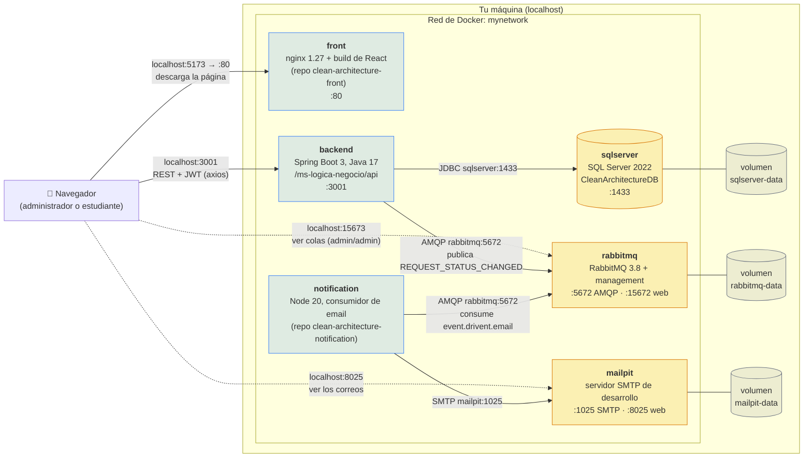

# Diagrama de despliegue

Un diagrama de despliegue responde a la pregunta *¿dónde corre cada cosa?* Este muestra lo que levanta el [`docker-compose.yml`](../docker-compose.yml) con `docker compose up -d --build`: seis contenedores en una red de Docker, tres volúmenes para guardar los datos y los puertos que quedan abiertos en tu máquina.

## Los contenedores

| Servicio | Imagen | Puerto en tu máquina → contenedor | Arranca después de | Qué hace |
|---|---|---|---|---|
| `sqlserver` | `sqlserver.Dockerfile` (SQL Server 2022 con `create-database.sql`) | `1435 → 1433` | — | Guarda la base `CleanArchitectureDB`. El script de creación solo corre si el volumen está vacío. |
| `rabbitmq` | `rabbitmq:3.8-management-alpine` | `5673 → 5672`, `15673 → 15672` | — | Recibe los eventos del backend. Usuario `admin`, contraseña `admin`. |
| `mailpit` | `axllent/mailpit:v1.21.8` | `1025 → 1025`, `8025 → 8025` | — | Atrapa los correos para verlos en el navegador. No envía nada a internet. |
| `backend` | `Dockerfile` de este repositorio | `3001 → 3001` | `sqlserver` y `rabbitmq` | El api en Spring Boot. |
| `notification` | `node/Dockerfile` del repo de notificaciones | ninguno | `rabbitmq` | Lee la cola `event.drivent.email` y envía los correos. Si un correo falla varias veces, lo deja en `event.drivent.email.failed`. |
| `front` | `Dockerfile` del repo del front | `5173 → 80` | `backend` | La interfaz, servida por nginx. |

## Cómo leerlo

**Dentro de la red los contenedores se buscan por nombre.** El backend no se conecta a `localhost:1435` sino a `sqlserver:1433`, porque ahí "sqlserver" funciona como un nombre de máquina. Los puertos de la izquierda en la tabla (`1435`, `5673`...) solo sirven para entrar desde tu computador, por ejemplo con un cliente de SQL. Se eligieron distintos a los normales para que no choquen con un SQL Server o un RabbitMQ que ya tengas instalado.

**El navegador le habla directo al backend.** nginx entrega la página, pero las peticiones de axios salen desde tu navegador hacia `localhost:3001`. Por eso la dirección del api se fija al construir la imagen del front (`VITE_API_HOST`).

**El backend y el servicio de notificaciones no se conocen.** Solo comparten RabbitMQ. Puedes apagar `notification` y el sistema sigue funcionando: los mensajes esperan en la cola hasta que vuelva.

**Los datos viven en los volúmenes.** `docker compose down` borra los contenedores pero conserva los volúmenes. `docker compose down -v` borra también los volúmenes, y la próxima vez la base arranca de nuevo desde `create-database.sql`.

El orden de arranque lo controlan los *healthchecks*: el backend espera a que SQL Server responda y RabbitMQ acepte conexiones, y el front espera al backend.

Las pruebas de integración ([#25](https://github.com/SemilleroSOLID/clean-architecture-api/issues/25)) no usan este despliegue. Levantan su propio SQL Server con la misma imagen y lo borran al terminar.
