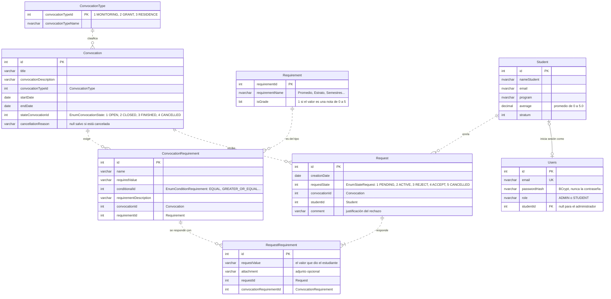

# Diagrama entidad-relación

El diagrama entidad-relación muestra cómo están guardados los datos: qué tablas hay, qué columnas tiene cada una y cómo se relacionan. Las tablas de `CleanArchitectureDB` se crean en dos momentos:

- [`create-database.sql`](../create-database.sql) crea los catálogos y los datos de prueba: `Requirement`, `Student`, `ConvocationType` y `Users`.
- Hibernate crea el resto al arrancar el backend (`spring.jpa.hibernate.ddl-auto=update`), a partir de las entidades JPA de `Infrastructure/Persistence/Entities`: `Convocation`, `ConvocationRequirement`, `Request` y `RequestRequirement`.

## Cómo leerlo

Hay dos tipos de línea y la diferencia importa.

La **línea continua** es una llave foránea de verdad: SQL Server no deja guardar un valor que no exista en la otra tabla. Solo hay una, `Users.studentId → Student.id`. Además, `create-database.sql` le agrega una regla `CHECK`: un usuario `STUDENT` siempre tiene `studentId` y el `ADMIN` nunca.

La **línea punteada** es una relación que la base no conoce. Las tablas que crea Hibernate guardan el id de la otra tabla (`convocationId`, `studentId`...) sin `FOREIGN KEY`, porque las entidades JPA no usan `@ManyToOne`. El proyecto lo hace así a propósito, para que el dominio trabaje con ids y cada servicio decida qué cargar. El costo es que la integridad la tiene que cuidar el código. Por ejemplo, `RequestService` comprueba que existan el estudiante y la convocatoria antes de guardar una solicitud, y `ConvocationService` no deja borrar una convocatoria que ya tiene solicitudes.

Otros detalles que conviene notar:

- Los estados y las condiciones no tienen tabla. `stateConvocationId`, `requestState` y `conditionalId` guardan el número de un enum del dominio, y los mappers de persistencia hacen la conversión. `convocationTypeId` sí tiene tabla (`ConvocationType`), con los mismos ids que `EnumConvocationType`.
- La regla de una sola solicitud por estudiante en cada convocatoria tampoco está en la base. La aplica el servicio con `existsByStudentIdAndConvocationId`, que responde 409.

## Cardinalidades

| Relación | Cómo se lee |
|---|---|
| `ConvocationType` – `Convocation` | Un tipo puede tener muchas convocatorias. |
| `Convocation` – `ConvocationRequirement` | Una convocatoria tiene varios requisitos, y cada requisito pertenece a una sola. |
| `Requirement` – `ConvocationRequirement` | Un tipo del catálogo, como *Promedio*, se usa en muchos requisitos concretos, como *Promedio mayor o igual a 4.0*. |
| `Student` – `Request` – `Convocation` | Un estudiante puede tener muchas solicitudes, pero solo una por convocatoria. |
| `Request` – `RequestRequirement` | Una solicitud tiene una respuesta por cada requisito de su convocatoria. |
| `Student` – `Users` | Cada estudiante con acceso tiene un usuario. El administrador es un usuario sin estudiante. |

Para ver cómo se reflejan estas tablas en el código, compáralas con el [modelo de dominio](diagrama-clases.md#2-modelo-de-dominio): las entidades usan los mismos ids, y los mappers de persistencia pasan de una forma a la otra.
