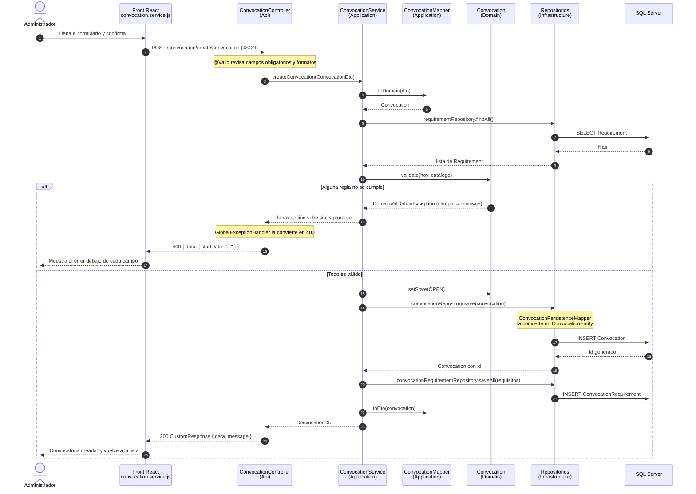
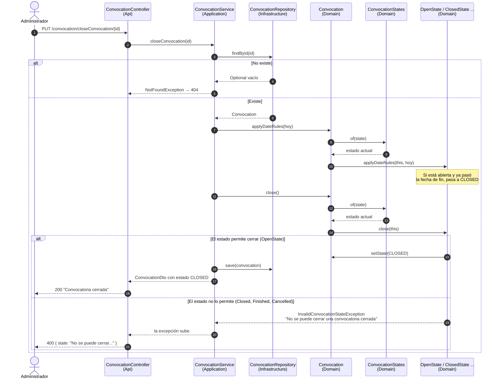
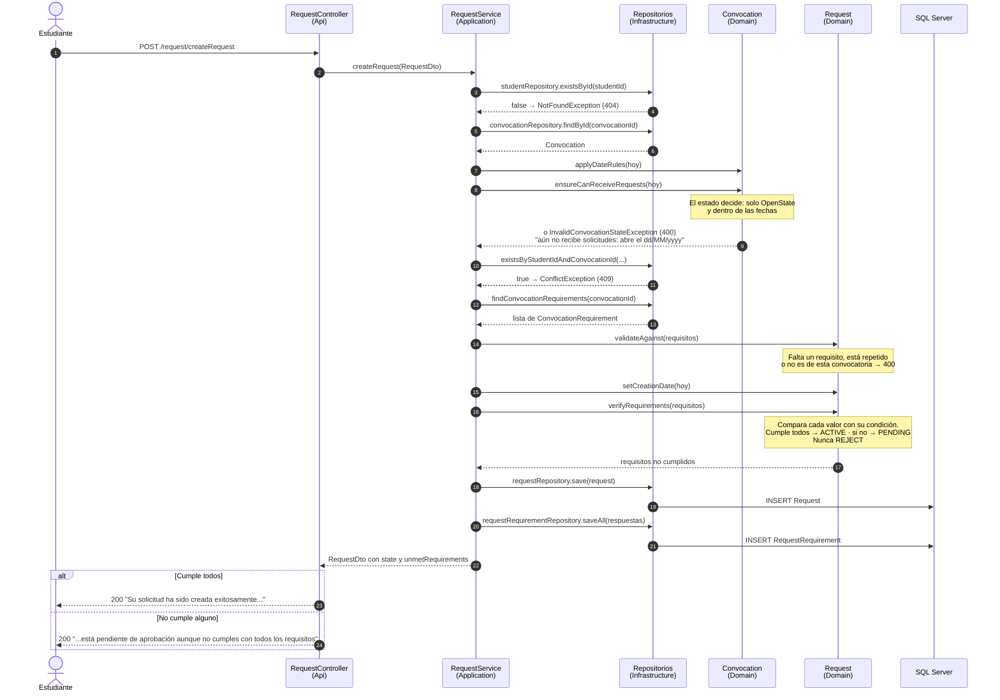
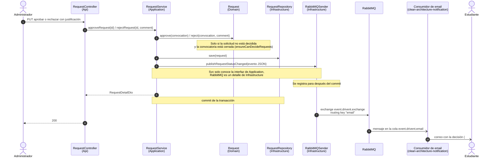

# Diagramas de secuencia

Estos diagramas muestran qué pasa, en orden, desde que el usuario hace clic en el front hasta que el dato queda guardado en SQL Server. Sirven para ver la arquitectura funcionando: cada petición entra por la capa Api, la capa Application coordina, el dominio decide si la operación es válida y la infraestructura guarda.

Los participantes tienen el nombre de la clase real y la capa a la que pertenece, para poder abrir el código mientras se lee el diagrama.

1. [Crear una convocatoria](#1-crear-una-convocatoria-cu-001) (CU-001)
2. [Cambiar el estado de una convocatoria](#2-cambiar-el-estado-de-una-convocatoria-patrón-state) (patrón State)
3. [Crear una solicitud](#3-crear-una-solicitud-cu-002) (CU-002)
4. [Aprobar una solicitud y notificar al estudiante](#4-aprobar-una-solicitud-y-notificar-al-estudiante) (eventos)

## 1. Crear una convocatoria (CU-001)

El administrador llena el formulario y lo envía. Hay dos niveles de validación: el formato de los campos lo revisa Bean Validation antes de entrar al servicio, y las reglas de negocio (fechas, requisitos) las revisa la entidad `Convocation`.

**Qué mostrar de aquí:** el controlador no tiene ninguna regla, solo recibe y responde. El servicio no sabe validar fechas, se lo pide a la entidad. Y el dominio no sabe que existe HTTP: lanza una excepción con un mapa de errores y es la capa Api la que decide que eso es un 400.

## 2. Cambiar el estado de una convocatoria (patrón State)

Ejemplo con *cerrar*. Reabrir, finalizar y cancelar siguen el mismo camino, porque todas pasan por el método privado `changeState` del servicio.

**Qué mostrar de aquí:** en `ConvocationService` no hay ningún `if (estado == ...)`. El servicio carga, delega y guarda. Quien decide si la acción es válida es el objeto del estado actual, y si mañana se agrega un estado nuevo, se crea su clase sin tocar el servicio.

## 3. Crear una solicitud (CU-002)

El estudiante se postula a una convocatoria con un valor para cada requisito. Las comprobaciones van de la más barata a la más costosa: primero que existan el estudiante y la convocatoria, después que la convocatoria esté recibiendo solicitudes, después que no haya una solicitud repetida y al final que las respuestas estén completas.

Las flechas que terminan en una excepción cortan el flujo: no se ejecuta nada de lo que sigue. Como todas las comprobaciones van antes del primer `INSERT`, una solicitud inválida nunca llega a la base de datos, y si algo falla al guardar los requisitos, `@Transactional` deshace también la solicitud.

## 4. Aprobar una solicitud y notificar al estudiante

Aprobar y rechazar ya está implementado ([#17](https://github.com/SemilleroSOLID/clean-architecture-api/issues/17)): `PUT /request/approveRequest/{id}` y `PUT /request/rejectRequest/{id}`, con la regla de la convocatoria cerrada resuelta por su patrón State (`ensureCanDecideRequests`). Desde [#20](https://github.com/SemilleroSOLID/clean-architecture-api/issues/20) cada cambio publica el evento `REQUEST_STATUS_CHANGED` (también al crear y al retirar); falta enviar el correo real ([#21](https://github.com/SemilleroSOLID/clean-architecture-api/issues/21)). Lo nuevo es la comunicación por eventos: el backend no envía el correo, publica un mensaje en RabbitMQ y el microservicio de notificaciones lo procesa por su cuenta.

El administrador recibe la respuesta sin esperar a que salga el correo. Si el servicio de notificaciones está caído, el mensaje queda en la cola y se envía cuando vuelva. Si el caído es RabbitMQ, la decisión se guarda igual y el backend registra en el log el evento que no pudo publicar. El mensaje completo está en el [README](../README.md#eventos-de-notificación).
