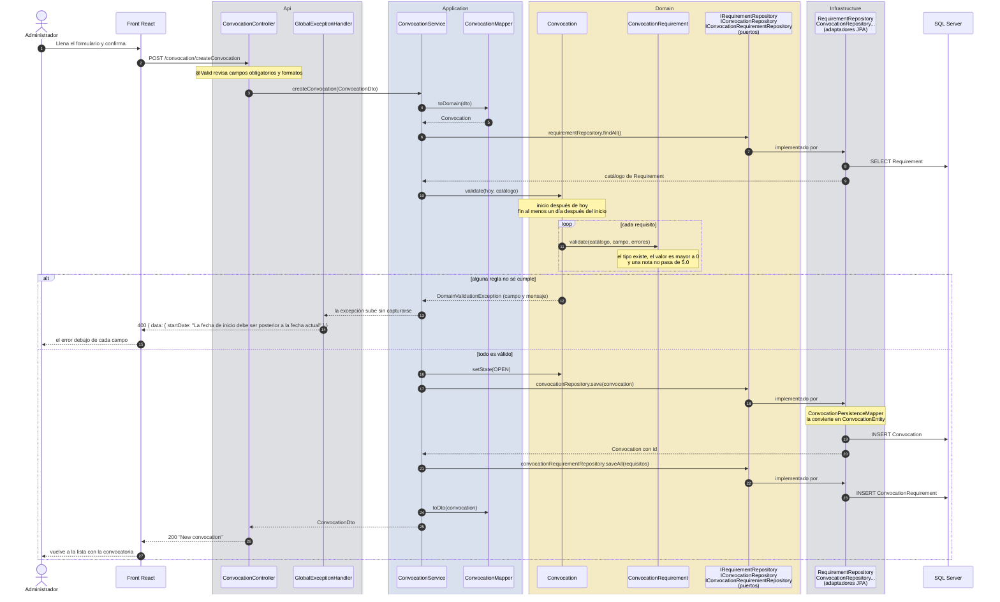
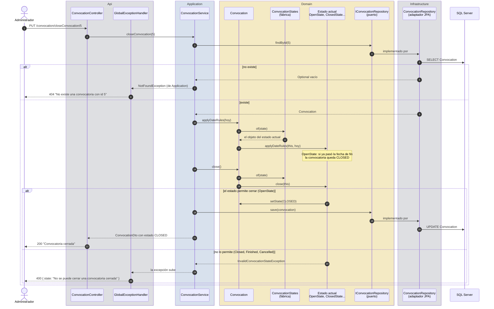
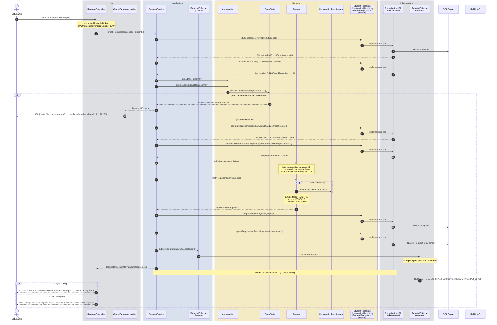
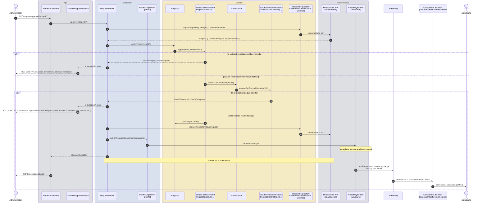
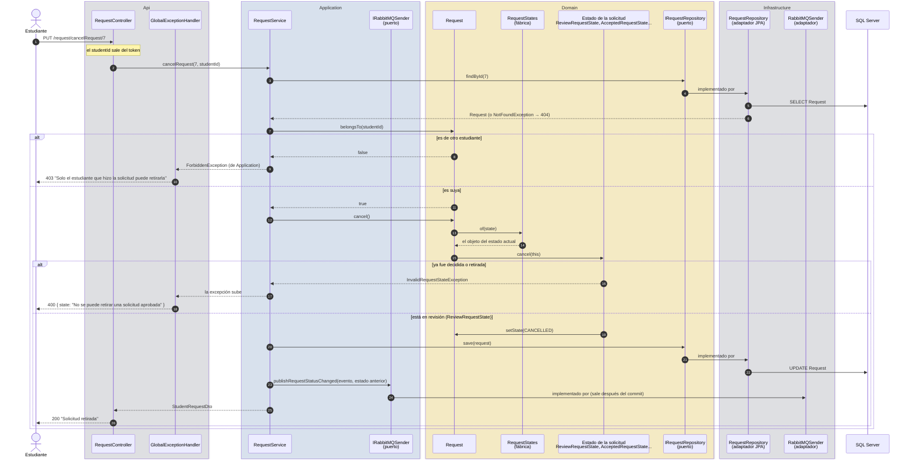
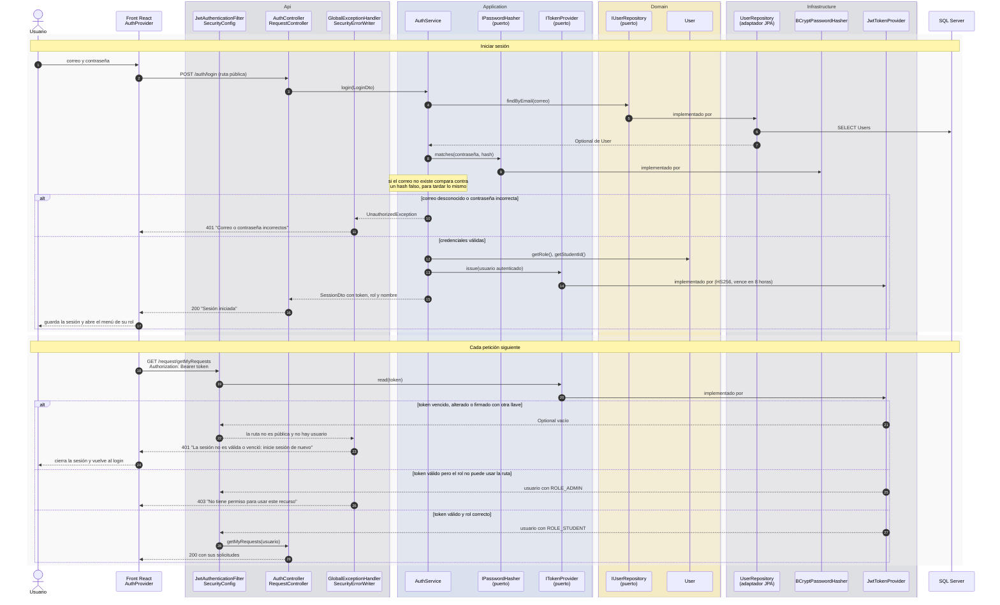

# Diagramas de secuencia

Estos diagramas muestran qué pasa, en orden, desde que el usuario hace clic en el front hasta que el dato queda guardado en SQL Server. Cada participante tiene el nombre de la clase real, para poder abrir el código mientras se lee, y está dentro de la caja de su capa:

| Caja | Qué hay adentro |
|---|---|
| **Api** (gris) | Controladores, filtro JWT y `GlobalExceptionHandler`: reciben HTTP y responden HTTP. |
| **Application** (azul) | Servicios y mappers: coordinan el caso de uso. También los puertos que no son del negocio (`IRabbitMQSender`, `IPasswordHasher`, `ITokenProvider`). |
| **Domain** (amarillo) | Entidades, objetos de estado (patrón State), puertos de los repositorios y excepciones del dominio. **Aquí están las reglas del negocio.** |
| **Infrastructure** (gris) | Adaptadores: repositorios JPA, publicador de RabbitMQ, BCrypt y JWT. |

SQL Server, RabbitMQ y el front quedan afuera de las cajas: son otros procesos.

Al leerlos, fíjate en dos cosas:

- **La caja Domain no llama a nadie que esté fuera de ella.** El servicio usa el puerto (`IConvocationRepository`, que es del dominio), y la implementación de Infrastructure se conecta por inyección de dependencias. Por eso las flechas hacia la base de datos salen del puerto con el texto *implementado por*.
- **Las reglas las decide el dominio y el error lo traduce la capa Api.** El dominio lanza `DomainValidationException` (o sus hijas `InvalidConvocationStateException` e `InvalidRequestStateException`) sin saber que existe HTTP, y `GlobalExceptionHandler` la convierte en un 400.

1. [Crear una convocatoria](#1-crear-una-convocatoria-cu-001) (CU-001)
2. [Cambiar el estado de una convocatoria](#2-cambiar-el-estado-de-una-convocatoria-patrón-state) (patrón State)
3. [Crear una solicitud](#3-crear-una-solicitud-cu-002) (CU-002)
4. [Aprobar o rechazar una solicitud](#4-aprobar-o-rechazar-una-solicitud) (patrón State y eventos)
5. [Retirar una solicitud](#5-retirar-una-solicitud)
6. [Iniciar sesión y usar el token](#6-iniciar-sesión-y-usar-el-token)

Para no repetir, los diagramas 1 a 5 suponen que la petición ya pasó la seguridad (el token es válido y el rol puede usar el endpoint). Cómo se revisa eso está en el [diagrama 6](#6-iniciar-sesión-y-usar-el-token).

## 1. Crear una convocatoria (CU-001)

El administrador llena el formulario y lo envía. Hay dos niveles de validación: el **formato** de los campos lo revisa Bean Validation (`@Valid`) en la capa Api antes de entrar al servicio, y las **reglas del negocio** (fechas y requisitos) las revisa la entidad `Convocation`, que a su vez le pide a cada `ConvocationRequirement` que se valide.

**Qué mostrar de aquí:** el controlador no tiene ninguna regla, solo recibe y responde. El servicio no sabe validar fechas, se lo pide a la entidad. Y como `validate` corre antes del primer `INSERT`, una convocatoria inválida nunca llega a la base; si fallara el segundo `INSERT`, `@Transactional` deshace también el primero.

## 2. Cambiar el estado de una convocatoria (patrón State)

Ejemplo con *cerrar*. Las cuatro acciones (cerrar, reabrir, finalizar y cancelar) pasan por el mismo método privado `changeState` del servicio: buscar, dejar que el estado aplique la transición y guardar.

Las otras tres acciones siguen el mismo camino; solo cambia qué revisa el estado:

| Acción | Endpoint | Qué decide el dominio | Error típico |
|---|---|---|---|
| Reabrir | `PUT /convocation/reopenConvocation/{id}` | Solo `ClosedState` la permite, con una nueva fecha de fin posterior a hoy. | *"La nueva fecha de fin debe ser posterior a la fecha actual"* |
| Finalizar | `PUT /convocation/finishConvocation/{id}` | Solo `ClosedState`, y sin solicitudes por decidir. El servicio pregunta antes `existsByConvocationIdAndStateIn(id, UNDECIDED)` y le pasa el resultado al dominio. | *"No se puede finalizar: hay solicitudes sin aprobar ni rechazar"* |
| Cancelar | `PUT /convocation/cancelConvocation/{id}` | `OpenState` y `ClosedState`, con justificación obligatoria. | *"La justificación de la cancelación es obligatoria"* |

**Qué mostrar de aquí:** en `ConvocationService` no hay ningún `if (estado == ...)`. El servicio carga, delega y guarda. Quien decide si la acción es válida es el objeto del estado actual, que entrega `ConvocationStates.of(...)` (una fábrica simple). Si mañana se agrega un estado, se crea su clase sin tocar el servicio.

## 3. Crear una solicitud (CU-002)

El estudiante se postula con un valor para cada requisito. Las comprobaciones van de la más barata a la más costosa: que existan el estudiante y la convocatoria, que la convocatoria esté recibiendo solicitudes, que no haya una solicitud repetida y, al final, que las respuestas estén completas. El estudiante sale del token, no del cuerpo de la petición.

Las flechas que terminan en una excepción cortan el flujo: no se ejecuta nada de lo que sigue. Como todas las comprobaciones van antes del primer `INSERT`, una solicitud inválida nunca llega a la base. Y como el evento sale **después del commit**, el estudiante nunca recibe un correo de una solicitud que no quedó guardada.

## 4. Aprobar o rechazar una solicitud

Cuando la convocatoria está cerrada, el administrador decide las solicitudes. La regla tiene dos partes y cada una vive en un objeto distinto del dominio: **la solicitud** debe estar en revisión (`ReviewRequestState`, que agrupa `PENDING` y `ACTIVE`) y **la convocatoria** debe estar cerrada (`ClosedState.ensureCanDecideRequests`). La solicitud le pregunta a la convocatoria; el servicio no revisa ninguna de las dos cosas.

**Rechazar** (`PUT /request/rejectRequest/{id}` con `{ "comment": "..." }`) sigue el mismo camino con `reject(convocation, comment)`. Además, la justificación es obligatoria dos veces: `@NotBlank` en `RejectRequestDto` (capa Api) y `ReviewRequestState.reject` en el dominio, que la guarda en `Request.comment` y pasa la solicitud a `REJECT`.

El administrador recibe la respuesta sin esperar a que salga el correo. Si el servicio de notificaciones está caído, el mensaje espera en la cola. Si el caído es RabbitMQ, la decisión se guarda igual y el backend registra en el log el evento que no pudo publicar. El detalle del mensaje está en el [README](../README.md#eventos-de-notificación).

## 5. Retirar una solicitud

El estudiante retira una solicitud mientras está en revisión. Hay dos reglas: que sea **su** solicitud (`Request.belongsTo`) y que el estado lo permita (`ReviewRequestState.cancel`). La solicitud no se borra: queda `CANCELLED` para el historial.

**Qué mostrar de aquí:** `belongsTo` es una pregunta al dominio ("¿esta solicitud es de este estudiante?"), pero la respuesta "no tienes permiso" es de Application (`ForbiddenException`), porque es una regla de acceso y no del negocio. Lo que sí es del negocio, que una solicitud aprobada ya no se puede retirar, lo decide el estado.

## 6. Iniciar sesión y usar el token

El login usa tres puertos: `IUserRepository` (del dominio, porque `User` es una entidad) e `IPasswordHasher` e `ITokenProvider` (de Application, porque son detalles técnicos que el caso de uso necesita). BCrypt y JWT quedan en Infrastructure, así que se podrían cambiar sin tocar `AuthService`.

En el login el dominio aporta la entidad `User` y su puerto, pero no lanza ninguna excepción: la regla *"correo o contraseña incorrectos"* es del caso de uso (`UnauthorizedException`, de Application). El mismo mensaje sirve para un correo que no existe y para una contraseña equivocada, así no se puede averiguar quién tiene cuenta.
