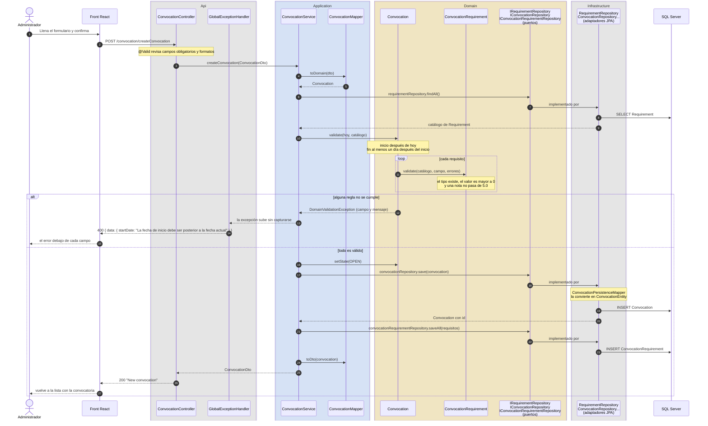
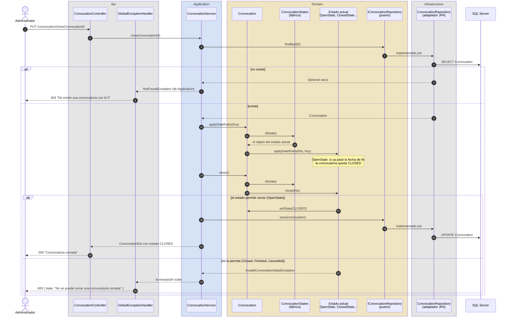
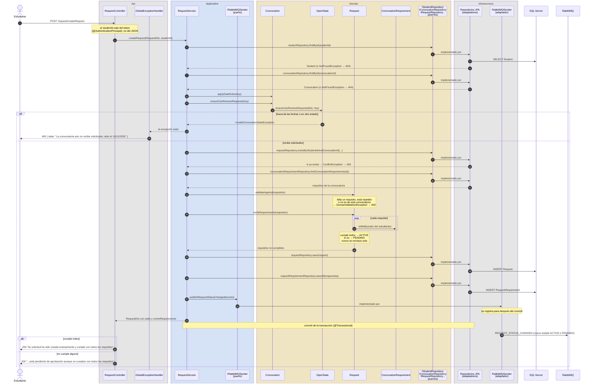
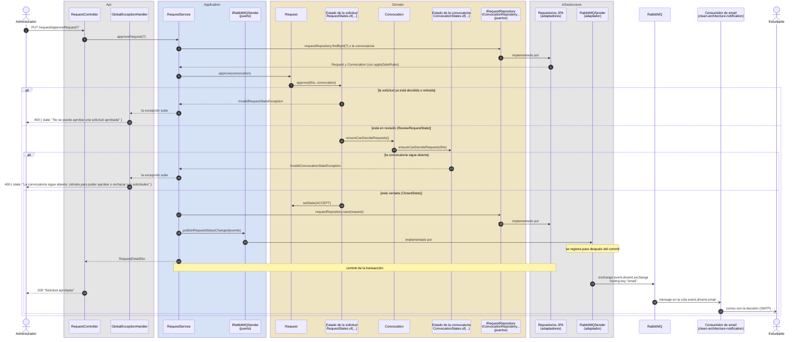
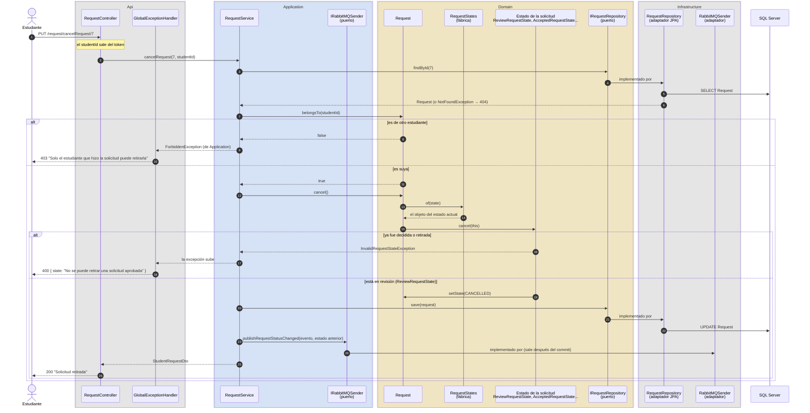
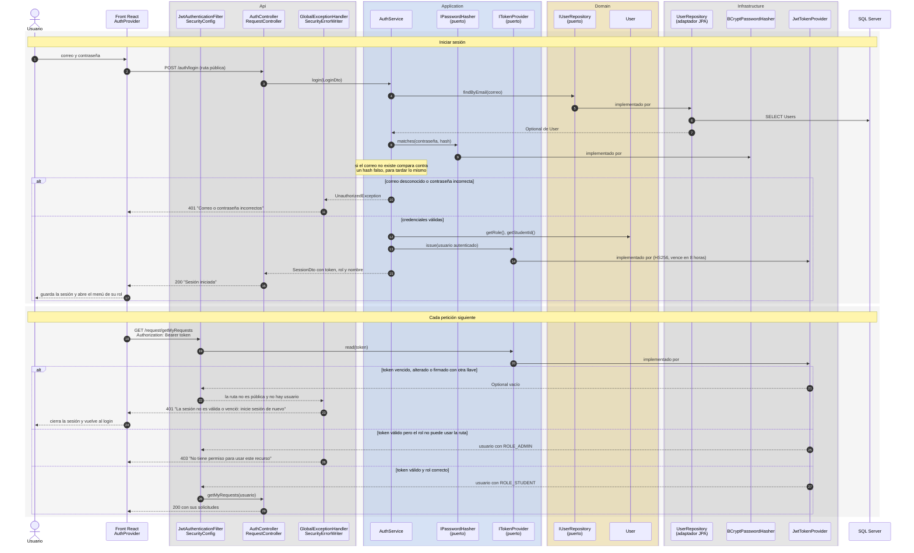

# Diagramas de secuencia

Un diagrama de secuencia se lee de arriba hacia abajo, como una conversación: cada flecha es una llamada de un objeto a otro y el número indica el orden. Aquí se usan para seguir una petición desde que el usuario hace clic hasta que el dato queda en SQL Server.

Los participantes están agrupados en cajas de color, una por capa de Clean Architecture:

| Caja | Qué contiene |
|---|---|
| Api (gris) | Controladores, el filtro JWT y `GlobalExceptionHandler`. Reciben HTTP y responden HTTP. |
| Application (azul) | Servicios y mappers, que coordinan el caso de uso. También los puertos técnicos: `IRabbitMQSender`, `IPasswordHasher` e `ITokenProvider`. |
| Domain (amarillo) | Entidades, objetos de estado, puertos de los repositorios y excepciones del negocio. Aquí se decide si algo está permitido. |
| Infrastructure (gris) | Los adaptadores: repositorios JPA, el publicador de RabbitMQ, BCrypt y JWT. |

SQL Server, RabbitMQ y el front quedan por fuera porque son otros procesos.

**Qué observar en todos.** La caja Domain nunca llama a algo que esté fuera de ella. Cuando el servicio necesita la base de datos le habla al puerto (por ejemplo `IConvocationRepository`), que pertenece al dominio, y es Spring quien conecta ese puerto con su implementación en Infrastructure. Por eso verás la flecha *implementado por* entre el puerto y el repositorio JPA. Lo mismo pasa con los errores: el dominio lanza una excepción sin saber nada de HTTP y es `GlobalExceptionHandler`, en la capa Api, quien la convierte en un 400.

Los diagramas son seis:

1. [Crear una convocatoria](#1-crear-una-convocatoria-cu-001)
2. [Cambiar el estado de una convocatoria](#2-cambiar-el-estado-de-una-convocatoria-patrón-state)
3. [Crear una solicitud](#3-crear-una-solicitud-cu-002)
4. [Aprobar o rechazar una solicitud](#4-aprobar-o-rechazar-una-solicitud)
5. [Retirar una solicitud](#5-retirar-una-solicitud)
6. [Iniciar sesión y usar el token](#6-iniciar-sesión-y-usar-el-token)

Del 1 al 5 se supone que la petición ya pasó la seguridad. El [diagrama 6](#6-iniciar-sesión-y-usar-el-token) muestra cómo se revisa el token.

## 1. Crear una convocatoria (CU-001)

El administrador envía el formulario. Hay dos validaciones distintas y conviene no confundirlas: `@Valid` revisa el formato de los campos en la capa Api (que el título no esté vacío, por ejemplo), y la entidad `Convocation` revisa las reglas del negocio (que las fechas tengan sentido y que los requisitos existan).

Fíjate en que el controlador no valida nada por su cuenta y que el servicio tampoco sabe validar fechas: se lo pide a la entidad. Como `validate` se ejecuta antes del primer `INSERT`, una convocatoria inválida nunca llega a la base. Y si fallara el segundo `INSERT`, `@Transactional` deshace también el primero.

## 2. Cambiar el estado de una convocatoria (patrón State)

El ejemplo es cerrar, pero reabrir, finalizar y cancelar recorren el mismo camino porque todas pasan por el método `changeState` del servicio: busca la convocatoria, deja que su estado aplique la acción y guarda.

Lo que cambia entre las cuatro acciones es solo lo que revisa el estado:

| Acción | Endpoint | Qué revisa el dominio | Error si no se cumple |
|---|---|---|---|
| Reabrir | `PUT /convocation/reopenConvocation/{id}` | Solo una convocatoria cerrada se reabre, y con una fecha de fin posterior a hoy. | *"La nueva fecha de fin debe ser posterior a la fecha actual"* |
| Finalizar | `PUT /convocation/finishConvocation/{id}` | Tiene que estar cerrada y sin solicitudes por decidir. El servicio consulta eso antes y le pasa el resultado al dominio. | *"No se puede finalizar: hay solicitudes sin aprobar ni rechazar"* |
| Cancelar | `PUT /convocation/cancelConvocation/{id}` | Abierta o cerrada, siempre con justificación. | *"La justificación de la cancelación es obligatoria"* |

Busca en `ConvocationService` un `if` que pregunte por el estado: no hay ninguno. Quien decide es el objeto que entrega `ConvocationStates.of(...)`. Si mañana apareciera un estado nuevo, se crearía su clase y el servicio quedaría igual.

## 3. Crear una solicitud (CU-002)

El estudiante se postula dando un valor para cada requisito. Las comprobaciones van de la más barata a la más costosa: primero que existan el estudiante y la convocatoria, luego que la convocatoria esté recibiendo solicitudes, después que no haya una solicitud repetida y por último que las respuestas estén completas. El id del estudiante sale del token y no del JSON, así nadie puede postularse a nombre de otro.

Cada flecha que termina en una excepción corta el flujo y lo que sigue ya no se ejecuta. El evento para el correo se registra antes de responder, pero sale después del commit, de modo que el estudiante nunca recibe un correo de una solicitud que no se guardó.

## 4. Aprobar o rechazar una solicitud

Para decidir una solicitud se deben cumplir dos condiciones y cada una la revisa un objeto distinto. La solicitud tiene que estar en revisión, y eso lo sabe su estado (`ReviewRequestState`, compartido por `PENDING` y `ACTIVE`). La convocatoria tiene que estar cerrada, y eso lo sabe el estado de la convocatoria. La solicitud le pregunta a la convocatoria y el servicio no revisa ninguna de las dos.

Rechazar funciona igual, con `reject(convocation, comment)`. La justificación se exige dos veces: `@NotBlank` en `RejectRequestDto` y otra vez en `ReviewRequestState.reject`, que la guarda en `Request.comment`.

El administrador recibe su respuesta sin esperar el correo. Si el servicio de notificaciones está apagado, el mensaje espera en la cola; si el apagado es RabbitMQ, la decisión se guarda de todas formas y el backend deja el evento perdido en el log. El formato del mensaje está en el [README](../README.md#eventos-de-notificación).

## 5. Retirar una solicitud

El estudiante puede retirar una solicitud mientras sigue en revisión. Aquí hay dos reglas de naturaleza distinta: que la solicitud sea suya y que su estado lo permita.

Vale la pena comparar los dos errores. `belongsTo` es una pregunta al dominio, pero el "no tienes permiso" lo lanza Application (`ForbiddenException`, 403) porque es una regla de acceso. En cambio, que una solicitud aprobada ya no se pueda retirar es una regla del negocio, y por eso la decide el estado. La solicitud retirada no se borra: queda `CANCELLED` para el historial.

## 6. Iniciar sesión y usar el token

El login usa tres puertos. `IUserRepository` está en Domain porque `User` es una entidad. `IPasswordHasher` e `ITokenProvider` están en Application porque son herramientas técnicas que el caso de uso necesita, no reglas del negocio. BCrypt y JWT viven en Infrastructure y se podrían cambiar sin tocar `AuthService`.

En este caso el dominio no lanza ninguna excepción. Comprobar las credenciales es trabajo del caso de uso, y el error es `UnauthorizedException`, de Application. El mensaje es el mismo para un correo que no existe y para una contraseña equivocada, así nadie puede averiguar quién tiene cuenta probando correos.
