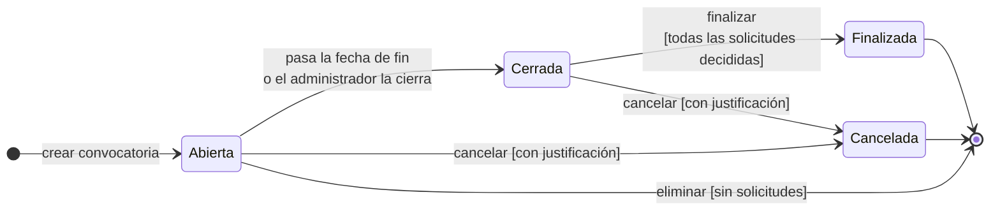
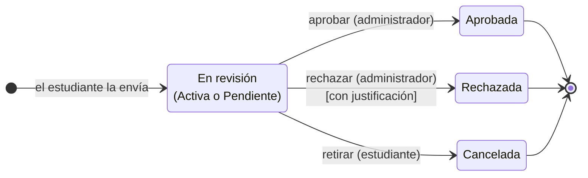

# Estados de una convocatoria

Propuesta del ciclo de vida de una convocatoria (issue [#30](https://github.com/SemilleroSOLID/clean-architecture-api/issues/30)). Sirve para definir qué estados existen, qué evento hace pasar de uno a otro y qué se puede hacer en cada uno, antes de cambiar el código. Es la base para evaluar el patrón State ([#31](https://github.com/SemilleroSOLID/clean-architecture-api/issues/31)).

**Estado:** propuesta en revisión con la profesora.

## Lo que ya está decidido

- Una convocatoria nueva queda en estado **Abierta** (aprobado por la profesora, ver [#7](https://github.com/SemilleroSOLID/clean-architecture-api/issues/7)).
- El sistema no rechaza solicitudes automáticamente: las que no cumplen quedan pendientes y las decide el administrador ([#14](https://github.com/SemilleroSOLID/clean-architecture-api/issues/14), [#17](https://github.com/SemilleroSOLID/clean-architecture-api/issues/17)).
- Una convocatoria con solicitudes no se elimina; ese caso se resuelve cancelándola ([#10](https://github.com/SemilleroSOLID/clean-architecture-api/issues/10)).
- Hoy el código solo tiene `OPEN` y `CLOSED`, y nada cambia el estado después de crear la convocatoria.

## Diagrama

## Estados

| Estado | Significado |
|---|---|
| **Abierta** (`OPEN`) | Estado inicial. Publicada y vigente; recibe solicitudes solo mientras la fecha actual está entre la fecha de inicio y la de fin. |
| **Cerrada** (`CLOSED`) | Ya no recibe solicitudes. El administrador revisa y decide las solicitudes que llegaron. |
| **Finalizada** (`FINISHED`, nuevo) | Todas las solicitudes fueron aprobadas o rechazadas. Queda solo para consulta. |
| **Cancelada** (`CANCELLED`, nuevo) | Se suspendió antes de terminar el proceso, con una justificación. Reemplaza la eliminación cuando ya hay solicitudes. Queda solo para consulta. |

## Transiciones

| Desde | Hacia | Evento | Quién | Condición | Efecto |
|---|---|---|---|---|---|
| (inicio) | Abierta | Crear convocatoria | Administrador | Validaciones del CU-001 | — |
| Abierta | Cerrada | Pasa la fecha de fin | Sistema | Fecha actual > fecha de fin | Deja de recibir solicitudes |
| Abierta | Cerrada | Cerrar anticipadamente | Administrador | — | Deja de recibir solicitudes |
| Cerrada | Finalizada | Finalizar | Administrador | Ninguna solicitud pendiente ni activa | Queda solo para consulta |
| Abierta / Cerrada | Cancelada | Cancelar | Administrador | Justificación obligatoria | Se notifica a los estudiantes con solicitudes ([#20](https://github.com/SemilleroSOLID/clean-architecture-api/issues/20)) |
| Abierta | (se borra) | Eliminar | Administrador | Sin solicitudes | Se borran la convocatoria y sus requisitos (ya implementado en #10) |

## Acciones permitidas en cada estado

| Acción | Abierta | Cerrada | Finalizada | Cancelada |
|---|---|---|---|---|
| Consultar | ✅ | ✅ | ✅ | ✅ |
| Editar título, tipo y descripción ([#9](https://github.com/SemilleroSOLID/clean-architecture-api/issues/9)) | ✅ | ❌ | ❌ | ❌ |
| Editar fechas | ✅ | ❌ | ❌ | ❌ |
| Editar requisitos | ✅ solo si no tiene solicitudes | ❌ | ❌ | ❌ |
| Recibir solicitudes ([#13](https://github.com/SemilleroSOLID/clean-architecture-api/issues/13)) | ✅ dentro de las fechas | ❌ | ❌ | ❌ |
| Aprobar o rechazar solicitudes ([#17](https://github.com/SemilleroSOLID/clean-architecture-api/issues/17)) | ✅ | ✅ | ❌ | ❌ |
| Cerrar | ✅ | — | — | — |
| Finalizar | ❌ | ✅ si todo está decidido | — | — |
| Cancelar | ✅ | ✅ | ❌ | — |
| Eliminar ([#10](https://github.com/SemilleroSOLID/clean-architecture-api/issues/10)) | ✅ solo sin solicitudes | ❌ | ❌ | ❌ |

Editar los requisitos con solicitudes ya enviadas cambiaría las reglas para quienes ya se postularon, por eso se bloquea.

## Preguntas para la profesora

1. **¿Hace falta un estado "Programada"?** Hoy una convocatoria se crea con fecha de inicio futura, así que entre la creación y la fecha de inicio está "Abierta" pero todavía no recibe solicitudes. La propuesta lo resuelve con la condición de fechas. La alternativa es un estado *Programada* que pase solo a *Abierta* al llegar la fecha de inicio, pero cambiaría el estado inicial que ya se aprobó.
2. **¿El administrador puede decidir solicitudes mientras la convocatoria sigue abierta**, o solo cuando ya está cerrada?
3. **¿El paso a Cerrada debe ser automático?** Se puede calcular al consultar (si la fecha de fin ya pasó, la convocatoria se trata como cerrada) o con una tarea programada que actualice la base de datos cada día.
4. **¿Se puede reabrir una convocatoria cerrada**, por ejemplo extendiendo la fecha de fin? La propuesta no lo permite.

## Cambios de código que implicaría

Se harán después de aprobar el diagrama, en [#31](https://github.com/SemilleroSOLID/clean-architecture-api/issues/31) o en issues nuevos:

- Agregar `FINISHED` y `CANCELLED` a `EnumConvocationState` y la justificación de cancelación a la convocatoria.
- Mover a la entidad `Convocation` (dominio) las reglas de la tabla de acciones permitidas, por ejemplo rechazar la edición de una convocatoria cerrada.
- Endpoints para cerrar, finalizar y cancelar, con sus botones en el detalle.
- El paso automático a Cerrada, según la respuesta a la pregunta 3.

## Anexo: estados de una solicitud

Como referencia, con las decisiones ya aprobadas ([#14](https://github.com/SemilleroSOLID/clean-architecture-api/issues/14), [#17](https://github.com/SemilleroSOLID/clean-architecture-api/issues/17), [#19](https://github.com/SemilleroSOLID/clean-architecture-api/issues/19)):

Al enviarla, la verificación automática la deja **Activa** si cumple todos los requisitos o **Pendiente** si no cumple alguno. Las dos esperan la decisión del administrador y tienen las mismas salidas; la diferencia es que en una solicitud pendiente el administrador ve qué requisitos no se cumplieron.
