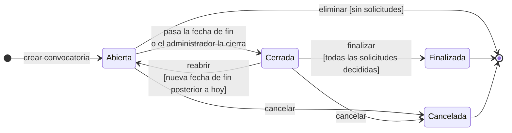
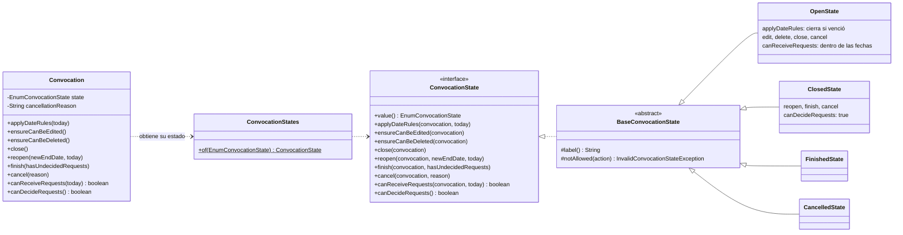
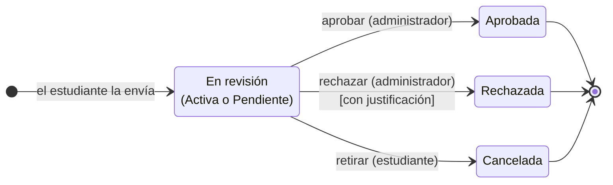

# Estados de una convocatoria

Propuesta del ciclo de vida de una convocatoria (issue [#30](https://github.com/SemilleroSOLID/clean-architecture-api/issues/30)). Sirve para definir qué estados existen, qué evento hace pasar de uno a otro y qué se puede hacer en cada uno, antes de cambiar el código. Es la base para evaluar el patrón State ([#31](https://github.com/SemilleroSOLID/clean-architecture-api/issues/31)).

**Estado:** decisiones tomadas por el equipo el 10 de octubre de 2026, pendientes de validar con la profesora. Implementado con el patrón State en [#31](https://github.com/SemilleroSOLID/clean-architecture-api/issues/31).

## Lo que ya está decidido

- Una convocatoria nueva queda en estado **Abierta** (aprobado por la profesora, ver [#7](https://github.com/SemilleroSOLID/clean-architecture-api/issues/7)).
- El sistema no rechaza solicitudes automáticamente: las que no cumplen quedan pendientes y las decide el administrador ([#14](https://github.com/SemilleroSOLID/clean-architecture-api/issues/14), [#17](https://github.com/SemilleroSOLID/clean-architecture-api/issues/17)).
- Una convocatoria con solicitudes no se elimina; ese caso se resuelve cancelándola ([#10](https://github.com/SemilleroSOLID/clean-architecture-api/issues/10)).
- Hoy el código solo tiene `OPEN` y `CLOSED`, y nada cambia el estado después de crear la convocatoria.

## Diagrama

## Estados

| Estado | Significado |
|---|---|
| **Abierta** (`OPEN`) | Estado inicial. Publicada y vigente; recibe solicitudes solo mientras la fecha actual está entre la fecha de inicio y la de fin. Antes de la fecha de inicio el front muestra "Abre el dd/mm/aaaa". |
| **Cerrada** (`CLOSED`) | Ya no recibe solicitudes. El administrador revisa y decide las solicitudes que llegaron. Se puede reabrir con una nueva fecha de fin. |
| **Finalizada** (`FINISHED`, nuevo) | Todas las solicitudes fueron aprobadas o rechazadas. Queda solo para consulta. |
| **Cancelada** (`CANCELLED`, nuevo) | Se suspendió antes de terminar el proceso, con una justificación. Reemplaza la eliminación cuando ya hay solicitudes. Queda solo para consulta. |

## Transiciones

| Desde | Hacia | Evento | Quién | Condición | Efecto |
|---|---|---|---|---|---|
| (inicio) | Abierta | Crear convocatoria | Administrador | Validaciones del CU-001 | — |
| Abierta | Cerrada | Pasa la fecha de fin | Sistema (automático) | Fecha actual > fecha de fin | Deja de recibir solicitudes |
| Abierta | Cerrada | Cerrar anticipadamente | Administrador | — | Deja de recibir solicitudes |
| Cerrada | Abierta | Reabrir | Administrador | Nueva fecha de fin posterior a hoy | Vuelve a recibir solicitudes; las ya decididas se conservan |
| Cerrada | Finalizada | Finalizar | Administrador | Ninguna solicitud pendiente ni activa | Queda solo para consulta |
| Abierta / Cerrada | Cancelada | Cancelar | Administrador | Justificación obligatoria | Se notifica a los estudiantes con solicitudes ([#20](https://github.com/SemilleroSOLID/clean-architecture-api/issues/20)) |
| Abierta | (se borra) | Eliminar | Administrador | Sin solicitudes | Se borran la convocatoria y sus requisitos (ya implementado en #10) |

## Acciones permitidas en cada estado

| Acción | Abierta | Cerrada | Finalizada | Cancelada |
|---|---|---|---|---|
| Consultar | ✅ | ✅ | ✅ | ✅ |
| Editar título, tipo y descripción ([#9](https://github.com/SemilleroSOLID/clean-architecture-api/issues/9)) | ✅ | ❌ | ❌ | ❌ |
| Editar fechas | ✅ | ❌ | ❌ | ❌ |
| Editar requisitos | ✅ solo si no tiene solicitudes | ❌ | ❌ | ❌ |
| Recibir solicitudes ([#13](https://github.com/SemilleroSOLID/clean-architecture-api/issues/13)) | ✅ dentro de las fechas | ❌ | ❌ | ❌ |
| Aprobar o rechazar solicitudes ([#17](https://github.com/SemilleroSOLID/clean-architecture-api/issues/17)) | ❌ | ✅ | ❌ | ❌ |
| Cerrar | ✅ | — | — | — |
| Reabrir | — | ✅ con nueva fecha de fin | ❌ | ❌ |
| Finalizar | ❌ | ✅ si todo está decidido | — | — |
| Cancelar | ✅ | ✅ | ❌ | — |
| Eliminar ([#10](https://github.com/SemilleroSOLID/clean-architecture-api/issues/10)) | ✅ solo sin solicitudes | ❌ | ❌ | ❌ |

Editar los requisitos con solicitudes ya enviadas cambiaría las reglas para quienes ya se postularon, por eso se bloquea. Las solicitudes se deciden con la convocatoria cerrada para comparar a todos los postulantes juntos; si el administrador quiere decidir antes, puede cerrarla anticipadamente.

## Decisiones

Tomadas por el equipo el 10 de octubre de 2026 para no detener el desarrollo. Se presentan a la profesora para validarlas; si cambia algo, se ajusta este documento.

| # | Pregunta | Decisión | Por qué |
|---|---|---|---|
| 1 | ¿Hace falta un estado "Programada"? | **No.** | Se mantiene "Abierta" como estado inicial (ya aprobado) y la condición de fechas controla cuándo recibe solicitudes. Un estado más agrega complejidad sin beneficio real. |
| 2 | ¿Se deciden solicitudes con la convocatoria abierta? | **No, solo cuando está Cerrada.** | Es más justo comparar a todos los postulantes cuando ya se postularon todos. El administrador puede cerrarla anticipadamente si necesita decidir antes. |
| 3 | ¿El paso a Cerrada es automático? | **Sí, calculado en el dominio.** | Si está Abierta y ya pasó la fecha de fin, la entidad `Convocation` la trata como Cerrada al consultarla o al intentar una acción. No necesita una tarea programada y la regla queda en el dominio. |
| 4 | ¿Se puede reabrir una convocatoria cerrada? | **Sí, con una nueva fecha de fin posterior a hoy.** | Permite dar más plazo, por ejemplo si se presentaron pocos estudiantes. La nueva fecha es obligatoria porque si no el cierre automático la volvería a cerrar. Finalizada y Cancelada siguen siendo definitivas. |

## Implementación: patrón State

**Decisión ([#31](https://github.com/SemilleroSOLID/clean-architecture-api/issues/31)):** se aplica el patrón State. Con cuatro estados, seis transiciones y reglas distintas en cada estado, sin el patrón las reglas terminarían como condicionales `if (estado == ...)` repetidos en los servicios. Con el patrón, cada estado es una clase del dominio que decide qué acciones permite y a qué estado pasa, y agregar un estado nuevo no obliga a modificar los servicios (principio abierto/cerrado).

- **Dónde está:** `src/main/java/com/example/demo/Domain/States`. Es código del dominio, sin Spring ni JPA; en la base de datos se sigue guardando solo el id del estado (`stateConvocationId`).
- **Cómo funciona:** `BaseConvocationState` rechaza todas las acciones por defecto con el mensaje *"No se puede {acción} una convocatoria {estado}"* (respuesta 400). Cada estado sobrescribe solo lo que permite. `Convocation` no conoce las reglas: delega en el objeto de su estado actual, que obtiene de `ConvocationStates`.
- **Servicio:** `ConvocationService` carga la convocatoria, aplica la regla de fechas (cierre automático) y llama al método de la convocatoria. No tiene condicionales sobre el estado.
- **Pruebas:** `ConvocationStateTest` cubre cada transición válida e inválida de los cuatro estados.

| Acción | Endpoint |
|---|---|
| Cerrar | `PUT /convocation/closeConvocation/{id}` |
| Reabrir | `PUT /convocation/reopenConvocation/{id}` con `{ "endDate": "AAAA-MM-DD" }` |
| Finalizar | `PUT /convocation/finishConvocation/{id}` |
| Cancelar | `PUT /convocation/cancelConvocation/{id}` con `{ "reason": "..." }` |

La notificación a los estudiantes al cancelar queda para [#20](https://github.com/SemilleroSOLID/clean-architecture-api/issues/20). Los estados de la solicitud (anexo) se pueden modelar con el mismo patrón cuando se implementen [#17](https://github.com/SemilleroSOLID/clean-architecture-api/issues/17) y [#19](https://github.com/SemilleroSOLID/clean-architecture-api/issues/19).

## Anexo: estados de una solicitud

Como referencia, con las decisiones ya aprobadas ([#14](https://github.com/SemilleroSOLID/clean-architecture-api/issues/14), [#17](https://github.com/SemilleroSOLID/clean-architecture-api/issues/17), [#19](https://github.com/SemilleroSOLID/clean-architecture-api/issues/19)):

Al enviarla, la verificación automática la deja **Activa** si cumple todos los requisitos o **Pendiente** si no cumple alguno. Las dos esperan la decisión del administrador y tienen las mismas salidas; la diferencia es que en una solicitud pendiente el administrador ve qué requisitos no se cumplieron.
