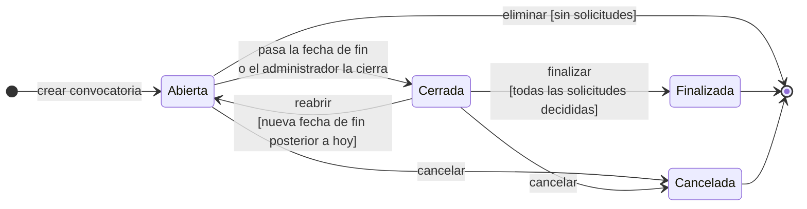
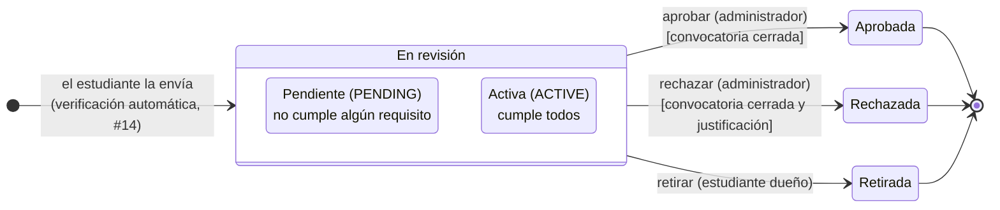
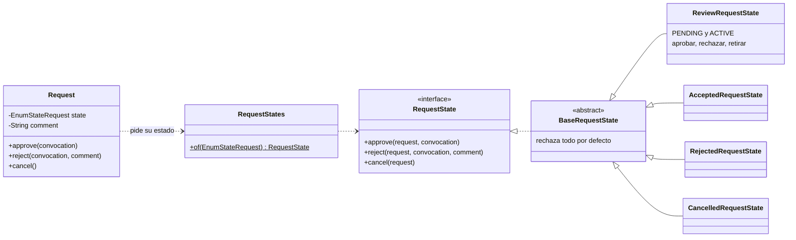

# Estados de una convocatoria

Una convocatoria pasa por varias etapas: se publica, recibe solicitudes, se cierra y al final se decide. Este documento define esas etapas como estados, qué hace pasar de uno a otro y qué se puede hacer en cada uno. Salió de la issue [#30](https://github.com/SemilleroSOLID/clean-architecture-api/issues/30) y se implementó con el patrón State en [#31](https://github.com/SemilleroSOLID/clean-architecture-api/issues/31).

Puntos de partida que ya estaban acordados antes de dibujarlo:

- Una convocatoria nueva queda **Abierta** (aprobado por la profesora en [#7](https://github.com/SemilleroSOLID/clean-architecture-api/issues/7)).
- El sistema no rechaza solicitudes por su cuenta. Las que no cumplen quedan pendientes y las decide el administrador ([#14](https://github.com/SemilleroSOLID/clean-architecture-api/issues/14), [#17](https://github.com/SemilleroSOLID/clean-architecture-api/issues/17)).
- Una convocatoria con solicitudes no se borra; se cancela ([#10](https://github.com/SemilleroSOLID/clean-architecture-api/issues/10)).

## Diagrama

Cada caja es un estado y cada flecha un evento que lo cambia. La flecha que sale del punto negro marca el estado inicial.

## Estados

| Estado | Qué significa |
|---|---|
| Abierta (`OPEN`) | Es el estado inicial. Recibe solicitudes solo entre la fecha de inicio y la de fin; antes de la fecha de inicio el front muestra "Abre el dd/mm/aaaa". |
| Cerrada (`CLOSED`) | Ya no recibe solicitudes y el administrador decide las que llegaron. Se puede reabrir con una nueva fecha de fin. |
| Finalizada (`FINISHED`) | Todas las solicitudes quedaron aprobadas o rechazadas. Solo se consulta. |
| Cancelada (`CANCELLED`) | Se suspendió antes de terminar, con una justificación. Es lo que se hace en lugar de borrar cuando ya hay solicitudes. Solo se consulta. |

## Transiciones

| Desde | Hacia | Evento | Quién | Condición |
|---|---|---|---|---|
| (inicio) | Abierta | Crear la convocatoria | Administrador | Las validaciones del CU-001 |
| Abierta | Cerrada | Pasa la fecha de fin | El sistema | Hoy es posterior a la fecha de fin |
| Abierta | Cerrada | Cerrar antes de tiempo | Administrador | — |
| Cerrada | Abierta | Reabrir | Administrador | Una nueva fecha de fin posterior a hoy. Las solicitudes ya decididas se conservan. |
| Cerrada | Finalizada | Finalizar | Administrador | Ninguna solicitud pendiente ni activa |
| Abierta o Cerrada | Cancelada | Cancelar | Administrador | Justificación obligatoria |
| Abierta | (se borra) | Eliminar | Administrador | Que no tenga solicitudes |

Al cancelar no se envía correo a los estudiantes. Los correos que existen hoy son los de cambio de estado de una solicitud ([#20](https://github.com/SemilleroSOLID/clean-architecture-api/issues/20)).

## Qué se puede hacer en cada estado

| Acción | Abierta | Cerrada | Finalizada | Cancelada |
|---|---|---|---|---|
| Consultar | ✅ | ✅ | ✅ | ✅ |
| Editar título, tipo, descripción y fechas ([#9](https://github.com/SemilleroSOLID/clean-architecture-api/issues/9)) | ✅ | ❌ | ❌ | ❌ |
| Editar requisitos | ✅ si no tiene solicitudes | ❌ | ❌ | ❌ |
| Recibir solicitudes ([#13](https://github.com/SemilleroSOLID/clean-architecture-api/issues/13)) | ✅ dentro de las fechas | ❌ | ❌ | ❌ |
| Aprobar o rechazar solicitudes ([#17](https://github.com/SemilleroSOLID/clean-architecture-api/issues/17)) | ❌ | ✅ | ❌ | ❌ |
| Cerrar | ✅ | — | — | — |
| Reabrir | — | ✅ con nueva fecha de fin | ❌ | ❌ |
| Finalizar | ❌ | ✅ si todo está decidido | — | — |
| Cancelar | ✅ | ✅ | ❌ | — |
| Eliminar ([#10](https://github.com/SemilleroSOLID/clean-architecture-api/issues/10)) | ✅ sin solicitudes | ❌ | ❌ | ❌ |

Dos reglas de esta tabla merecen explicación. Los requisitos no se editan cuando ya hay solicitudes porque se le cambiarían las condiciones a quien ya se postuló. Y las solicitudes se deciden con la convocatoria cerrada para comparar a todos los postulantes al mismo tiempo; si el administrador necesita decidir antes, puede cerrarla antes de la fecha.

## Decisiones del equipo

Estas preguntas quedaron abiertas en el diseño y el equipo las resolvió el 10 de octubre de 2026 para no frenar el desarrollo.

| Pregunta | Decisión | Razón |
|---|---|---|
| ¿Hace falta un estado "Programada" para antes de la fecha de inicio? | No. | Con "Abierta" y la condición de fechas alcanza. Un estado más complica el modelo sin aportar nada. |
| ¿Se pueden decidir solicitudes con la convocatoria abierta? | No, solo cerrada. | Es más justo comparar cuando ya se postularon todos. |
| ¿El paso a Cerrada es automático? | Sí, y lo calcula el dominio. | Si está abierta y ya pasó la fecha de fin, `Convocation` la trata como cerrada al consultarla. No hace falta una tarea programada. |
| ¿Se puede reabrir una cerrada? | Sí, con una nueva fecha de fin. | Sirve para dar más plazo si se postularon pocos. La fecha nueva es obligatoria porque sin ella el cierre automático la volvería a cerrar. |

## Implementación: patrón State

Con cuatro estados y reglas distintas en cada uno, sin un patrón el servicio terminaría lleno de `if (estado == ...)` repetidos. Con el patrón State cada estado es una clase del dominio que sabe qué acciones permite y a qué estado lleva cada una. Agregar un estado nuevo no obliga a tocar los servicios, que es el principio abierto/cerrado.

Cómo está armado:

- Las clases están en `src/main/java/com/example/demo/Domain/States`. Son código del dominio, sin Spring ni JPA. En la base se sigue guardando solo el número del estado (`stateConvocationId`).
- `BaseConvocationState` rechaza todas las acciones con el mensaje *"No se puede {acción} una convocatoria {estado}"*, que llega como un 400. Cada estado sobrescribe solo lo que sí permite.
- `Convocation` no conoce las reglas. Le pide a `ConvocationStates.of(...)` el objeto de su estado actual y le delega la acción.
- `ConvocationService` carga la convocatoria, aplica el cierre automático por fecha y llama al método de la entidad, sin preguntar por el estado.
- `ConvocationStateTest` prueba cada transición válida e inválida de los cuatro estados.

| Acción | Endpoint |
|---|---|
| Cerrar | `PUT /convocation/closeConvocation/{id}` |
| Reabrir | `PUT /convocation/reopenConvocation/{id}` con `{ "endDate": "AAAA-MM-DD" }` |
| Finalizar | `PUT /convocation/finishConvocation/{id}` |
| Cancelar | `PUT /convocation/cancelConvocation/{id}` con `{ "reason": "..." }` |

## Anexo: estados de una solicitud

La solicitud tiene su propio ciclo, implementado en [#14](https://github.com/SemilleroSOLID/clean-architecture-api/issues/14), [#17](https://github.com/SemilleroSOLID/clean-architecture-api/issues/17) y [#19](https://github.com/SemilleroSOLID/clean-architecture-api/issues/19).

Al enviarla, la verificación automática la deja **Activa** si cumple todos los requisitos o **Pendiente** si falla alguno. Las dos esperan al administrador y tienen las mismas salidas. La diferencia está en lo que ve el administrador: en una pendiente aparecen los requisitos que no se cumplieron.

| Estado | Enum | Qué se puede hacer |
|---|---|---|
| Pendiente o Activa | `PENDING`, `ACTIVE` | El administrador la aprueba o la rechaza (con justificación) cuando la convocatoria está cerrada. El estudiante la puede retirar en cualquier momento. |
| Aprobada | `ACCEPT` | Nada, es final. |
| Rechazada | `REJECT` | Nada, es final. El estudiante ve la justificación en *Mis solicitudes*. |
| Retirada | `CANCELLED` | Nada, es final. Se guarda para el historial en vez de borrarla. |

### Implementación: patrón State

Se usa el mismo patrón que en la convocatoria. `Request` delega en el objeto de su estado. `BaseRequestState` rechaza todo con *"No se puede {acción} una solicitud {estado}"*, y solo `ReviewRequestState`, que comparten `PENDING` y `ACTIVE`, permite aprobar, rechazar y retirar. Si la convocatoria está cerrada o no lo responde la propia convocatoria con su estado (`ensureCanDecideRequests`). Las pruebas están en `RequestStateTest` y `RequestDecisionTest`.

| Acción | Endpoint |
|---|---|
| Aprobar | `PUT /request/approveRequest/{id}` |
| Rechazar | `PUT /request/rejectRequest/{id}` con `{ "comment": "..." }` |
| Retirar | `PUT /request/cancelRequest/{id}`. El estudiante sale del token, y si la solicitud no es suya la respuesta es 403. |
